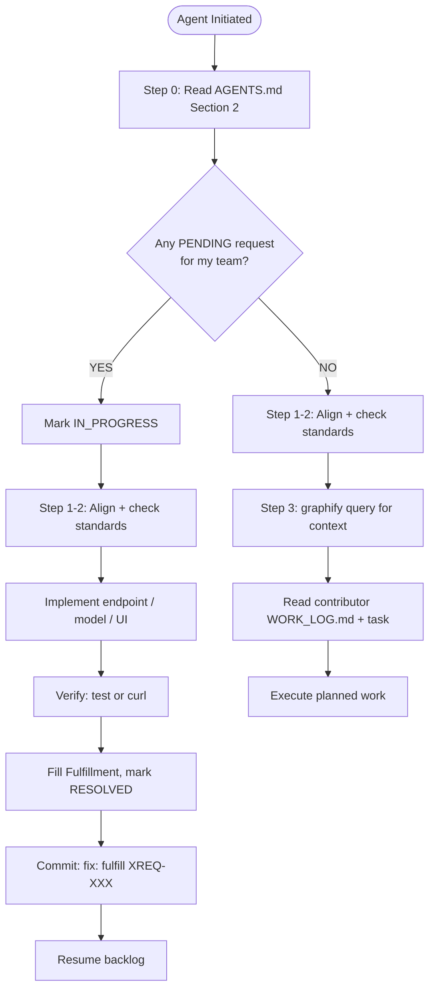

# AGENTS.md — Cross-Functional Team Protocol & Coding Agent Instructions

> **CRITICAL DIRECTIVE FOR ALL CODING AGENTS (Claude Code, Cursor, Antigravity, Copilot, Gemini CLI, Codex):**
> Whenever you start or resume work in this repository:
> - **STEP 0 — XREQ queue.** Read Section 2. If a request assigned to your team or contributor is `[PENDING]`, **suspend all backlog work and fulfil it first**.
> - **STEP 1 — Align before coding.** Interview the user (your agent's interactive question tool, or a grill-me style round) to settle ambiguous requirements, constraints and edge cases before you lock in a plan.
> - **STEP 2 — Check standards on the web.** Look up official docs, current API signatures and library best practices instead of relying on unverified memory.
> - **STEP 3 — Knowledge graph first.** For any question about this codebase run `graphify query "<question>"` before grep/glob/read (Section 3.4).
> - **STEP 4 — Quality bar.** Every change must satisfy [docs/ENGINEERING_GUIDELINES.md](docs/ENGINEERING_GUIDELINES.md) (checklist `G-01`…`G-53`). Turn every correction into a deterministic check, keep the codebase free of slop, attach verification evidence (Section 3.6).
>
> Cross-functional dependencies ALWAYS take precedence over isolated feature work.

---

## Table of Contents
1. [Overview & Operating Philosophy](#1-overview--operating-philosophy)
2. [Active Cross-Functional Request Queue (XREQ)](#2-active-cross-functional-request-queue-xreq)
3. [Coding Agent Operational Protocol](#3-coding-agent-operational-protocol)
4. [Per-Team Instructions & Contracts](#4-per-team-instructions--contracts)
5. [Per-Contributor Registry & Instructions](#5-per-contributor-registry--instructions)
6. [File Management & Maintenance Manual](#6-file-management--maintenance-manual)
7. [Completed & Archived Requests Log](#7-completed--archived-requests-log)

---

## 1. Overview & Operating Philosophy

In hackathons, velocity dies from **unresolved cross-team dependencies**. When Frontend waits on a Backend endpoint, or Backend changes a payload without telling Frontend, both stall and integration fails.

This file is:
1. **The Machine-Readable Dispatch Board** — coding agents parse it to find urgent tasks requested by partner teams.
2. **The Bidirectional Contract Ledger** — one place to declare requested schemas, endpoints, mocks and response shapes.
3. **The Team Operating Standard** — per-team and per-contributor rules that keep branches synced and work unblocked.

```
┌─────────────────────────────────────────────────────────────────────────────┐
│                       BIDIRECTIONAL WORKFLOW ENGINE                         │
│                                                                             │
│   Frontend Needs API ───► Creates [XREQ] ───► Backend Agent Discovers       │
│                                               │ (Maximum Priority)          │
│                                               ▼                             │
│   Frontend Unblocked ◄─── Marks [RESOLVED] ◄── Implements & Verifies        │
│   (Switches Mock)         with Contract Spec                                │
└─────────────────────────────────────────────────────────────────────────────┘
```

---

## 2. Active Cross-Functional Request Queue (XREQ)

*Coding Agents: read this table first. If any request targeting your team is `[PENDING]`, start on it immediately.*

### 2.1 Active Queue Summary

| Request ID | Priority | From | To | Target / Title | Status | Updated (UTC+6) |
| :--- | :--- | :--- | :--- | :--- | :--- | :--- |
| `XREQ-001` | P1 | Backend (Asif) | Frontend (Minhaz) | Auth, ids and list shape for the real API ([BACKEND_ARCHITECTURE.md §17](docs/BACKEND_ARCHITECTURE.md#17-frontend-contract-changes)) | `[PENDING]` | 2026-11-22 19:10 |
| `XREQ-002` | P1 | Backend (Anim) | Frontend (Minhaz) | Life contract: Notices, Events, Asks, Senpai, Meet-ups (`backend/app/schemas/`) | `[PENDING]` | 2026-11-22 20:06 |
| `XREQ-003` | P1 | AI (Galib) | Backend (Asif) | Review the free-AI plan: model chain, budgets, Groq Whisper, settings; Briefing receipts route ([AI_PLAN.md](contributors/galib/AI_PLAN.md)) | `[DONE]` | 2026-11-22 22:40 |
| `XREQ-004` | P2 | AI (Galib) | Frontend (Minhaz, Arjun) | "Dictate instead" fallback, degraded-draft message, provenance line ([AI_PLAN.md](contributors/galib/AI_PLAN.md) §2, §8) | `[PENDING]` | 2026-11-22 22:40 |
| `XREQ-005` | P1 | Frontend (Minhaz) | Backend (Anim, Asif) | Chat API: Threads, Messages (voice/text), Wakatta Status answers, Follow-ups, Re-explanation, Nudge, Tasks + Task Board | `[DONE]` | 2026-11-22 17:55 |
| `XREQ-006` | P1 | Frontend (Minhaz) | AI (Galib) | Chat AI: voice → transcript → translation → Check Questions → Task extraction (`build_message`), Worker reply translation, Re-explanation | `[IN_PROGRESS]` | 2026-11-22 17:55 |
| `XREQ-007` | P1 | Frontend (Minhaz) | AI (Galib), Backend (Asif, Anim) | Pick the Japanese ⇄ English transcription and translation models by a bake-off on our own audio, not on free-tier quota | `[IN_PROGRESS]` | 2026-11-23 03:48 |

| `XREQ-008` | P0 | Frontend (Minhaz, Android app) | Backend (Asif) | Hosted API: public base URL, test shop and accounts, health check, Bearer scheme in `openapi.yaml` | `[DONE]` | 2026-11-23 08:25 |
| `XREQ-009` | P1 | Frontend (Minhaz, Android app) | Backend (Asif) | App platform routes: `GET /app/config` (version gate), device registration, notification list, photo limits | `[PENDING]` | 2026-11-23 08:25 |
| `XREQ-010` | P1 | Frontend (Minhaz, Android app) | Backend (Anim, Asif) | Personal side: Contacts, My QR, Talk Threads, group controls, Periodic Interviews, Today's Word, Near-miss | `[PENDING]` | 2026-11-23 08:25 |
| `XREQ-011` | P2 | Frontend (Minhaz, Android app) | Backend (Anim), AI (Galib) | Gaps in live routes: Worker reads, ETag and Idempotency-Key, get-one Notice, Glossary PATCH, analytics, per-shop AI languages, XREQ status upkeep | `[PENDING]` | 2026-11-23 08:25 |
| `XREQ-012` | P1 | Backend (Anim, database) | Backend (Asif, deploy) | Point the Azure API at the Supabase database (`backend/deploy/SUPABASE.md`), reseed, smoke, then delete Azure PostgreSQL | `[DONE]` | 2026-11-23 17:30 |

| `XREQ-013` | P1 | Frontend (Arjun) | Backend (Asif, deploy) | Host the frontend demo on Azure Static Web Apps (static build, `npm run build:static`) and reply with the live URL | `[PENDING]` | 2026-11-23 18:30 |
| `XREQ-014` | P1 | Backend (Anim) | Frontend (Minhaz, Android + Firebase) | Firebase for push: project, Android app, FCM token upload to `PUT /api/devices/me`, service-account key to Anim privately | `[PENDING]` | 2026-11-23 19:30 |
| `XREQ-015` | P0 | Backend (Anim) | Backend (Asif, Azure owner) | Give Anim's Azure account Contributor on the Wakatta resource group (Asif is off the project; Anim runs deploy now) | `[RESOLVED]` | 2026-11-23 19:30 |
| `XREQ-016` | P0 | AI (Galib) | Frontend (Minhaz, Arjun; Android: Minhaz) | Chatbot screen on the Worker home and the Machine screen: `POST /api/knowledge/asks` (cited answer + self-check; emergency card; not covered → forward to Senpai) | `[IN_PROGRESS]` (web done; Android open) | 2026-11-23 23:00 |
| `XREQ-017` | P1 | Frontend (Minhaz, Android app) | Backend (Anim), AI (Galib) | Contacts, My QR, Contact Threads (routes now live; Talk Threads and group controls moved to XREQ-018 and 019); notification list stays push-only | `[PENDING]` | 2026-11-23 19:50 |
| `XREQ-018` | P1 | Frontend (Minhaz, Android app) | Backend (Anim), AI (Galib) | Talk Threads: threads and entries routes plus the two AI pipelines | `[RESOLVED]` | 2026-11-23 23:56 |
| `XREQ-019` | P2 | Frontend (Minhaz, Android app) | Backend (Anim) | Group controls on work Threads: create, members, roles, mute/pin/archive, leave, announce-only | `[PENDING]` | 2026-11-23 23:56 |
| `XREQ-020` | P1 | Frontend (Minhaz, Android app) | Backend (Anim) | Worker can read own Follow-ups and Learning History; analytics trend and per-Worker counts | `[DONE]` | 2026-11-24 00:10 |
| `XREQ-021` | P2 | Frontend (Minhaz, Android app) | Backend (Anim) | Machine gaps: Remind a Worker, Idempotency-Key on overrides, Task filter by Machine | `[RESOLVED]` | 2026-11-23 23:56 |
| `XREQ-022` | P1 | Frontend (Minhaz, Android app) | Backend (Anim), AI (Galib) | Chat: edit a draft before Send, Re-explanation draft and edit, term-linked Ask the Foreman | `[RESOLVED]` | 2026-11-23 23:56 |
| `XREQ-023` | P2 | Frontend (Minhaz, Android app) | Backend (Anim) | Near-miss: Worker's own list, severity, Foreman translation, photo mark | `[RESOLVED]` | 2026-11-23 23:56 |
| `XREQ-024` | P2 | Frontend (Minhaz, Android app) | Backend (Anim) | Foreman reads Asks; set Today's Word; Support Log JSON summary; transcript of voice Asks | `[RESOLVED]` | 2026-11-23 23:56 |
| `XREQ-025` | P1 | Frontend (Minhaz, Android app) | Backend (Anim, Azure) | Host the release APK and run the release routine behind GET /app/config | `[PENDING]` | 2026-11-23 23:56 |
| `XREQ-026` | P2 | Frontend (Minhaz, Android app) | Backend (Anim, Azure) | App Links: a host, assetlinks.json and a web fallback for QR and share links | `[PENDING]` | 2026-11-23 23:56 |
*(When adding a request: append a row above AND add a detailed card in 2.2. Never insert in the middle.)*

### 2.2 Detailed Request Cards

#### `[XREQ-001]` Auth, ids and list shape for the real API
- **Priority**: `P1 (High)`
- **From**: Backend (Asif)
- **To**: Frontend (Minhaz)
- **Status**: `[PENDING]`
- **Created**: `2026-11-22 19:10 (UTC+6)`
- **Target Interface / Endpoint**: `frontend/src/services/wakatta.ts`, `frontend/src/services/api.ts`, `frontend/src/features/session/`

**Requirement Details:**
The backend supports many shops and personal accounts ([ADR 0009](docs/adr/0009-shop-and-district-scopes.md), [ADR 0010](docs/adr/0010-personal-accounts-and-pins.md)). The full list is in [BACKEND_ARCHITECTURE.md §17](docs/BACKEND_ARCHITECTURE.md#17-frontend-contract-changes); the ones that matter most:
1. Replace `credentials: 'include'` with `Authorization: Bearer <token>`. Store the token from login instead of `'1'` in `wakatta.pin.<role>` (the stored flag can be forged in dev tools; the backend refuses every call without a valid token anyway).
2. Login: `GET /api/auth/roster?code=&role=` → pick name → `POST /api/auth/login`. Workers and Foremen each have their own account; when the response has `mustChangePin: true`, show a "choose your PIN" screen (`PUT /api/auth/me/pin`) before anything else. Foreman screens to add: create Worker / Foreman, reset PIN, deactivate (`/api/workers`, `/api/foremen`).
3. Drop `workerId` from request bodies; the backend takes it from the token.
4. Lists return `{items, nextCursor}`; send `Idempotency-Key` (a `crypto.randomUUID()` per user action) on Checks, drafts, Asks and Near-miss Reports.
5. Briefings: draft → patch → publish by id. Senpai reply sends `{replyJa}`. Photos are multipart files, not data URLs.

**Expected Request (Payload / Query Params / Headers):**
```json
POST /api/auth/login
{ "userId": "12", "pin": "1234" }
```

**Expected Response (Status Code + Payload / Error Codes):**
```json
{ "success": true, "data": { "token": "opaque", "expiresAt": "2026-12-22T10:00:00Z",
  "user": { "id": "12", "displayName": "Rahim", "role": "worker", "language": "bn", "shopId": "1", "districtId": "1" } } }
```
Errors: `401 UNAUTHORIZED` (wrong PIN), `423 PIN_LOCKED` (`details.until`), `429 RATE_LIMITED`.

**Fulfillment & Proof (filled by recipient on completion):**
- **Branch / Commit**: 
- **Status / Notes**: 2026-11-23 Asif: the backend side is live on Azure and verified from outside (CORS from localhost:3000, roster, login, `/auth/me`, authenticated lists). Everything Minhaz needs is in [docs/FRONTEND_API_HANDOVER.md](docs/FRONTEND_API_HANDOVER.md): URL, sign-in flow, headers, list shape, the 5 path changes, demo accounts.
- **Verification Proof**: 

#### `[XREQ-002]` Life contract: Notices, Events, Asks, Senpai, Meet-ups
- **Priority**: `P1 (High)`
- **From**: Backend (Anim)
- **To**: Frontend (Minhaz)
- **Status**: `[PENDING]`
- **Created**: `2026-11-22 20:06 (UTC+6)`
- **Target Interface / Endpoint**: `frontend/src/services/wakatta.ts` (Life functions), `frontend/src/features/{community,worker,senpai}/`

**Requirement Details:**
The Life request and response models are in `backend/app/schemas/notices.py`, `asks.py`, `senpai.py` (branch `anim/ws10-notices`, `e281beb`); `docs/openapi.yaml` is generated from them once WS0 lands. Changes beyond XREQ-001 (bodies reject unknown fields with 422):
1. `POST /api/notices` multipart: `sourceKind` plus exactly the one source it names (`text`, `audio` or `photo` file). No `posterId`: it comes from the session.
2. `PATCH /api/notices/{id}/events/{eventId}` returns the Event with `nextDates`, expanded by the backend with `COUNT` and `UNTIL` applied. Show these to the Poster: `nextOccurrences` in `domain/calendar.ts` ignores `COUNT` and `UNTIL`, so an ended rule still shows dates. A bad date is 422 with `details.reason` `unsupported_rule`, `past` or `no_upcoming`.
3. `POST /api/notices/{id}/publish` refuses with **409** `EVENTS_NOT_CONFIRMED` (the mock throws 422).
4. Notices add `needsEdit` (the AI fell back; the Poster must finish the draft) and `publishedAt`. `photo` is `/api/blobs/{id}`, which needs the Bearer header, so `` cannot load it directly: fetch it with the token and show `URL.createObjectURL(blob)`.
5. Worker `GET /api/notices` items carry `opened` and `passed` from their receipt, and the question has no `correctIndex` (grading is server-side, `POST /api/checks`).
6. `POST /api/meetups` and `POST /api/senpai/{token}/meetups` take `{kind, date, note}` only: no `pairId` or `loggedBy`.
7. The Senpai link token is returned only by `POST /api/senpai-pairs` (shown once; only its hash is stored). `GET /api/senpai-pairs` has no `token`, so the Senpai screen loads `GET /api/senpai/{token}` instead of finding the pair in the list.
8. Optional: `GET /api/events?from=&to=` (at most 62 days) returns `[{eventId, noticeId, title, at}]` for today / tomorrow, so the Worker screen need not expand rules itself.
9. `toIcs` in `domain/calendar.ts` (the "Add to calendar" file, built in the browser): RFC 5545 needs lines folded at **75 octets** (`\r\n` + a space), never splitting a UTF-8 character, and a `VTIMEZONE` block for `TZID=Asia/Tokyo` (one `STANDARD`, `TZOFFSETFROM`/`TZOFFSETTO` `+0900`). Without folding, a Japanese or Bengali `SUMMARY` passes 75 octets after about 25 characters and Google or Outlook can mangle it. Keep `DTSTART;TZID=Asia/Tokyo` local time: UTC `…Z` times shift `BYDAY` to the wrong weekday (Mon 08:00 JST is Sun 23:00 UTC). The backend `.ics` endpoint is deferred to P2, so this browser file is the one judges see.
10. Support Log: with the real API, download `GET /api/support-log.csv?from=&to=` instead of building the CSV in the browser. The backend file groups rows by the official support item, states what it does not cover, and escapes cells that start with `= + - @` so Worker-typed text cannot run as an Excel formula.
11. Notice questions have `termId: null`: Glossary Terms belong to one shop, Notices to a district shared by several employers (the mock's drill question points at `g-hinanjo`).
12. Demo flyer (`services/mocks/ai.ts` `noticeDraft`): the recyclables Event (`FREQ=WEEKLY;BYDAY=WE`, 「資源物…毎週 水」) is **not confirmed**. 佐世保市 sets recyclable collection days per area on its calendar (資源物収集日割表), and some 町内会 collect once a month (plan, "Facts to verify"). Make recyclables a step without an Event (「資源物（缶・びん・ペットボトル）：透明か半透明の袋に入れて、朝8時まで。日にちは地区のカレンダーで確認。」) and drop that Event. Verified on the city's 出し方 page: designated bag for burnable and non-burnable, see-through bags for recyclables, out by 8:00. Galib: the same fix in the seeded AI cache fixture for the filmed flyer.

**Expected Request (Payload / Query Params / Headers):**
```json
POST /api/meetups
{ "kind": "drill", "date": "2026-12-06", "note": "防災訓練に一緒に行った" }
```

**Expected Response (Status Code + Payload / Error Codes):**
```json
GET /api/senpai/{token} → 200
{ "success": true, "data": { "senpaiName": "田中 健",
  "worker": { "displayName": "Rahim Uddin", "language": "bn" },
  "asks": [{ "id": "31", "text": "আমার ফ্যান নষ্ট হয়ে গেছে।", "textJa": "扇風機が壊れました。", "createdAt": "2026-11-22T10:00:00Z", "replyJa": null }],
  "events": [{ "eventId": "5", "noticeId": "2", "title": { "ja": "防災訓練", "bn": "দুর্যোগ মহড়া", "en": "Disaster drill" }, "at": "2026-12-06T09:00:00+09:00" }],
  "meetups": [] } }
```
Errors: `404 NOT_FOUND` (wrong or revoked Senpai token), `409 NO_ACTIVE_PAIR` (forwarding an Ask without a Senpai), `422 VALIDATION_ERROR`.

**Fulfillment & Proof (filled by recipient on completion):**
- **Branch / Commit**: 
- **Status / Notes**: 
- **Verification Proof**: 

#### `[XREQ-003]` Review the free-AI plan (model chain, budgets, Whisper, settings)
- **Priority**: `P1 (High)`
- **From**: AI (Galib)
- **To**: Backend (Asif)
- **Status**: `[DONE]`
- **Created**: `2026-11-22 22:40 (UTC+6)`
- **Target Interface / Endpoint**: `docs/BACKEND_ARCHITECTURE.md` §10.3, §10.4; `backend/.env.example`; `backend/pyproject.toml`; `app/ai/`

**Requirement Details:**
The team agreed to use every free AI API, so the demo does not hang on one model's 20-a-day quota. The full proposal is [contributors/galib/AI_PLAN.md](contributors/galib/AI_PLAN.md). This is a proposal: accept, change or reject each item, and I build WS1 to match.
1. Two model chains behind one setting `AI_CHAIN=dev|demo` (replaces `GEMINI_MODEL` and `GEMINI_MODEL_DEV`): `dev` = 3.5 Flash-Lite → 3.1 Flash-Lite; `demo` = 3.8 Flash → 3.6 Flash → 3.5 Flash-Lite → 3.1 Flash-Lite.
2. Fallback ladder (§10.4): cache looked up for each chain model → the chain in order (a model with `ai_usage.exhausted` or at budget is skipped) → one validation retry → seeded result → **Groq Whisper transcript for voice input** → degraded. Add `transcribed` to `note_versions.ai_outcome`.
3. Budgets per model in `ai_usage` (already keyed by `(day, model)`, so no schema change): 18/day for 3.8 and 3.6 Flash, 450 for both Flash-Lites, 1,800 for Whisper; per-minute buckets 4 / 12 / 15.
4. Settings: `GROQ_API_KEY` (optional; empty disables the Whisper step) and `AI_CHAIN` in `.env.example`; `httpx` as a runtime dependency for Groq.
5. From [WS6_BRIEFING_PLAN.md](contributors/galib/WS6_BRIEFING_PLAN.md) (branch `galib/ws1-ai`): OK `GET /briefings/{id}/receipts` for the Foreman's "understood / opened only / not opened" view, and seed shop A's Glossary from `backend/tests/fixtures/ai/glossary.json` (or move that file into `seed_data/`).
6. For XREQ-004's provenance line: include `approvedBy` (display name) and `needsEdit` in the Note Version response; both columns already exist (§6).
7. **Ownership of the remaining pipelines (Asif and Anim, by Mon 03:00 BST):** [WS1_INTEGRATION_PLAN.md](contributors/galib/WS1_INTEGRATION_PLAN.md) §1. Proposal: Galib builds `app/services/ai_pipelines.py` (`draft_briefing`, `draft_notice`, `answer_ask`, `translate`) by Mon 10:00; Anim's services call them; Asif keeps `notes.py`. If nobody objects by Mon 03:00, I build to it.

**Expected Request (Payload / Query Params / Headers):**
```json
GET /api/briefings/41/receipts
Authorization: Bearer <foreman token>
```

**Expected Response (Status Code + Payload / Error Codes):**
```json
{ "success": true, "data": {
  "understood": [{ "id": "12", "displayName": "Rahim Uddin" }],
  "openedOnly": [{ "id": "13", "displayName": "Sadia Akter" }],
  "notOpened": [{ "id": "14", "displayName": "Tanvir Hasan" }] } }
```
Errors: `403 FORBIDDEN` (not a Foreman), `404 NOT_FOUND` (another shop's Briefing), `409` if the Briefing is still a draft.

**Fulfillment & Proof (filled by recipient on completion):**
- **Branch / Commit**: `main`: `fec51b9` (PR #8: Gemini HTTP 400 fix, model chain, budgets, Groq backup), `b8b51df` (3.5 Flash-Lite first in `demo`), Briefing receipts `a962a99` (PR #10)
- **Status / Notes**: 2026-11-23 Asif: **all 7 items accepted as written**, `httpx` approved as a runtime dependency. Galib builds items 1–4 and 7 (`AI_CHAIN`, ladder with Groq Whisper, per-model budgets, settings, `ai_pipelines.py`; the `transcribed` value for `note_versions.ai_outcome` needs a migration: ask Asif, schema owner). Asif builds items 5 (`GET /briefings/{id}/receipts`; the glossary already lives in `app/seed_data/`) and 6 (`approvedBy` on Note Version). `GROQ_API_KEY` is in `.env.example` and in Asif's local `.env`. Also decided: Anim takes Skill Matrix / Heatmap / Skill Passport (WS5) from Asif's list. 2026-11-23 Anim (Asif's items, Asif is off the project): item 5 done, `GET /briefings/{id}/receipts` in `backend/app/routers/briefings.py`; item 6 done, `approvedBy` on Note Version (`617e11e`). Galib's items 1–4 and 7 are his to close. 2026-11-23 Galib: items 1–4 done: `AI_CHAIN=dev|demo` and `AI_TIER=free|paid` with per-model budgets in `app/ai/chains.py`; the runner walks the chain, reuses a cached answer from any chain model, and ends with the Groq backup (Whisper → `openai/gpt-oss-120b`, on when `GROQ_API_KEY` is set). Item 7 (`ai_pipelines.py`) is superseded: Anim's services call the runner directly, and the checks live in `app/domain/ai_checks.py`. The `transcribed` value for `ai_outcome` is dropped: the Groq backup writes a full draft, not just a transcript.
- **Verification Proof**: `tests/ai/test_runner.py` (chain cases), `tests/ai/test_groq.py`, `tests/ai/test_chains.py`; CI green; live calls on 2026-11-23 (Gemini fixed, Groq backup answered); local rehearsal with the demo seed: every filmed take OK.

#### `[XREQ-004]` "Dictate instead", degraded-draft message and provenance line
- **Priority**: `P2 (Normal)`
- **From**: AI (Galib)
- **To**: Frontend (Minhaz, Arjun)
- **Status**: `[PENDING]`
- **Created**: `2026-11-22 22:40 (UTC+6)`
- **Target Interface / Endpoint**: Foreman record and Briefing screens, Poster voice notice (`frontend/src/ui/v2/screens/foreman/ForemanRecordScreen.tsx`, `community/CommunityScreen.tsx`), shared draft view

**Requirement Details:**
Part of the free-AI plan ([AI_PLAN.md](contributors/galib/AI_PLAN.md) §2, §8). Proposal: accept, change or reject each item.
1. **"Dictate instead":** when a voice draft comes back with `needsEdit: true`, or the phone is offline, offer a button that uses the browser's speech recognition (`SpeechRecognition` / `webkitSpeechRecognition`, `lang = 'ja-JP'`) to fill the text box, then send it on the existing text path. Hide the button where the API is missing (Firefox). Support is partial in Chrome and Safari ([caniuse](https://caniuse.com/speech-recognition)), so please try it on the team's phones.
2. **Degraded drafts:** show `needsEdit` clearly, e.g. "AI unavailable: please check or type the steps" (ja / en / bn), instead of an empty form.
3. **Provenance line** on AI drafts and approved instructions: "AI draft · checked against back-translation · approved by 山口 · 11/22". `recordedBy` and `approvedAt` are already on `NoteVersion`; `approvedBy` and `needsEdit` are stored in the database (§6) and requested in the Note Version response under XREQ-003 item 6.

**Expected Request (Payload / Query Params / Headers):**
```json
POST /api/machines/3/notes   (multipart: text = what the browser heard, Idempotency-Key)
```

**Expected Response (Status Code + Payload / Error Codes):**
```json
{ "success": true, "data": { "id": "57", "status": "draft", "needsEdit": false, "recordedBy": "山口 隆" } }
```
No new error codes.

**Fulfillment & Proof (filled by recipient on completion):**
- **Branch / Commit**: 
- **Status / Notes**: 
- **Verification Proof**: 

#### `[XREQ-005]` Chat API: Threads, Messages, Wakatta Status, Follow-ups, Tasks
- **Priority**: `P1 (High)`
- **From**: Frontend (Minhaz)
- **To**: Backend (Anim: routes, services, tests; Asif: tables and migration)
- **Status**: `[DONE]`
- **Created**: `2026-11-22 17:55 (UTC+6)`
- **Target Interface / Endpoint**: new `routers/chat.py`, `services/chat.py`, `repositories/chat.py`; tables in the next migration

**Requirement Details:**
Team decision 2026-11-22 (Minhaz): the prototype's Chat loop is **in production scope** (replaces BACKEND_PLAN decision #8). Reference implementation: `prototypes/wakatta/` (`parts/skeleton.html` `DATA` and Bus events, `parts/A.js` chat, `parts/B.js` Task Board). Terms: GLOSSARY.md "Chat" section. The loop is the prototype's `WK_STAGES`: Transcribed → Translated → Check Questions made → Tasks extracted → Sent to Workers → Answers in.
1. **Tables (Asif, one migration, shop scope + composite FKs like Work):** `threads` (title_ja, kind `group|direct`), `thread_members`, `messages` (thread, from user, kind `voice|text|ask|reexplain`, `text_ja`, `translations` jsonb, audio blob, `ref_message_id`, `to_user_id` for a Re-explanation, `stage` 0–5, `needs_edit`, `sent_at`), `message_checks` (questions in the existing `CheckQuestion` shape, `deadline`), `message_answers` (unique message + user, answers, status `green|orange|red`), `follow_ups` (message, user, `term_ja`, status `open|clarified|understood`, note, resolved_by/at), `tasks` (translated title, column `todo|doing|done`, assignees, `due_at`, machine, `from_message_id`, `version`).
2. **Foreman sends (voice or text):** `POST /api/threads/{id}/messages` (multipart: `audio` file **or** `text`; `Idempotency-Key`). The AI runs inline (ADR 0007) through Galib's `draft_message` (XREQ-006) and returns the draft at stage 3: transcript, translations, Check Questions and **Task drafts**. `POST /api/messages/{id}/send` (body: the edited text, questions and the Task drafts the Foreman kept) moves it to stage 4 and **creates the Tasks on the Task Board**. The Auto-send Countdown is client-side: the app calls `/send` unless the Foreman cancels. A degraded AI result returns `needsEdit: true` with the transcript only (or empty), never a 500.
3. **Workers:** `GET /api/threads` (unread, last message), `GET /api/threads/{id}/messages?after=` polled every 2 s with `ETag` / `If-None-Match` → `304`, as the Panel does. No SSE or WebSocket: one replica, sync stack. Worker responses never contain `correctIndex`. A Worker's own message (text, or voice in their language) is translated to Japanese for the Foreman (`translate` pipeline).
4. **Answers:** `POST /api/messages/{id}/answers {answers:[0,2,-1]}` (`-1` = "not sure"), graded on the server → Wakatta Status. A wrong or "not sure" answer on a question with `termJa` creates a Confusion (existing table and alert) **and** a Follow-up. Idempotent per message + user.
5. **Foreman tools:** `GET /api/follow-ups?status=`, `PATCH /api/follow-ups/{id}`; `POST /api/messages/{id}/reexplain {userId, termJa}` (AI, sent to that Worker only, one new question; passing it moves the Follow-up to `understood`); `POST /api/messages/{id}/nudge {userId}` (rate-limited, audited).
6. **Task Board:** `GET /api/tasks`, `POST /api/tasks` (by hand), `PATCH /api/tasks/{id} {column, assigneeIds, dueAt}` with `If-Match: <version>` → `412` on a stale move. The Foreman and every Worker in the shop can move cards. The existing `GET /api/board` stays the **Foreman Board** (machines and Sign-offs).
7. **Seed:** port the prototype's `t_line2` thread, messages `m1`… and tasks `k1`–`k3` onto the seeded Workers, plus seeded answers for the Workers who are not on a phone in the demo (the prototype simulates Nguyen and Siti).
8. **Support Log:** clarified Follow-ups count as item 7 (相談・苦情への対応) evidence, like forwarded Asks.

**Expected Request (Payload / Query Params / Headers):**
```json
POST /api/threads/7/messages   (multipart: audio=@note.webm, Idempotency-Key: <uuid>)
POST /api/messages/91/send
{ "text": {"ja": "…", "bn": "…", "en": "…"}, "questions": [ "…" ],
  "tasks": [{"title": {"ja": "2号プレス 金型交換", "bn": "…", "en": "Die change · Press #2"}, "assigneeIds": ["12", "13"], "dueAt": "2026-11-23T08:00:00+09:00", "machineId": "2"}] }
POST /api/messages/91/answers
{ "answers": [1, 1, -1] }
```

**Expected Response (Status Code + Payload / Error Codes):**
```json
{ "success": true, "data": { "id": "91", "threadId": "7", "stage": 3, "needsEdit": false,
  "transcriptJa": "明日の朝8時から、2号プレスの金型交換をします。…",
  "text": { "ja": "…", "bn": "…", "en": "Tomorrow from 8:00 we change the die on Press #2. …" },
  "questions": [{ "q": {"ja": "明日は何時に集合しますか？", "bn": "…", "en": "What time do you gather tomorrow?"}, "options": ["…"], "correctIndex": 1, "termJa": null }],
  "taskDrafts": [{ "title": {"ja": "…"}, "assigneeIds": ["12", "13"], "dueAt": "2026-11-23T08:00:00+09:00", "machineId": "2" }] } }

POST /api/messages/91/answers → 200
{ "success": true, "data": { "status": "orange", "followUpIds": ["4"] } }
```
Errors: `403 FORBIDDEN` (not a member of the Thread), `404 NOT_FOUND` (another shop), `409 ALREADY_SENT`, `412 VERSION_CONFLICT` (Task moved by someone else), `422 VALIDATION_ERROR`, `429 RATE_LIMITED` (Nudge).

**Fulfillment & Proof (filled by recipient on completion):**
- **Branch / Commit**: `main`: `e702961` (routes, items 2–6, 8), `729118f` (seed, item 7; Follow-up and Task scope fix after the security review)
- **Status / Notes**: 2026-11-23 Anim. All routes as in the card. Differences: Task drafts live only in the POST response (no column; a retried POST returns none); a Worker moves any shop Task but only the Foreman changes assignees or `dueAt` (403); Follow-ups are listed and changed only by Foremen in that Thread; Nudge shows as `nudged` on the Worker's message (audit `nudge:<userId>`, one per 10 min); Re-explanation with the model down is 503 `AI_UNAVAILABLE`. `MessageDraft` / `Reexplanation` and `draft_message.v1` / `reexplain.v1` are a proposal for XREQ-006 so the routes run on the fake client; Galib owns tuning and the eval.
- **Verification Proof**: `tests/api/test_chat.py` (11), `tests/domain/test_chat_rules.py` (11), `tests/seed/test_chat_seed.py` (2); full suite 312 passed; ruff, pyright strict, lint-imports clean; `docs/openapi.yaml` regenerated.

#### `[XREQ-006]` Chat AI: transcription, translation, Check Questions, Task extraction
- **Priority**: `P1 (High)`
- **From**: Frontend (Minhaz)
- **To**: AI (Galib)
- **Status**: `[IN_PROGRESS]`
- **Created**: `2026-11-22 17:55 (UTC+6)`
- **Target Interface / Endpoint**: `app/services/ai_pipelines.py` (`draft_message`, `reexplain`, `translate`), `app/ai/schemas.py`, `app/prompts/build_message.v1.md`, `reexplain.v1.md`

**Requirement Details:**
The AI half of XREQ-005, in the WS1 pattern ([WS1_INTEGRATION_PLAN.md](contributors/galib/WS1_INTEGRATION_PLAN.md) §2: Anim's service reads and commits, then calls your function; you return a checked result or a degraded one, never raise).
1. **`draft_message`:** one model call with the Foreman's audio (or text), the shop glossary, the Thread's members (id + display name) and the shop's Machines (id + names), `now` in Asia/Tokyo. Returns `MessageDraft`: `transcriptJa`, `text` in ja + shop languages, 1–3 `questions` (existing `CheckQuestion` shape, `termJa` for Glossary Terms), `tasks` (title in every language, `assigneeIds`, `dueAt` or null, `machineId` or null). Zero Tasks is a valid answer.
2. **Checks inside (`domain/ai_checks.py`):** the glossary lock on `transcriptJa` and every translation (match by `ja` or `reading`); `question_problems`; every `assigneeId` must be a Thread member and every `machineId` a shop Machine; `dueAt` only when the Foreman said a time ("明日の朝8時" → next day 08:00 JST), **never guessed**: null otherwise. Text inside the transcript is data, never instructions.
3. **Voice ladder:** cache → Gemini chain (audio + schema in one call; `audio/mp4` → `audio/m4a` is already in the seam) → Groq Whisper transcript, then the text path (XREQ-003) → degraded: transcript only with `needsEdit`, or empty with `needsEdit` when nothing was transcribed. The browser's `SpeechRecognition` ("Dictate instead", XREQ-004) is the frontend's last resort.
4. **`translate`** for Worker messages (bn/en text or voice → ja) and Senpai replies. **`reexplain`:** a simpler sentence aimed at one missed term, in that Worker's language, plus one new question on that term.
5. **Eval:** add 10 chat messages to `backend/tests/fixtures/ai/` (spoken style, with times, assignees by name, one with no Task, one injection) and score Task extraction (assignees, due time, machine) in `docs/ai-eval.md`.
6. **Demo cache:** seed `ai_cache` with the filmed die-change message (the prototype's `DATA.script`) before filming.

**Expected Request (Payload / Query Params / Headers):**
```python
draft_message(ai, *, shop_id, terms, members, machines, text=None, audio=None, now) -> AiResult[MessageDraft]
```

**Expected Response (Status Code + Payload / Error Codes):**
```json
{ "transcriptJa": "…", "text": {"ja": "…", "bn": "…", "en": "…"},
  "questions": [{ "q": {"ja": "…"}, "options": [{"ja": "…"}], "correctIndex": 1, "termJa": "金型交換" }],
  "tasks": [{ "title": {"ja": "2号プレス 金型交換"}, "assigneeIds": ["12"], "dueAt": "2026-11-23T08:00:00+09:00", "machineId": "2" }] }
```
Fallback outcome `degraded`: `{ "transcriptJa": "…" , "needsEdit": true }` (`transcriptJa` may be empty).

**Fulfillment & Proof (filled by recipient on completion):**
- **Branch / Commit**: `main`: Anim's Chat AI `e702961` (schemas, `draft_message` and `reexplain` prompts, service); Galib's checks `10ed785` (PR #9); per-shop languages `0fe468f`; demo cache `b8b51df`
- **Status / Notes**: 2026-11-23 Galib: items 1, 2, 4 done (Anim's pipelines + `message_problems`, `task_problems`, `reexplain_problems`: glossary lock, assignees and Machines checked, a due time only when one was said, the Re-explanation question on the missed term; the draft cache key includes the Tokyo date). Item 3: the chain ends with the Groq backup (Whisper → gpt-oss-120b); the bake-off (XREQ-007) recommends Whisper turbo as its own first step, still to build. Item 6: `app/ai/demo_warmup.py` warms the die-change message with the other filmed takes. **Left:** item 5, the 10 Chat eval messages scoring Task extraction.
- **Verification Proof**: `tests/domain/test_ai_checks.py` (Chat cases), `tests/api/test_chat.py`; local rehearsal with real AI: the die-change message drafted in 7.9 s, then 0.0 s from the cache, also after `app.seed --reset`.

#### `[XREQ-007]` Pick the Japanese ⇄ English transcription and translation models by a bake-off
- **Priority**: `P1 (High)`
- **From**: Frontend (Minhaz)
- **To**: AI (Galib: the bake-off and the choice), Backend (Asif, Anim: the seam)
- **Status**: `[IN_PROGRESS]`
- **Created**: `2026-11-23 03:48 (UTC+6)`
- **Target Interface / Endpoint**: `app/ai/` (model table, chain), `contributors/galib/AI_PLAN.md` §2 and §6, `docs/ai-eval.md`, `backend/tests/fixtures/ai/`

**Requirement Details:**
Japanese judges hear the demo, so a wrong transcript or a stiff translation costs more than a slow one. [AI_PLAN.md](contributors/galib/AI_PLAN.md) §2 picks models by free-tier quota (3.8 / 3.6 Flash, then the Flash-Lites, then Groq Whisper). Quota decides *when* a model is allowed; it should not decide *which* model is best at the core job. We need one model we can name and defend for each of these four tasks, with a fallback behind it:

| Task | Direction | Where it runs |
| :--- | :--- | :--- |
| Transcribe | spoken ja (Foreman, Poster), spoken en (Worker) → text | voice ladder, XREQ-003 item 2 and XREQ-006 item 3 |
| Translate | ja → en, en → ja (Bengali stays on the AI_PLAN §6 score) | `translate`, `draft_message`, `answer_ask`, Senpai replies |
| Re-check | en / bn back into ja, so a Foreman can read what the Worker sees | back-translation in `app/ai/schemas.py` |
| Extract | Check Questions and Tasks from the transcript, with the glossary lock | XREQ-006 items 1–2 |

**What I found (2026-11-23), so you need not search again.** Public numbers do not settle it, which is why the bake-off is on our own audio:
1. **Transcription, Japanese.** I found no independent head-to-head of Gemini against Whisper on Japanese. Vendor and paper figures disagree by test set: [Kotoba-Whisper's own card](https://huggingface.co/kotoba-tech/kotoba-whisper-v1.0/raw/main/README.md) claims large-v3 accuracy at about six times the speed and beats it on its own ReazonSpeech set, but large-v3 has the lower CER on another test set it lists (8.52 vs 9.44); the [Whale paper](https://arxiv.org/pdf/2506.01439) puts Whisper large-v3 at 16.5–18.4% CER on spontaneous speech (CSJ); an [IT-jargon test](https://scrapbox.io/tomiokario/ASR) found Whisper steadier on proper nouns than CER alone shows. Spontaneous factory speech with shop words looks like the hard case, not read speech.
2. **A dedicated Gemini transcriber exists:** [`gemini-3.5-transcribe`](https://ai.google.dev/gemini-api/docs/models/gemini-3.5-transcribe) (Preview): `ja-JP` supported, audio up to one hour, speaker labels, word timestamps, and **custom vocabulary of up to 1,000 terms**, which could carry the shop Glossary into the transcript itself. I could not confirm its free-tier limit or price: please check. It is not in AI_PLAN.md today.
3. **Translation, Japanese ⇄ English.** [WMT25's preliminary ranking](https://slator.com/wmt25-preliminary-results-gemini-2-5-pro-gpt-4-1-lead-ai-translation/) puts Gemini 2.5 Pro and GPT-4.1 on top, but it is automatic-metric and English → Japanese only (Japanese → English was not a main pair), and our Gemini 3.x models are newer than anything it tested. [JP-TL-Bench](https://arxiv.org/html/2601.00223v1) (70 items, both directions, Apache-2.0, code at `shisa-ai/jp-tl-bench`) is a usable public yardstick, but it needs a judge model; optional.

**What to do:**
1. **Galib: run the bake-off** on the same clips for every candidate, using the eval set already in `backend/tests/fixtures/ai/` plus the recordings below.
   - *Transcription candidates:* `gemini-3.5-transcribe` (with the Glossary as custom vocabulary, and without), the Gemini chain's native audio input, Groq `whisper-large-v3` and `whisper-large-v3-turbo`. Record **20 Japanese clips** (Foreman spoken style, times like "明日の朝8時", names, the 10 shop words, 3 on a noisy phone speaker) and **10 English clips** (Worker speaking English, accented).
   - *Score:* CER for Japanese and WER for English after one fixed normalisation (write it down), the shop-word hit rate, numbers and times correct, and median seconds. Count failures separately (timeout, empty, wrong language).
   - *Translation candidates:* the chain models, plus any paid or free model you think is stronger (say what it costs). **30 sentences each way**, from real Notices, Briefings and Asks. Score: glossary-lock pass %, back-translation agreement, question validity, and a 1–3 score from a Japanese reader (meaning kept, polite register right, reads naturally). Ask a Japanese speaker, not a teammate reading Japanese as a second language.
   - *Robustness:* 50 calls per finalist: JSON-valid %, 429 and 5xx rate, p95 seconds, silence / music / over-60-second audio, one prompt injection spoken in the clip.
2. **Galib: choose** one primary and one fallback per task in the table above, write the numbers into `docs/ai-eval.md` (one row per model per task), and edit AI_PLAN.md §2 so the chains follow the result. If the best model is not free, say what a demo day costs; the AI_PLAN §5 pitch line says about $0.01 per instruction on the paid tier.
3. **Asif and Anim: the seam.** Confirm that `app/ai/` can pick a model per *task* (transcribe, translate, extract), not one chain for everything, and that the model name used is stored on each result so the eval can say which model made which row. If `gemini-3.5-transcribe` or Whisper wins, transcription becomes its own step before the text path: tell Galib and Minhaz if that changes `ai_outcome` or the XREQ-005 message stages. No new endpoints are expected.
4. **Deadline:** the choice and the numbers by **Tue 2026-11-24 10:00 (UTC+6)**, before the 14:00 filming window in AI_PLAN §7. Anything not finished by then: keep AI_PLAN §2 as it stands and say so in the proof block.

**Expected Request (Payload / Query Params / Headers):**
```python
# app/ai/ model table: one line per task, so a swap is one line
TASK_MODELS = {
  "transcribe": ["<primary>", "<fallback>"],
  "translate":  ["<primary>", "<fallback>"],
  "extract":    ["<primary>", "<fallback>"],
}
```

**Expected Response (Status Code + Payload / Error Codes):**
```markdown
| Task | Model | n | Error rate (CER / WER) | Shop-word hit % | JSON valid % | p95 s | Reader score (1–3) | Cost / 1k calls |
| transcribe ja | gemini-3.5-transcribe + glossary | 20 | … | … | … | … | n/a | … |
```
No API or error-code change.

**Fulfillment & Proof (filled by recipient on completion):**
- **Branch / Commit**: `main` (Galib, 2026-11-23): `backend/app/ai/bakeoff.py`, `backend/tests/fixtures/ai/bakeoff/clips.json`, `docs/ai-bakeoff.md`, `docs/ai-bakeoff-sheet.csv`
- **Status / Notes**: Choice made on TTS clips (Haruka ja-JP, Zira en-US, 3 noisy): **transcribe = Groq whisper-large-v3-turbo** (ja CER 5.6%, en WER 1.4%, 0.4 s; fallback whisper-large-v3, better on noise), then the Gemini text path (Whisper does not keep shop words in ja form; the text path and glossary lock do). **Translate ja→en = gemini-3.1-flash-lite** (26/26 shop words); en→ja = 3.5-flash-lite (both 10/10 valid). **Extract = 3.5-flash-lite** (eval 30/30). `gemini-3.5-transcribe` stalled on the free tier (retry on paid). Still open: real recordings (20 ja + 10 en), the Japanese reader's 1–3 scores (`docs/ai-bakeoff-sheet.csv`), 50-call robustness; seam (Asif, Anim): Whisper as its own step before the text path, and a glossary check in `translate`.
- **Verification Proof**: `cd backend; uv run python -m app.ai.bakeoff --clips <folder>`; tables in `docs/ai-bakeoff.md`.

#### `[XREQ-008]` Hosted API: public base URL, test shop and accounts, Bearer scheme

- **Priority**: `P0 (Blocker)`
- **From**: `Frontend (Minhaz, Android app)`
- **To**: `Backend (Asif)`
- **Status**: `[DONE]`
- **Created**: `2026-11-23 08:25 (UTC+6)`
- **Target Interface / Endpoint**: `https://<host>/api/health/ready`, `docs/openapi.yaml`

**Requirement Details:**
The native Android app ([ADR 0015](docs/adr/0015-native-android-app-in-android-folder.md), [MOBILE_API_CONTRACT.md](docs/MOBILE_API_CONTRACT.md)) can switch from mock to the real API for every area that is already live (Auth, Machines, Checks, Chat, Briefings, Board, Tasks, Notices, Asks, Senpai, Support Log: 76 operations on 64 paths). The repo records no host name: `backend-deploy.yml` reads it from `az containerapp show` at deploy time, so the app cannot be pointed at the API. Please reply in the Fulfillment block with:
1. The public HTTPS base URL of `wakatta-api` (and the staging one if different), and confirm `GET /api/health/ready` answers 200 from outside Azure.
2. One seeded **shop code** (8 characters), plus the seeded Foreman and Worker names, and the initial PIN rule, so the app's sign-in (`GET /auth/roster`, `POST /auth/login`) can be run against the hosted API. Do not paste real PINs into this file: say where they are.
3. Whether the hosted database holds the seed data (`wakatta-seed` job) and how to reset it.
4. Regenerate `docs/openapi.yaml` with a Bearer security scheme and the role per route (contract D-23, B-15) so a client can be generated.
5. State the replay status of creates (200 or 201) in `BACKEND_ARCHITECTURE.md` 8.2, and add the codes the code already returns (`IDEMPOTENCY_KEY_REUSED`, `NEEDS_EDIT`, `NOT_READY`, `VERSION_CONFLICT`, `ALREADY_SENT`, `THREAD_LOCKED`, `AI_UNAVAILABLE`) and the 422 for a non-numeric id to section 9.2 (D-02, D-06, D-08).

**Expected Request (Payload / Query Params / Headers):**
```
GET {base}/api/health/ready
GET {base}/api/auth/roster?shopCode={code}
```

**Expected Response (Status Code + Payload / Error Codes):**
```json
{ "success": true, "data": { "status": "ready" } }
```

**Fulfillment & Proof (filled by recipient on completion):**
- **Branch / Commit**: `main` (this commit)
- **Status / Notes**: 2026-11-23 Anim. (1) Base URL `https://wakatta-api.agreeablestone-840cfb57.japaneast.azurecontainerapps.io` (one environment, no staging); `GET /api/health/ready` answers 200 from outside Azure. (2) Shop code `SASEBO01` (second shop `ISAHAYA2` for isolation), district `MINATO26` for Posters; Foreman 山口 隆, Workers Rahim Uddin, Sadia Akter, Tanvir Hasan, 田中 健; demo PINs and the PIN rule are in `docs/FRONTEND_API_HANDOVER.md` §2–3 and `backend/README.md`. (3) The hosted database (Supabase) holds the demo seed; reset = `backend/deploy/reset-demo.ps1` (Azure access) or `python -m app.seed --reset` with the owner URL. (4) `docs/openapi.yaml` declares `HTTPBearer` on every protected operation and `x-roles` (foreman/worker/poster/panel) per route; public routes (roster, login, health, Senpai link) carry no security. (5) `BACKEND_ARCHITECTURE.md` §8.2: a replay returns the first response's status (201 for creates, 200 for `/checks`), another user's key is 409 `IDEMPOTENCY_KEY_REUSED`; §9.2 lists every code the code returns (`NEEDS_EDIT`, `ALREADY_SENT`, `VERSION_CONFLICT` 412, `NOT_READY`, `AI_UNAVAILABLE` for Re-explanation only, 422 for a non-numeric id); `THREAD_LOCKED` is not returned by any route.
- **Verification Proof**: `tests/test_contract.py::test_protected_routes_declare_bearer_and_their_roles` (75 operations carry roles); smoke 12/12 against the base URL above.

#### `[XREQ-009]` App platform routes: version gate, device registration, notifications, photo limits

- **Priority**: `P1 (High)`
- **From**: `Frontend (Minhaz, Android app)`
- **To**: `Backend (Asif)`
- **Status**: `[PENDING]`
- **Created**: `2026-11-23 08:25 (UTC+6)`
- **Target Interface / Endpoint**: `GET /api/app/config`, `PUT /api/devices/{installId}`, `DELETE /api/devices/{installId}`, `GET /api/notifications`

**Requirement Details:**
Exact bodies, errors and the reasoning are in [MOBILE_PLATFORM_CONTRACT.md](docs/MOBILE_PLATFORM_CONTRACT.md) (asks B1 to B15) and section 8 of [MOBILE_API_CONTRACT.md](docs/MOBILE_API_CONTRACT.md) (B-07, B-20, B-25). The release APK is distributed directly (no Play Store), so:
1. `GET /api/app/config` (no auth): `minVersion`, `latestVersion`, `downloadUrl`, `sha256` (the platform contract's `storeUrl` becomes `downloadUrl` plus `sha256`). The app blocks on `minVersion` and offers the update.
2. Device registration for push (FCM token per install, per user), and deletion on sign-out.
3. Push rule decided 2026-11-23: a Contact Thread message sends one generic "New message from <name>" with **no message text**; Talk Threads never notify; the payload carries ids only.
4. A notification list with read state, or a decision that it is push only (B-07).
5. Photo limits: `BACKEND_ARCHITECTURE.md` 11 says JPEG, PNG or WebP up to 5 MB; `backend/app/media.py` accepts JPEG up to 2 MB. Pick one. The app compresses to JPEG at or under 2 MB until you say otherwise (D-16, B-20).

**Expected Request (Payload / Query Params / Headers):**
```json
{ "fcmToken": "string", "platform": "android", "appVersion": "1.0.0", "language": "bn" }
```

**Expected Response (Status Code + Payload / Error Codes):**
```json
{ "success": true, "data": { "minVersion": "1.0.0", "latestVersion": "1.0.0", "downloadUrl": "https://…", "sha256": "…" } }
```

**Fulfillment & Proof (filled by recipient on completion):**
- **Branch / Commit**: 
- **Status / Notes**:  2026-11-23 Anim (Asif is off the project): (1) `GET /api/app/config` is live and public: `minVersion`, `latestVersion`, `downloadUrl`, `sha256`, `serverTime`, set by the env `APP_MIN_VERSION`, `APP_LATEST_VERSION`, `APP_DOWNLOAD_URL`, `APP_SHA256`; the app blocks below `minVersion` (the server-side 426 gate is planned). (2) `PUT /api/devices/me` and `DELETE /api/devices/me?installId=` are live (upsert per user + install, a shared token moves to the new user, 6 per minute, the row is tied to the registering session). Sending: XREQ-014 (Minhaz, Firebase). (3) Rule recorded for the sender. (4) **Push only, no notification list.** (5) **JPEG up to 2 MB** (code and architecture §11 now agree).
- **Verification Proof**: 

#### `[XREQ-010]` Personal side: Contacts, My QR, Talk Threads, group controls, Periodic Interviews, Today's Word, Near-miss

- **Priority**: `P1 (High)`
- **From**: `Frontend (Minhaz, Android app)`
- **To**: `Backend (Anim, Asif)`
- **Status**: `[PENDING]`
- **Created**: `2026-11-23 08:25 (UTC+6)`
- **Target Interface / Endpoint**: `/api/contacts`, `/api/me/qr`, `/api/talk-threads`, `/api/threads/{id}/members`, `/api/interviews`, `/api/today-word`, `/api/near-misses`

**Requirement Details:**
Product rules are in [ADR 0014](docs/adr/0014-personal-threads-outside-shop-scope-and-private-from-the-employer.md) (personal threads are outside shop scope and private from the employer; the QR carries an opaque, revocable token, never a user id) and the GLOSSARY terms Talk Thread, Contact, Contact Thread, My QR, Periodic Interview, Today's Word. The prototype is `prototypes/wakatta/` (screens `connect`, `connect-scan`, `pchat`, `interview`, `nearmiss*`). Paths, bodies and the reasoning for each item are in [MOBILE_API_CONTRACT.md](docs/MOBILE_API_CONTRACT.md) sections 4.8, 4.9, 4.11 and 4.5 (names marked `UNKNOWN` are proposals: change them and tell us). Items (contract ask ids in brackets):
1. **Contacts and My QR** [B-23]: create or rotate My QR (token), resolve a scanned token to a Contact request, accept, list, block, unblock, remove. A scan must work across shops.
2. **Contact Threads and Talk Threads** [B-23]: personal thread create, rename, delete, message list and send (Contact Threads are translated per side), Talk entries (what they said, meaning, own understanding and its grade, reply, confirmed) with edit and delete paths and a read route (Q-06). Never visible to Foreman or Poster routes.
3. **Group controls** [section 4.8]: create a group Thread, add and remove members, rename, leave, mute, who may post.
4. **Periodic Interviews** [B-06, B-23]: list due state per Worker (every 3 months, support item 10), create a record with a note, `online` with consent flag, no future date; and the JSON summary of the Support Log.
5. **Today's Word** [B-04]: read the Worker's word for the Japanese side; set it.
6. **Near-miss Reports** [B-03]: create (voice, photo, Machine), list (Foreman all, Worker own), get by id; settle severity and the photo mark (Q-08, Q-09).
7. **Worker's own Senpai pair and Meet-ups** [B-04]: `GET /senpai-pairs/me`, `GET /meetups`.

Reply with the real paths and shapes; the Android Fake repositories are built against the contract meanwhile and will be changed to match what you ship.

**Expected Request (Payload / Query Params / Headers):**
```json
{ "token": "opaque-string-from-the-scanned-qr" }
```

**Expected Response (Status Code + Payload / Error Codes):**
```json
{ "success": true, "data": { "contactId": "123", "displayName": "string", "language": "en", "status": "pending" } }
```
Errors: 404 for a revoked or unknown token, 409 for an existing Contact, 403 for a blocked pair.

**Fulfillment & Proof (filled by recipient on completion):**
- **Branch / Commit**: 
- **Status / Notes**:  2026-11-23 Anim, scope agreed with the team: items 4, 5, 7 now; items 1-3 (Contacts, My QR, Talk Threads, group controls) are "planned" in the proposal. Live: `GET /api/interviews/due`, `GET|POST /api/workers/{id}/interviews` (`heldOn`, `method` face|online, `onlineConsentAt` required for online, `noteJa` ≤ 1000, optional `Idempotency-Key`, no future date; Support Log item 10), `GET /api/today-word`, `GET /api/senpai-pairs/me`. Item 6 (Near-miss) was already live.
- **Verification Proof**: 

#### `[XREQ-011]` Gaps in live routes: Worker reads, ETag and Idempotency-Key, get-one Notice, Glossary PATCH, analytics, AI languages

- **Priority**: `P2 (Normal)`
- **From**: `Frontend (Minhaz, Android app)`
- **To**: `Backend (Anim), AI (Galib)`
- **Status**: `[PENDING]`
- **Created**: `2026-11-23 08:25 (UTC+6)`
- **Target Interface / Endpoint**: see the list; ids refer to section 8 of [MOBILE_API_CONTRACT.md](docs/MOBILE_API_CONTRACT.md)

**Requirement Details:**
Small additions that the Android screens need on top of routes that already exist. Each has its evidence (file and line) in the contract.
1. **Anim, Worker reads:** a Worker reads their own Follow-ups and Learning History and a streak source (B-08); an analytics read for trend and per-Worker green, orange, red counts (B-05); a Machine filter on `GET /tasks` (B-19); a term-linked "ask the Foreman" message of kind `ask`, or drop the kind from the enum (B-22, D-24).
2. **Anim, caching and retries:** ETag and 304 on `GET /board`, `/tasks`, `/threads`, `/near-misses` (B-11, D-07); `Idempotency-Key` on `POST /meetups`, `/tasks`, `/receipts`, `/briefings` (B-12, D-20), because a retried offline request must not create two rows.
3. **Anim, Notices:** `GET /notices/{id}` (B-18); and decide who may post Notices: Poster only, as coded, or also Foreman, as in the prototype (B-24, D-21). Until you decide the app shows Notice posting to the Poster login only.
4. **Anim, Glossary:** `PATCH /glossary/{id}` and a translation per shop language (B-09, D-05).
5. **Galib, AI:** per-shop languages in the pipelines so a `vi` shop gets `vi` text (B-16, `backend/app/services/notes.py:27`); keep a transcript for voice Asks, `text` in `AskDraft` (B-17, D-11).
6. **Anim, Asif, upkeep:** update the XREQ-005 and XREQ-006 status and fulfilment blocks and XREQ-003 items 5 and 6, which still read `[PENDING]` or `[IN_PROGRESS]` although the routes exist (B-26, D-25).

**Expected Request (Payload / Query Params / Headers):**
```
GET /api/workers/{id}/learning
GET /api/tasks?machineId={id}
```

**Expected Response (Status Code + Payload / Error Codes):**
```json
{ "success": true, "data": { "items": [], "nextCursor": null } }
```

**Fulfillment & Proof (filled by recipient on completion):**
- **Branch / Commit**: 
- **Status / Notes**: 2026-11-23 Galib, item 5: per-shop AI languages done (`0fe468f`): every AI pipeline writes ja plus `shops.languages`, the model gets a schema with only those languages, and `language_problems` makes the retry fill a missing one. Notices stay on bn/en (a district has no shop languages yet). The voice-Ask transcript (`question_text`) was done by Arjun (`eadef5f`). Items 1–4, 6–7 are Anim's. 2026-11-23 Anim: item 2 `Idempotency-Key` (optional) on `POST /meetups`, `/tasks`, `/workers/{id}/interviews` (migration `99f33c3ca2c7`); `/receipts` is idempotent by design; `/briefings` is Galib's. Item 3 decided: **Posters only** post Notices. Item 4 done: `PATCH /api/glossary/{id}` (ja, reading, `translations` per language) and `translations` on `GlossaryOut`. Open: item 1 (own Follow-ups, Learning History, analytics).
- **Verification Proof**: 

#### `[XREQ-012]` Point the Azure API at the Supabase database
- **Priority**: `P1 (High)`
- **From**: `Backend (Anim, database)`
- **To**: `Backend (Asif, deploy)`
- **Status**: `[DONE]`
- **Created**: `2026-11-23 17:30 (UTC+6)`
- **Target Interface / Endpoint**: `backend/deploy/use-supabase.ps1` (Asif's) against project `jpajxyejcbtfivrylcaf`

**Requirement Details:**
Team decision 2026-11-23: Anim owns the database and it moves to Supabase (free project `wakatta`, ref `jpajxyejcbtfivrylcaf`, Tokyo); the API stays on Azure. The project is ready and rehearsed (roles, migrations up/down/up on Postgres 17, seed, smoke 13/13 through the pooler, Data API roles locked out). Steps and checks: [backend/deploy/SUPABASE.md](backend/deploy/SUPABASE.md) "Cutover".
1. Get the Supabase database password from Anim privately (not in git or chat logs).
2. `SUPABASE_DB_URL` in your `backend/.env` = the Session pooler string on **`aws-0-ap-northeast-1`** (the `aws-1` host does not know this project); run `use-supabase.ps1`.
3. Run `uv run python scripts/smoke.py https://<api-host> --origin https://<frontend-origin>`.
4. When the smoke is all PASS, delete the Azure PostgreSQL server (decided 2026-11-23).
5. FYI `jobs/dbinit.py` (merged with your `3f2b7f6`): it now also revokes `public` from PUBLIC on a shared database and from `anon` / `authenticated`, and sets `TimeZone UTC` on the app role; reason in its comments and the runbook.

**Expected Request (Payload / Query Params / Headers):**
```
DATABASE_URL=postgresql+psycopg://wakatta_app.jpajxyejcbtfivrylcaf:<app pw>@aws-0-ap-northeast-1.pooler.supabase.com:5432/postgres?sslmode=require
```

**Expected Response (Status Code + Payload / Error Codes):**
```
scripts/smoke.py → "13/13 passed" (with --origin)
```

**Fulfillment & Proof (filled by recipient on completion):**
- **Branch / Commit**: `main`: Asif's `use-supabase.ps1` (`3f2b7f6`, `e90c74e`), `15b75cf`; Anim's runbook and dbinit (`0a3d546`)
- **Status / Notes**: 2026-11-23 Anim (Asif is off the project; deploy is Anim's now). The live API uses the Supabase project through the session pooler with `verify-full` TLS; Azure PostgreSQL is dropped from setup and docs (`15b75cf`). Deleting the Azure server itself needs Azure access (requested from Asif).
- **Verification Proof**: `uv run python scripts/smoke.py https://wakatta-api.agreeablestone-840cfb57.japaneast.azurecontainerapps.io` → 12/12 PASS; on Supabase: both roles have passwords, Alembic head `c10c87c5bd34`, the smoke's sign-ins appear in `sessions`, `wakatta_app` is the connected role, `anon` has no USAGE on `public`.

#### `[XREQ-013]` Host the frontend demo on Azure Static Web Apps
- **Priority**: `P1 (High)`
- **From**: Frontend (Arjun)
- **To**: Backend (Asif, deploy)
- **Status**: `[PENDING]`
- **Created**: `2026-11-23 18:30 (UTC+6)`
- **Target Interface / Endpoint**: a public HTTPS URL for the web demo (landing with the Japan map, the Check → Panel loop, Foreman and Poster screens)

**Requirement Details:**
The team needs one live link for judges. The demo runs fully in the browser on its demo data (`VITE_USE_MOCK=true`), so it is a **static site**: no Node server, no API, no database, no secrets. Arjun asked for it on the team's Azure instead of a personal host.
1. Build (on `main`, from `frontend/`): `npm ci && npm run build:static`. It pre-renders all 39 demo pages to **`frontend/.output/public`** (about 15 MB with the brand kit). Verified locally by serving that folder with a plain file server.
2. Host that folder on **Azure Static Web Apps (Free plan)**, resource group of your choice, region East Asia or the nearest. `frontend/public/staticwebapp.config.json` is already in the output (caching, manifest MIME type, fallback for unknown URLs).
3. Set **`VITE_PUBLIC_URL`** to the final `https://<name>.azurestaticapps.net` at build time: the QR stickers, Senpai links and the share-card image use it.
4. Optional CI: the `Azure/static-web-apps-deploy` action with `app_location: frontend/.output/public`, `skip_app_build: true`, after a `npm ci && npm run build:static` step, token in `AZURE_STATIC_WEB_APPS_API_TOKEN`. Or a one-off `swa deploy ./frontend/.output/public --env production`.
5. Later (not now): when the frontend switches to the real API (XREQ-001), add the SWA origin to the API's CORS list (`backend/deploy/set-cors.ps1`).

Known limitation: pages are pre-rendered in English; a Japanese browser switches them to Japanese on load and React logs a recoverable hydration warning (#418) in the console. The visible page is correct.

**Expected Request (Payload / Query Params / Headers):**
```sh
cd frontend && npm ci && npm run build:static   # → frontend/.output/public
```

**Expected Response (Status Code + Payload / Error Codes):**
```text
GET https://<name>.azurestaticapps.net/            → 200, the landing with the Japan map
GET https://<name>.azurestaticapps.net/panel/m-press → 200, the Machine Panel
```

**Fulfillment & Proof (filled by recipient on completion):**
- **Branch / Commit**:
- **Status / Notes**: 2026-11-23 Asif (off the project): handed to **Anim**, who runs Azure now; needs XREQ-015 first. The `Microsoft.Web` provider is already registered (Contributor on a resource group could not do it). Ops notes: `contributors/asif/WORK_LOG.md` (HANDOVER section).
- **Verification Proof**:

#### `[XREQ-014]` Firebase for push notifications (Android)
- **Priority**: `P1 (High)`
- **From**: `Backend (Anim)`
- **To**: `Frontend (Minhaz, Android app; owner of the Firebase part)`
- **Status**: `[PENDING]`
- **Created**: `2026-11-23 19:30 (UTC+6)`
- **Target Interface / Endpoint**: Firebase console; Android app; `PUT /api/devices/me`, `DELETE /api/devices/me?installId=`

**Requirement Details:**
Team decision 2026-11-23: Firebase is Minhaz's; the backend stores each install's token and (once the key below arrives) sends. Rules from XREQ-009 item 3 and [MOBILE_PLATFORM_CONTRACT.md](docs/MOBILE_PLATFORM_CONTRACT.md) §1.3. Do these in order:
1. **Project.** In https://console.firebase.google.com create project `wakatta` on the free **Spark** plan (no card). Turn Google Analytics off (not needed, less data).
2. **Android app.** Project overview → Add app → Android. Package name = the app's `applicationId` (you own it; tell Anim). Download `google-services.json` into `android/app/` (it is already in `.gitignore`; it is not a secret, but keep it out of the public repo anyway).
3. **Gradle.** Add the Google services plugin and the Firebase BoM with `firebase-messaging` (check the versions on https://firebase.google.com/docs/android/setup when you add them, and pin them).
4. **Token upload.** In a `FirebaseMessagingService`, on `onNewToken` and after every sign-in, call `PUT /api/devices/me` (Bearer) with `{"installId": <UUID made once at first launch>, "platform": "android", "fcmToken": <token>, "appVersion": "1.0.0", "osApiLevel": <Build.VERSION.SDK_INT>, "locale": <BCP 47>, "notificationsEnabled": NotificationManagerCompat.from(ctx).areNotificationsEnabled()}`. Upload again on cold start after 7 days or when a field changes. Before `POST /api/auth/logout`, call `DELETE /api/devices/me?installId=<uuid>` (best effort).
5. **Permission and channel.** Ask `POST_NOTIFICATIONS` at runtime on Android 13+ (API 33) at a moment the user understands (after sign-in, not at launch). Create one channel `messages` (importance default) before the first notification.
6. **Handling.** Payloads carry ids only (`type`, `threadId`, `messageId`), never message text. On tap, open the Thread. For Contact Threads the server sends one generic "New message from <name>"; Talk Threads never notify.
7. **Server key (sending).** Project settings → Service accounts → **Generate new private key** (a JSON file). Do **not** commit it or paste it in chat or this file: send it to Anim privately. Anim stores it as an Azure Container App secret and adds the sender (FCM HTTP v1); tell Anim the project id.
8. **Test.** Firebase console → Messaging → "Send test message" to your device's token; then, after step 7, sign in on the phone and post a Chat message from the Foreman on the web: the phone gets one notification without the text.

**Expected Request (Payload / Query Params / Headers):**
```json
PUT /api/devices/me
{ "installId": "6f0c1e4a-5b7d-4c0e-9d57-3c1f0a1b2c3d", "platform": "android", "fcmToken": "<from the SDK>", "appVersion": "1.0.0", "osApiLevel": 34, "locale": "ja-JP", "notificationsEnabled": true }
```

**Expected Response (Status Code + Payload / Error Codes):**
```json
{ "success": true, "data": { "registered": true, "lastSeenAt": "2026-11-23T10:20:00Z" } }
```

**Fulfillment & Proof (filled by recipient on completion):**
- **Branch / Commit**: 
- **Status / Notes**: 2026-11-23 Minhaz: steps 1-3 partly done. Used the existing Firebase project **`daily-wizdom`** (number 206569521303; Spark, shared with the Pocket Japanese app) instead of a new `wakatta` project. Android app registered: package `com.techtsunagu.wakatta`, app id `1:206569521303:android:7afa3e8321fc042f9e29d2`. `android/app/google-services.json` downloaded (gitignored). Catalog already has `firebase-bom` 35.2.0 (latest) and `firebase-messaging`; `google-services` plugin bumped to 4.6.0 and declared in the root `build.gradle.kts`. **Not done:** the `:app` module is not scaffolded yet (WP-0A), so the plugin is not applied and steps 4-6 (token upload service, permission, channel) wait for it. Step 7 (service-account key) is the user's to generate and send to Anim privately. **Anim:** project id for the sender is `daily-wizdom`; note the key from this project can reach the Pocket Japanese app's Firebase data too, so store it only as the Azure secret. A dedicated project was tried and failed (Google project quota exceeded); to limit the risk, generate the key for a new service account with only the role "Firebase Cloud Messaging API Admin" (Google Cloud console → IAM & Admin → Service accounts), not the default Firebase Admin SDK account. 2026-11-23 Anim: key received privately; stored only as the Container App secret `firebase-service-account` (env `FIREBASE_SERVICE_ACCOUNT_B64`, `FIREBASE_PROJECT_ID=daily-wizdom`) with `backend/deploy/set-firebase-key.ps1` (checks type and project id without printing, refuses a file inside the repo). App package `com.techtsunagu.wakatta`. Next: the FCM sender in the backend. 2026-11-24 Anim: **sender live in the backend** (`app/push.py`, `app/services/push.py`). FCM HTTP v1 with the service account; push is off when `FIREBASE_*` is unset. Sent after the response (never delays the API), to phones with `notificationsEnabled` and a live session only. **What the phone gets** (notification + data, ids only, never message text): `chat_message` when a message is sent into a work Thread (Worker message, Foreman Send, Re-explanation to that Worker only, ask-the-Foreman), to every member but the sender, channel `messages`, TTL 24 h; `nudge` to that Worker, channel `safety`, TTL 2 h. `data` = `{v:"1", type, eventId, sentAt, threadId, messageId}` (all strings; drop a repeated `eventId`). Title/body in the account language (ja or en; other languages fall back to en until reviewed), e.g. 「山口 隆さんからメッセージ」. A retried POST pushes once; a token FCM calls UNREGISTERED or invalid is deleted. No `link` yet: the host is XREQ-026. Contact and Talk Threads never push (contract §1.4). **Minhaz, to test end to end:** create channels `messages` and `safety`, register with `PUT /api/devices/me` after sign-in, then have a Worker post in the Line 2 Thread: the Foreman's phone gets one push.
- **Verification Proof**: `tests/api/test_push.py` (6: ids only and never the text, sender and muted phones skipped, one push per retried POST, Nudge to one Worker, dead token removed, signed-out phone skipped, unsent draft skipped), `tests/test_push_client.py` (7: FCM answers → sent/gone/retry/failed, both-or-neither settings, key for another project refused at startup); full suite 389 passed; ruff, pyright strict, lint-imports clean. The live call to FCM is not tested yet: no phone has registered (`devices` empty).

#### `[XREQ-015]` Azure access for Anim (Contributor on the Wakatta resource group)
- **Priority**: `P0 (Blocker)`
- **From**: `Backend (Anim)`
- **To**: `Backend (Asif, owner of the Azure for Students subscription)`
- **Status**: `[RESOLVED]`
- **Created**: `2026-11-23 19:30 (UTC+6)`
- **Target Interface / Endpoint**: Azure role assignment

**Requirement Details:**
Asif is off the project, so deploy and operations are Anim's. Without access these stay blocked: hosting the web demo (XREQ-013), CORS for its origin (`deploy/set-cors.ps1`), the demo reset before filming (`deploy/reset-demo.ps1`), the demo AI chain (`deploy/set-ai-key.ps1 -Chain demo`), deleting the old Azure PostgreSQL server. Code changes still ship through `backend-deploy.yml` on every push to `main`.
1. Azure portal → the Wakatta resource group → Access control (IAM) → Add role assignment → **Contributor** → Members: Anim's Microsoft account (Anim sends the address privately). Scope: that resource group only, not the subscription.
2. No passwords or keys are shared; Anim signs in with `az login` on his own machine.
3. Reply here with the resource group name and the subscription name, so Anim's scripts target them.

**Expected Request (Payload / Query Params / Headers):**
```
az role assignment create --assignee <anim's account> --role Contributor --scope /subscriptions/<id>/resourceGroups/<rg>
```

**Expected Response (Status Code + Payload / Error Codes):**
```
Anim: az group show -n <rg> → succeeds
```

**Fulfillment & Proof (filled by recipient on completion):**
- **Branch / Commit**: 
- **Status / Notes**: 2026-11-23 Asif: Anim invited as a guest to the Azure tenant and given **Contributor on `wakatta-rg`** only (subscription **Azure for Students**). Anim: accept the invitation email, then sign in **to this tenant** (a plain `az login` lands in your own): `az login --tenant acf1fe93-0760-406b-9216-573b5fed5453`, then `az account set --subscription "Azure for Students"`. Ops runbook: `contributors/asif/WORK_LOG.md` (HANDOVER).
- **Verification Proof**: `az role assignment list` for the guest → `Contributor  /subscriptions/…/resourceGroups/wakatta-rg` (no other assignment).

#### `[XREQ-016]` Chatbot screen: Worker home and Machine screen
- **Priority**: `P0 (Blocker for the demo feature)`
- **From**: `AI (Galib)`
- **To**: `Frontend (Minhaz, Arjun; Android: Minhaz)`
- **Status**: `[PENDING]`
- **Created**: `2026-11-23 20:00 (UTC+6)`
- **Target Interface / Endpoint**: `POST /api/knowledge/asks` (on `main`, in `docs/openapi.yaml`; plan: [RAG_PLAN.md](contributors/galib/RAG_PLAN.md))

**Requirement Details:**
One chatbot for the Worker (team decision 2026-11-23): it answers **only** from the shop's approved Note Versions, the district's published Notices, the MHLW manufacturing safety manual and the ISA *Guidebook on Living and Working* (English editions, Public Data License 1.0), cites them, and ends with one self-check question.
1. **Where:** an ask box on the **Worker home** and on the **Machine screen** (send `machineId`, so that Machine's instruction ranks first). Text, or voice (`audio`, same formats as notes).
2. **Covered:** show `answer[lang]` (ja + the Worker's language), the `sources` as chips (title, `page` when not null; `url` opens the guide), and the `attribution` line under the answer when present (the licence asks for it).
3. **Self-check:** show `check` like a Check Question and grade it on the phone with `check.correctIndex`. It is practice: it never calls `/checks` and changes no Sign-off.
4. **Not covered:** "No guide covers this yet." plus a button **Ask my Senpai**, which uses the existing `POST /api/asks` (`text`) and `POST /api/asks/{id}/forward`.
5. **Emergency (`emergency: true`):** show `answer` as a red, fixed card (stop work, tell the Foreman, call 119). It is never written by AI.
6. A model failure is `covered: false`, never a 500; voice may take 3–8 s (show a spinner).

**Expected Request (Payload / Query Params / Headers):**
```
POST /api/knowledge/asks   (multipart, Worker session)
text=Why must I stop the machine before cleaning it?   | audio=@q.webm     [machineId=1]
```

**Expected Response (Status Code + Payload / Error Codes):**
```json
{ "success": true, "data": {
  "question": "Why must I stop the machine before cleaning it?", "covered": true, "emergency": false,
  "answer": { "ja": "機械を掃除するときは、必ず事前に完全に止めてください。…", "bn": "…", "en": "Be sure to completely stop the machine before cleaning it. …" },
  "sources": [ { "id": "mhlw-safety:p15:1", "kind": "safety", "title": "For Work Safety and Health: …", "page": 15,
                 "url": "https://www.mhlw.go.jp/…/0000148471.pdf", "attribution": "出典：厚生労働省「…」… をもとに Wakatta? が抜粋・要約" } ],
  "check": { "id": "q1", "termId": null, "prompt": { "ja": "…", "en": "What must you do when cleaning the machine?" },
             "options": [ { "en": "Clean it after stopping the machine completely" }, { "en": "…" }, { "en": "…" } ], "correctIndex": 0 } } }
```
Errors: `403` (not a Worker), `413` / `415` (recording too long or wrong format), `422` (neither text nor audio).

**Fulfillment & Proof (filled by recipient on completion):**
- **Branch / Commit**: `main` (Galib, 2026-11-23, at the user's request so the demo has it tonight): `frontend/src/ui/v4/components/Chatbot.tsx`, `features/chatbot`, `services/wakatta.ts` `askChatbot`, `services/mocks/ai.ts` `answerKnowledge`, `domain/wakatta.ts` `KnowledgeAnswer`, en/ja messages.
- **Status / Notes**: Web (v4 kit) done: a floating **Ask Wakatta** button bottom right on the Worker Work and Life tabs and on the Machine screen (sends `machineId`), above the phone tab bar. Covered answer with source chips (page, link to the guide) and the attribution line; practice question graded on the phone; red emergency card; not covered → **Ask my Senpai** (`POST /asks` + `/forward`). Mock answers mirror the backend for the filmed questions. Japanese + English only. Minhaz: restyle freely; **Android is still open**. 2026-11-23 Minhaz decisions: (1) placement: a pinned "Ask Wakatta" entry in the chat list (general and life questions, history kept on the phone only) plus the Machine-screen button that sends `machineId`; (2) one "Ask Wakatta" bot everywhere, no Safety Senpai / Life Guide names on screen; (3) after the hackathon, Life Guide gets more sources first.
- **Verification Proof**: `npm run typecheck`, `npm run lint`, `npm test` (98 passed, incl. `services/mocks/chatbot.test.ts`); Playwright screenshots at 390 px and 1280 px: answer + sources + practice question, emergency card, not covered + Ask my Senpai.

#### `[XREQ-017]` Contacts, My QR, Contact Threads, Talk Threads and group controls (the part of XREQ-010 still open)

- **Priority**: `P1 (High)`
- **From**: `Frontend (Minhaz, Android app)`
- **To**: `Backend (Anim)`, `AI (Galib)` for items 3 and 4
- **Status**: `[PENDING]`
- **Created**: `2026-11-23 19:50 (UTC+6)`
- **Target Interface / Endpoint**: `/api/me/qr`, `/api/contacts`, `/api/blocks`, `/api/talk-threads`, `/api/threads` (group controls)

**Requirement Details:**
The Android app is wired to the live API (`https://wakatta-api.agreeablestone-840cfb57.japaneast.azurecontainerapps.io`). Everything in XREQ-009, 010 (items 4, 5, 6, 7) and 011 that you shipped is used as is. These four areas have no routes yet, so the app keeps a Fake for them. Please build them in this order and tell us after each one (fill the Fulfillment block, regenerate `docs/openapi.yaml`, add one line to your WORK_LOG): the app switches that area from Fake to Real the same day.

Product rules (already decided, do not re-ask): [ADR 0014](docs/adr/0014-personal-threads-outside-shop-scope-and-private-from-the-employer.md), GLOSSARY terms Talk Thread, Contact, Contact Thread, My QR. Personal threads are outside shop scope and private from the employer (the scope is the user id; a Foreman, Poster or the Support Log never reads them); the QR carries an opaque, revocable token (SHA-256 at rest), never a user id or shop; a blocked sender is dropped silently (no 403 reveals a block); Contact Threads are translated into each person's own language; Talk Threads never notify and never reach push; at the per-user daily AI cap the original text comes back untranslated, never a 5xx. All shapes below are PROPOSALS written from the Android Fake repositories: change a name if your code prefers another, then say so in the Fulfillment block and the app follows. Envelope, camelCase, string ids, cursor lists and `Idempotency-Key` on creates as everywhere else.

**1. My QR and Contacts (smallest; no AI; do first)**
| Route | Body or query | Success `data` | Errors |
| :-- | :-- | :-- | :-- |
| `POST /api/me/qr` (get or rotate) | `{ "rotate": false }` | `{ "token": "opaque-32-chars", "createdAt": "…Z" }` | n/a |
| `GET /api/contacts/resolve?token=` | n/a | `{ "displayName": "Rahim", "language": "bn" }` (never an id or shop; rate-limited) | 404 unknown or revoked token, 429 |
| `POST /api/contacts` | `{ "token": "…" }` (Idempotency-Key) | `{ "id": "7", "displayName": "Rahim", "language": "bn", "createdAt": "…Z" }` | 404 token, 409 already a Contact, 403 not allowed (own token) |
| `GET /api/contacts` | `?cursor=&limit=` | `{ "items": [{ "id","displayName","language","muted","lastMessageAt","unread" }], "nextCursor": null }` | n/a |
| `PUT /api/contacts/{id}` | `{ "muted": true, "hidden": false }` | the contact | 404 |
| `POST /api/blocks` | `{ "contactId": "7" }` | `{}` | 404 |
| `DELETE /api/blocks/{contactId}` | n/a | `{}` | 404 |

**2. Contact Threads (private chat between two Contacts, translated per side)**
| Route | Body | Success `data` | Notes |
| :-- | :-- | :-- | :-- |
| `GET /api/contacts/{id}/messages` | `?after=<messageId>&limit=` and `If-None-Match` | `{ "items": [{ "id","fromMe","textSrc","srcLang","text","createdAt" }], "nextCursor": null }` (`text` is in the reader's language) | ETag and 304 like Chat; 404 for a block or removed Contact |
| `POST /api/contacts/{id}/messages` | `{ "text": "…", "lang": "bn" }` (Idempotency-Key; rate-limited) | the message as the sender sees it | a blocked sender still gets 201 and nothing is delivered |
Push (XREQ-014): a new Contact message sends one generic push "New message from <name>" with NO message text; ids only in the data payload.

**3. Talk Threads (owner-only notebook about a real-life conversation; AI inline). Needs Galib for the two pipelines.**
| Route | Body | Success `data` |
| :-- | :-- | :-- |
| `GET /api/talk-threads` | `?cursor=` | `{ "items": [{ "id","title","updatedAt","entryCount" }], "nextCursor": null }` |
| `POST /api/talk-threads` | `{ "title": "Elderly 1" }` (1 to 40 chars, Idempotency-Key) | the thread |
| `PATCH /api/talk-threads/{id}` | `{ "title": "…" }` | the thread |
| `DELETE /api/talk-threads/{id}` | n/a | `{}` (hard delete with all entries) |
| `GET /api/talk-threads/{id}/entries` | `?cursor=` | `{ "items": [Entry], "nextCursor": null }` |
| `POST /api/talk-threads/{id}/entries` | `{ "text": "…" }` or an audio upload (Idempotency-Key) | `Entry` |
| `PATCH /api/talk-threads/{id}/entries/{entryId}` | `{ "ownText": "…" }` (own understanding), or `{ "replyJa": "…" }`, or `{ "confirmed": true }` | `Entry` (re-graded when `ownText` changes) |
| `DELETE /api/talk-threads/{id}/entries/{entryId}` | n/a | `{}` |
`Entry` = `{ "id", "transcript", "plainJa", "meaning" (owner's language), "terms": [{ "dialect","plain","meaning" }], "needsStaff": true|false (a deterministic rule, not the model), "ownText": null, "grade": null|"green"|"orange"|"red", "replyOptions": ["…"], "replyJa": null, "confirmed": null|true|false, "createdAt" }`. AI pipelines named in the handoff: `explain_utterance` (transcript to plainJa, meaning, terms; Kyushu dialect aware) and `grade_understanding` (ownText against meaning). On AI failure return the entry with `transcript` only and `needsEdit: true`, never a 500, as everywhere. The prototype logic to mirror is `prototypes/wakatta/parts/D.js` (`UTTER`, `grade`, `exCard`, `renderPchat`).

**4. Group controls on work Threads (shop scope; extends XREQ-005)**
`POST /api/threads` `{ "title","description","memberIds":[…],"announceOnly":false }` (Foreman; Idempotency-Key) · `GET /api/threads/{id}` (header and members: `{ "id","title","description","announceOnly","locked","members":[{ "userId","displayName","role":"admin|member","joinedAt" }] }`) · `PATCH /api/threads/{id}` `{ "title","description","announceOnly" }` (`409 THREAD_LOCKED` for a locked thread) · `POST /api/threads/{id}/members` `{ "userIds":[…] }` · `PATCH /api/threads/{id}/members/{userId}` `{ "role" }` (a thread keeps at least one Foreman admin: 409) · `DELETE /api/threads/{id}/members/{userId}` (soft removal; history stays; a new member sees messages from the join time) · `PUT /api/threads/{id}/me` `{ "muted","pinned","archived" }` · `POST /api/threads/{id}/leave` (409 `THREAD_LOCKED`). Workers get 403 on member changes. In an announce-only thread a Worker cannot post but can still answer Checks. System messages have `kind: "system"` with `{ event, actorId, subjectId }`; the client renders the text per language. Mute is notification-only: Nudge and Check deadlines ignore it.

**Notification list.** Decided push-only on your side (XREQ-009): the Android app keeps a local list built from the pushes it received; nothing to build.

**Also please** (small): fill the Fulfillment block of XREQ-010 items 1-3 as "moved to XREQ-017", and answer Q-04 of `docs/MOBILE_API_CONTRACT.md` (which route a Worker uses to ask the Foreman a term-linked question, kind `ask`) in your next log entry. A reply of "later" for any item is fine; say which, and the app keeps the Fake and shows nothing broken.

**Expected Request (Payload / Query Params / Headers):**
```json
{ "token": "opaque-string-from-the-scanned-qr" }
```

**Expected Response (Status Code + Payload / Error Codes):**
```json
{ "success": true, "data": { "id": "7", "displayName": "Rahim", "language": "bn", "createdAt": "2026-11-23T10:00:00Z" } }
```

**Fulfillment & Proof (filled by recipient on completion):**
- **Branch / Commit**: 
- **Status / Notes**: 2026-11-23 Minhaz: items 3 (Talk Threads) and 4 (group controls) are re-filed as XREQ-018 and XREQ-019 so they can be answered alone; items 1 and 2 (My QR, Contacts, Contact messages, blocks) are in `docs/openapi.yaml`: the Android app will wire them and reply here. 2026-11-23 Anim: **items 1 and 2 live** (migration `21d9f849b5c9`, tables `qr_tokens`, `contacts`, `blocks`, `contact_messages`; no shop scope, no Foreman/Poster/Support Log route reads them). Paths as proposed: `POST /api/me/qr`, `GET /api/contacts/resolve?token=`, `POST|GET /api/contacts`, `PUT /api/contacts/{id}`, `POST /api/blocks`, `DELETE /api/blocks/{contactId}`, `GET|POST /api/contacts/{id}/messages`. **One change:** `POST /me/qr` returns `token` only when it is created or rotated (only its SHA-256 is stored); otherwise `token: null` with `createdAt`: keep the token on the phone, call with `rotate: true` after a reinstall. `POST /contacts` connects both sides; contact `hidden` is in the item and hides it from the list. Messages: `{id, fromMe, textSrc, srcLang, text, createdAt}`, `text` in the reader's language (the original when the model is down); optional `Idempotency-Key`; 20 resolves and 30 sends per minute. A blocked sender gets 201 and nothing is delivered; the blocker's list and thread hide that Contact until unblocked. Push: after XREQ-014. Items 3 (Talk Threads, needs Galib's `explain_utterance` / `grade_understanding`) and 4 (group controls) are next.
- **Verification Proof**: 

#### `[XREQ-018]` Talk Threads: threads, entries and the two AI pipelines

- **Priority**: `P1 (High)`
- **From**: `Frontend (Minhaz, Android app)`
- **To**: `Backend (Anim)`, `AI (Galib)`
- **Status**: `[RESOLVED]`
- **Created**: `2026-11-23 23:56 (UTC+6)`
- **Target Interface / Endpoint**: `/api/talk-threads` (none of it exists in `docs/openapi.yaml` yet, 82 paths)

**Requirement Details:**
Split out of XREQ-017 item 3 so it can be answered alone. The Android app has the full Talk Thread UI on a Fake. Rules: [ADR 0014](docs/adr/0014-personal-threads-outside-shop-scope-and-private-from-the-employer.md) (private to the owner, outside shop scope, hard delete, never notifies, never visible to Foreman, Poster or the Support Log), GLOSSARY "Talk Thread". Routes: `GET|POST /talk-threads` (title 1 to 40 chars, Idempotency-Key), `PATCH|DELETE /talk-threads/{id}`, `GET|POST /talk-threads/{id}/entries` (text or audio upload, Idempotency-Key), `PATCH|DELETE /talk-threads/{id}/entries/{entryId}`. An Entry is `{ id, transcript, plainJa, meaning (owner's language), terms:[{dialect,plain,meaning}], needsStaff (deterministic rule, not the model), ownText, grade: null|green|orange|red, replyOptions:[…], replyJa, confirmed: null|bool, createdAt }`. `PATCH` on an entry takes one of `{ownText}` (re-grades), `{replyJa}`, `{confirmed}`. AI pipelines (Galib): `explain_utterance` (transcript to plainJa, meaning, dialect terms; Kyushu dialect aware) and `grade_understanding` (ownText against meaning). On AI failure return the entry with `transcript` only and `needsEdit: true`, never a 500. Prototype logic to mirror: `prototypes/wakatta/parts/D.js` (`UTTER`, `grade`, `exCard`). Full proposal: XREQ-017 item 3.

**Expected Response (Status Code + Payload / Error Codes):**
```json
{ "success": true, "data": { "id": "9", "title": "Elderly 1", "updatedAt": "2026-11-23T10:00:00Z", "entryCount": 0 } }
```

**Fulfillment & Proof (filled by recipient on completion):**
- **Branch / Commit**: `main` (Galib, 2026-11-24: routes and tables as well as the two AI pipelines, so the Android app can switch tonight). Migration `f440ca5739ea` (`talk_threads`, `talk_entries`).
- **Status / Notes**: All 8 routes as proposed (Foreman and Worker; another user's thread is a 404; hard delete; nothing notifies; no Foreman, Poster or Support Log route reads them). `POST /entries` is multipart: `text` **or** `audio` (same formats as notes), optional `Idempotency-Key`. **One change from the proposal:** `replyOptions` is `[{ja, meaning}]`, not `["…"]`: the Worker also needs to know what the Japanese reply says (`meaning` is in their language). `terms` is `[{dialect, plain, meaning}]` as proposed. `needsStaff` is a fixed word rule (`app/domain/talk.py`: pain, illness, falls, appetite, breathing, medicine, toilet), never the model. AI down: the entry keeps the transcript (typed text; empty for a recording) with `needsEdit: true`, `meaning: null`; a grade the model cannot make is `grade: null`. `PATCH` an entry with exactly one of `ownText` (graded again), `replyJa` (clears `confirmed`), `confirmed` (else 422). Rate limit: 10 entries or grades a minute per user (429). Prompts `explain_utterance.v1` (Kyushu dialect aware; never lists a word that was not said, checked in code) and `grade_understanding.v1`.
- **Verification Proof**: `tests/api/test_talk.py` (5: explain → grade → reply → confirm; AI down keeps the transcript; an invented dialect word is retried; privacy against another Worker and the Foreman; rename, delete, idempotent create, validation) and `tests/test_talk_rules.py`; full backend suite, ruff, pyright strict, import-linter green; `docs/openapi.yaml` regenerated. **Live (Groq gpt-oss-120b; Gemini was 503 all night):** the prototype's 3 Kyushu sentences were explained correctly (いたか→痛い, けん→ので, せんばい→しません, お茶ば→お茶を, ばってん→でも), the staff flag set for pain and appetite, a staff reply offered; grading 7 of 8 as expected. The 8th ("Her knee hurts so no walk today" → orange) came from a meaning written as "Your knee hurts"; the prompt now says the meaning is in the speaker's words. Not re-run live: Groq's free daily limit was used up and Gemini was 503.

#### `[XREQ-019]` Group controls on work Threads

- **Priority**: `P2 (Normal)`
- **From**: `Frontend (Minhaz, Android app)`
- **To**: `Backend (Anim)`
- **Status**: `[PENDING]`
- **Created**: `2026-11-23 23:56 (UTC+6)`
- **Target Interface / Endpoint**: `POST /api/threads`, `GET|PATCH /api/threads/{id}`, `/api/threads/{id}/members`, `PUT /api/threads/{id}/me`, `POST /api/threads/{id}/leave` (today only `GET /api/threads` exists)

**Requirement Details:**
Split out of XREQ-017 item 4. Today a Foreman cannot create a group Thread, rename it or manage members from the app: `GET /threads` is the only thread route. Needed: `POST /threads` `{title, description, memberIds[], announceOnly}` (Foreman, Idempotency-Key) · `GET /threads/{id}` `{id,title,description,announceOnly,locked,members:[{userId,displayName,role admin|member,joinedAt}]}` · `PATCH /threads/{id}` `{title,description,announceOnly}` (409 `THREAD_LOCKED` for a locked Safety-notices thread) · `POST /threads/{id}/members` `{userIds[]}` · `PATCH /threads/{id}/members/{userId}` `{role}` (a thread keeps at least one Foreman admin: 409) · `DELETE /threads/{id}/members/{userId}` (soft removal, history stays, a new member sees messages from the join time) · `PUT /threads/{id}/me` `{muted,pinned,archived}` · `POST /threads/{id}/leave`. Workers get 403 on member changes. In an announce-only thread a Worker cannot post but can still answer Checks. System messages: `kind:"system"` with `{event,actorId,subjectId}` (the client renders the text per language). Mute is notification-only: Nudge and Check deadlines ignore it.

**Fulfillment & Proof (filled by recipient on completion):**
- **Branch / Commit**: 
- **Status / Notes**: 
- **Verification Proof**: 

#### `[XREQ-020]` Worker reads for Follow-ups and Learning History, plus the analytics trend

- **Priority**: `P1 (High)`
- **From**: `Frontend (Minhaz, Android app)`
- **To**: `Backend (Anim)`
- **Status**: `[DONE]`
- **Created**: `2026-11-23 23:56 (UTC+6)`
- **Target Interface / Endpoint**: `GET /api/follow-ups` (foreman only today), new `GET /api/workers/me/learning`, new analytics read

**Requirement Details:**
The still-open item 1 of XREQ-011. (1) `GET /follow-ups` is Foreman-only, so a Worker cannot see their own open and clarified Follow-ups; the `learning` screen needs it. Please allow a Worker to read their own (filtered by the token, never another user's), or add `GET /workers/me/learning` returning the Worker's timeline `{items:[{termJa, missedAt, clarifiedAt|null, understoodAt|null, status}], streakDays}`. (2) The `analytics` screen needs the understanding trend and per-Worker counts: a read such as `GET /analytics/understanding?days=30` returning `{trend:[{day,green,orange,red}], perWorker:[{workerId,displayName,green,orange,red}], topTerms:[{termJa,count}]}` (Foreman only). `GET /heatmap` and `GET /metrics/effort` already cover part of it.

**Fulfillment & Proof (filled by recipient on completion):**
- **Branch / Commit**: `main` (this commit)
- **Status / Notes**: 2026-11-24 Anim. (1) **`GET /api/workers/me/learning`** (Worker only; `?limit=&cursor=`) → `{items:[{followUpId, termJa, status, missedAt, clarifiedAt, understoodAt}], nextCursor, streakDays}`, newest first, only the caller's own Follow-ups (from the token). `GET /follow-ups` stays Foreman-only. One `resolved_at` is stored, so a Follow-up that went clarified → understood shows only `understoodAt`. `streakDays`: Tokyo days in a row with a passed Check or a green Chat answer, ending today (a run that ended yesterday still counts until today is over). (2) **`GET /api/analytics/understanding?days=30`** (Foreman only, `days` 1–90, default 30) → `{days, trend:[{day, green, orange, red}] (one entry per Tokyo day, oldest first, zeros filled), perWorker:[{workerId, displayName, green, orange, red}] (every active Worker of the shop), topTerms:[{termJa, count}] (top 10 Follow-up terms)}`. Counts are Chat Wakatta Status answers; Work Check misses per Machine stay in `GET /heatmap`. No migration.
- **Verification Proof**: `tests/api/test_learning.py` (6: own items only, clarified/understood dates, streak after a green answer, cursor paging, trend/per-Worker/top terms on the seed, 403 for the wrong role, 422 for `days=91`, another shop sees none), `tests/domain/test_learning_rules.py` (5); full suite 372 passed; ruff, pyright strict, lint-imports clean; `docs/openapi.yaml` and frontend types regenerated.

#### `[XREQ-021]` Machine screen gaps: Remind a Worker, override idempotency, Tasks by Machine

- **Priority**: `P2 (Normal)`
- **From**: `Frontend (Minhaz, Android app)`
- **To**: `Backend (Anim)`
- **Status**: `[RESOLVED]`
- **Created**: `2026-11-23 23:56 (UTC+6)`
- **Target Interface / Endpoint**: new `POST /api/machines/{machine_id}/remind`, `POST /api/machines/{machine_id}/overrides`, `GET /api/tasks`

**Requirement Details:**
(1) **Remind a Worker** (Panel, Foreman): the button "remind this Worker to take the Check" has no route; propose `POST /machines/{id}/remind` `{workerId}` that sends one generic push (same rules as Nudge: ids only, no text). (2) **Idempotency-Key on `POST /machines/{id}/overrides`**: `OverrideIn` has `workerId, minutes, reason` and no key; a retry on a bad network can create two overrides. Please accept an optional `Idempotency-Key` header like `/tasks` and `/meetups` do. (3) **`GET /tasks?machineId=`** filter (the Machine screen lists a Machine's Tasks; it fetches all today). Not a gap, FYI: `PanelOut` already has `versionNo`; the app will use it.

**Fulfillment & Proof (filled by recipient on completion):**
- **Branch / Commit**: `main` (Minhaz, 2026-11-24, built in the backend so the Android app can finish).
- **Status / Notes**: All three. (1) **`POST /api/machines/{id}/remind` `{workerId}`** (Foreman): one generic push to the Worker's phones, data type `check_due` with `machineId`, channel `safety`, no text from the app; again for the same Worker and Machine within 10 minutes is `429`. (2) `POST /api/machines/{id}/overrides` takes an optional `Idempotency-Key`; the same key returns the first override (older apps that send no key keep working). (3) `GET /api/tasks?machineId=` already existed.
- **Verification Proof**: `tests/api/test_work.py` (override retry), `tests/api/test_push.py` (remind, 429, roles); full backend suite, ruff, pyright strict and import-linter green; migration `a445952485bc` runs up and down; `docs/openapi.yaml` and the frontend types regenerated.

#### `[XREQ-022]` Chat: edit the draft before Send, Re-explanation draft, "ask the Foreman" message

- **Priority**: `P1 (High)`
- **From**: `Frontend (Minhaz, Android app)`
- **To**: `Backend (Anim)`, `AI (Galib)`
- **Status**: `[RESOLVED]`
- **Created**: `2026-11-23 23:56 (UTC+6)`
- **Target Interface / Endpoint**: `POST /api/threads/{id}/messages`, `POST /api/messages/{id}/send`, `POST /api/messages/{id}/reexplain`

**Requirement Details:**
The Foreman's flow is: dictate, see the transcript, edit, then send (Auto-send Countdown). The live routes create a draft from `text` or `audio` and `POST /messages/{id}/send` publishes it, but there is no way to **edit the draft text** between the two. Needed: `PATCH /messages/{id}` `{text}` on an unsent draft, which re-runs translation and Check Question generation (or says clearly in the Fulfillment block that `needsEdit` drafts are re-created by posting again). **Re-explanation:** `ReexplainIn` takes only `{userId, termJa}`; the app lets the Foreman see the simpler version first, edit it, and then send. Please add a draft step (`POST /messages/{id}/reexplain/draft` returning `{easyJa, explanation: Tri, question: {prompt: Tri, options: [Tri], termId}}`) or accept the edited `easyJa`, `explanation` and question in `ReexplainIn`. **Ask the Foreman:** a Worker taps "ask again" on a term; no route creates a message of kind `ask` (contract D-24): either add it (`POST /messages/{id}/ask` `{termJa}`) or tell us it is dropped.

**Fulfillment & Proof (filled by recipient on completion):**
- **Branch / Commit**: `main` (Galib, 2026-11-24, Galib built the routes as well as the AI part, so the Android app is unblocked tonight).
- **Status / Notes**: All three, names as proposed except where noted. (1) **`PATCH /api/messages/{id}` `{textJa}`** (Foreman, own unsent draft): runs `draft_message` again on the corrected Japanese and returns the draft like the POST (translations, questions, `taskDrafts`); the AI down → `needsEdit: true` with the Foreman's text; already sent → `409 ALREADY_SENT`. (2) **`POST /api/messages/{id}/reexplain/draft` `{userId, termJa}`** returns `{text, question}` and stores nothing: `text.ja` is the easy Japanese (your `easyJa`), the other languages are the explanation, `question` is a full `CheckQuestion` (with `termId`, `correctIndex`). Then **`POST /reexplain`** accepts the edited `text` and `question` (both or neither, else 422) and sends them as written with no model call; without them it works as before. (3) **`POST /api/messages/{id}/ask` `{termJa}`** (Worker, 201): a fixed sentence, no AI (「〇〇がわかりません。もう一度教えてください。」 / "I don't understand ..."), kind `ask`, `refMessageId` = the message, and one open Follow-up on the term for the Foreman (asking twice opens one).
- **Verification Proof**: `tests/api/test_chat.py` (4 new tests: edit re-translates, edit without the model, re-explanation draft then edited send, Worker ask + Follow-up + roles); full backend suite, ruff, pyright strict, import-linter green; `docs/openapi.yaml` regenerated (3 new paths).

#### `[XREQ-023]` Near-miss Reports: Worker's own list, severity, translation for the Foreman

- **Priority**: `P2 (Normal)`
- **From**: `Frontend (Minhaz, Android app)`
- **To**: `Backend (Anim)`
- **Status**: `[RESOLVED]`
- **Created**: `2026-11-23 23:56 (UTC+6)`
- **Target Interface / Endpoint**: `GET /api/near-misses`, `POST /api/near-misses`, `NearMissOut`

**Requirement Details:**
Live: `POST /near-misses` (machineId, text, audio, photo), `GET /near-misses` (Foreman only), `POST .../ack`, `GET .../photo`. Missing for the prototype's screens: (1) a Worker must list and open their own reports ("My reports"): allow `GET /near-misses` for a Worker filtered to themselves, and a get-by-id `GET /near-misses/{id}`; (2) `NearMissOut` (`id, workerId, machineId, text, photo, createdAt, acknowledgedAt`) has no **translation for the Foreman**: add `textJa` (and the original `text` with its `lang`); (3) `severity` (`low|mid|high`) on create and in the output, and the photo mark position `{x,y}` (0 to 1); (4) the Task created from a Near-miss: `taskId` or a route; (5) the reporter's display name for the Foreman list.

**Fulfillment & Proof (filled by recipient on completion):**
- **Branch / Commit**: `main` (Minhaz, 2026-11-24, built in the backend so the Android app can finish).
- **Status / Notes**: All five. `NearMissOut` gains `workerName`, `textJa`, `lang`, `severity` (`low`, `mid`, `high` or null), `photoMark {x, y}` (0 to 1, or null) and `taskId`. `POST /api/near-misses` takes the form fields `severity`, `photoMarkX`, `photoMarkY` (both or neither, and only with a photo, else 422). `GET /api/near-misses` lists a Worker's own reports, and the shop's for a Foreman. New `GET /api/near-misses/{id}` (own or shop, else 404) and **`PUT /api/near-misses/{id}/task` `{taskId}`** (Foreman; a retry changes nothing; a second, different Task is `409`).
- **Verification Proof**: `tests/api/test_near_misses.py` (own list and get, bad severity and mark, Task link, other shop 404); full backend suite, ruff, pyright strict and import-linter green; migration `a445952485bc` runs up and down; `docs/openapi.yaml` and the frontend types regenerated.

#### `[XREQ-024]` Asks for the Foreman, Today's Word setter, Support Log summary, voice Ask transcript

- **Priority**: `P2 (Normal)`
- **From**: `Frontend (Minhaz, Android app)`
- **To**: `Backend (Anim)`, `AI (Galib)` for item 4
- **Status**: `[RESOLVED]`
- **Created**: `2026-11-23 23:56 (UTC+6)`
- **Target Interface / Endpoint**: `GET /api/asks`, `GET /api/today-word`, new `GET /api/support-log/summary`

**Requirement Details:**
(1) `GET /asks` is `worker` only (`x-roles`): the Foreman's Ask screen (Asks forwarded to the Senpai, covered or not) cannot read them. Allow the Foreman to list the shop's Asks. (2) **Today's Word:** `GET /today-word` is Foreman-only and nothing sets it. Add `PUT /today-word` `{word, reading, meaning}` for a Worker (one word of their language, shown to the Japanese side), keeping the Foreman read. (3) **Support Log JSON summary** `GET /support-log/summary?month=YYYY-MM` (Foreman): `{meetups, noticeChecks, interviews, perWorker:[{workerId,displayName,meetups,noticeChecks,interviews}]}` so the screen does not parse the CSV (`GET /support-log.csv` stays for the file). (4) **Voice Asks** are saved with an empty `text` (contract D-11): keep the transcript in `AskOut.text` (add to `AskDraft`).

**Fulfillment & Proof (filled by recipient on completion):**
- **Branch / Commit**: `main` (Minhaz, 2026-11-24, built in the backend so the Android app can finish).
- **Status / Notes**: (1) `GET /api/asks` answers a Foreman with the shop's Asks; `AskOut` gains `workerName`, `textJa`, `repliedAt`. (4) The transcript of a voice Ask was already kept. **Not built:** (2) `PUT /api/today-word`, because the app has no screen that sets it (the server gives an automatic word), and (3) the JSON summary, because the app reads `support-log.csv`. File a new request if a screen needs one of them.
- **Verification Proof**: `tests/api/test_asks_senpai.py`; full backend suite, ruff, pyright strict and import-linter green; migration `a445952485bc` runs up and down; `docs/openapi.yaml` and the frontend types regenerated.

#### `[XREQ-025]` Host the release APK; update `GET /app/config` on each release

- **Priority**: `P1 (High)`
- **From**: `Frontend (Minhaz, Android app)`
- **To**: `Backend (Anim, Azure)`
- **Status**: `[PENDING]`
- **Created**: `2026-11-23 23:56 (UTC+6)`
- **Target Interface / Endpoint**: Azure Blob Storage (or static hosting), env `APP_MIN_VERSION`, `APP_LATEST_VERSION`, `APP_DOWNLOAD_URL`, `APP_SHA256`

**Requirement Details:**
The app updates itself from `GET /app/config` (`minVersion, latestVersion, downloadUrl, sha256`), which is live. No Google Play: the signed APK must be reachable over HTTPS without a login. Please (1) create a public read-only container (for example in `wakatta-rg`) or static path for `wakatta-<version>.apk`, with `Content-Type: application/vnd.android.package-archive`; (2) tell us how to upload (a command or script in `backend/deploy/`), and how the four env values are changed and the API restarted, so a release is: upload, set env, done; (3) reply with the first real `downloadUrl`. The Release Owner (Minhaz) builds the APK and its SHA-256 (`android/tools/release/build-release.sh`).

**Fulfillment & Proof (filled by recipient on completion):**
- **Branch / Commit**: 
- **Status / Notes**: 
- **Verification Proof**: 

#### `[XREQ-026]` App Links host, `assetlinks.json` and web fallback

- **Priority**: `P2 (Normal)`
- **From**: `Frontend (Minhaz, Android app)`
- **To**: `Backend (Anim, Azure)`
- **Status**: `[PENDING]`
- **Created**: `2026-11-23 23:56 (UTC+6)`
- **Target Interface / Endpoint**: `https://<host>/.well-known/assetlinks.json`, `https://<host>/m/{machineId}?s={shopCode}`

**Requirement Details:**
Machine QR stickers and shared links open the app directly (Android App Links, see [MOBILE_PLATFORM_CONTRACT.md](docs/MOBILE_PLATFORM_CONTRACT.md) section 2). That needs (1) a stable HTTPS host: tell us which (the API FQDN or a custom domain; the app currently has a placeholder `[HOST]`); (2) `GET https://<host>/.well-known/assetlinks.json` served as `application/json` with package `com.techtsunagu.wakatta` and the SHA-256 certificate fingerprint of the release key (Minhaz sends the fingerprint when the keystore exists; a debug fingerprint can be added for testing); (3) a minimal web fallback for `/m/{machineId}` and `/c/{token}` (a page that says "open in the Wakatta? app" with the download link from XREQ-025) for phones without the app. Paths and shapes are in the platform contract; change a name if your routing needs it.

**Fulfillment & Proof (filled by recipient on completion):**
- **Branch / Commit**: 
- **Status / Notes**: 
- **Verification Proof**: 

### 2.3 Blank XREQ Template (copy & paste)

```markdown
#### `[XREQ-00X]` [Brief Actionable Title: e.g., POST /api/items Endpoint]
- **Priority**: `[P0 (Blocker) | P1 (High) | P2 (Normal)]`
- **From**: `[Frontend / Backend / AI] ([Contributor Name])`
- **To**: `[Backend / Frontend / AI] ([Contributor Name / Any])`
- **Status**: `[PENDING]`
- **Created**: `YYYY-MM-DD HH:MM (UTC+6)`
- **Target Interface / Endpoint**: `[e.g., POST /api/analyze or UI Error Toast]`

**Requirement Details:**
[Why this is needed, what feature it enables, expected behavior.]

**Expected Request (Payload / Query Params / Headers):**
```json
{ "field": "value" }
```

**Expected Response (Status Code + Payload / Error Codes):**
```json
{ "success": true, "data": {} }
```

**Fulfillment & Proof (filled by recipient on completion):**
- **Branch / Commit**: `[branch-name or commit-hash]`
- **Status / Notes**: `[Implemented route / schema / component]`
- **Verification Proof**: `[curl command, Swagger link, or test output]`
```

### 2.4 Worked Example (illustrative only — not a real request)

```markdown
#### `[XREQ-EXAMPLE]` POST /api/auth/login
- **Priority**: `P0 (Blocker)`
- **From**: Frontend (Minhaz)
- **To**: Backend (Asif)
- **Status**: `[RESOLVED]`
- **Created**: YYYY-MM-DD 18:00 (UTC+6)
- **Target Endpoint**: `POST /api/auth/login`

**Requirement Details:** Navbar + session state need a login endpoint returning a token and user object.

**Expected Request:** `{ "email": "user@example.com", "password": "secret" }`
**Expected Response (200):** `{ "success": true, "data": { "token": "opaque-token", "user": { "id": "usr_101", "name": "Jane", "email": "user@example.com", "role": "admin" } } }`

**Fulfillment & Proof:**
- **Branch / Commit**: `asif/auth-login` (`<commit-hash>`)
- **Status / Notes**: Route live; persistence stubbed.
- **Verification Proof**: `curl -X POST localhost:8000/api/auth/login -d '{...}'` returns 200 matching schema; visible at `http://localhost:8000/docs`.
```

---

## 3. Coding Agent Operational Protocol



### 3.1 Step 0 — Check the XREQ Queue
1. Open Section 2.1. Filter rows where `To` matches your team or contributor.
2. Any `[PENDING]` row → change it to `[IN_PROGRESS]`, commit, then implement.
3. Only when the queue is clear for your team may you touch backlog work.

### 3.2 Rules for Recipient & Requester Agents

**Recipient (fulfilling):**
1. **Never ignore `[PENDING]`.** If Frontend logged an `XREQ` for an endpoint, that endpoint is Job #1.
2. **Speed over perfection.** If persistence isn't ready, **return mock data matching the contract immediately**, then wire real logic. Unblock the partner in minutes.
3. **Document proof.** Never mark `[RESOLVED]` without branch/commit + verification snippet.

**Requester (submitting):**
1. **Never guess field names.** Log an `XREQ` with the exact JSON you need.
2. **Provide a fallback mock immediately** behind the `USE_MOCK` toggle (Section 4.1) so your side keeps moving.
3. **Verify and close.** When `[RESOLVED]`, test the live endpoint, switch mock off, mark `[VERIFIED_AND_CLOSED]`.

### 3.3 Steps 1–2 — Align, Then Check Standards
1. **Align first.** Before a plan or design assumption, ask the user about ambiguous requirements, constraints and edge cases. Ask decisions interactively (your agent's question tool), with a recommended option first.
2. **Check standards.** Search official docs, current API signatures, RFCs and library best practices before writing code that depends on them.
3. **Team knowledge packs (optional).** If your team ships agent skills, list the routing (domain → skill) here and load the matching one before coding in that domain.

### 3.4 Step 3 — Query the Knowledge Graph First

`graphify-out/` is the local knowledge graph of this repo (untracked in git to prevent sync noise).
- Codebase question → `graphify query "<question>"` before any grep/glob/read.
- Relationship → `graphify path "A" "B"`. One concept → `graphify explain "X"`.
- Broad architecture review only → read `graphify-out/GRAPH_REPORT.md`.
- **After changing code** → `graphify update .` (local AST update, free). **After changing docs** → `/graphify . --update`.
- `graphify` missing → `pip install graphifyy`, or `python -m graphify`.

### 3.5 Git Rules for Agents
- **Branch**: `<name>/<short-topic>` (e.g. `minhaz/dashboard-ui`, `asif/auth-login`). Direct pushes to `main` are allowed **only after `git pull origin main`**; the pre-push hook rejects a push that is missing remote commits.
- **Merge**: small, safe changes may go straight to `main` after pulling. Anything that touches another team's area, the API contract or shared config goes through a PR with one teammate's approval. Keep PRs small (< 400 lines when possible).
- **Commit messages**: Conventional Commits (`feat:`, `fix:`, `docs:`, `chore(xreq):`). No AI/tool attribution trailers.
- **Sync**: the pre-push hook ([`.githooks/pre-push`](.githooks/pre-push)) fetches and merges `origin/main` before every push. It is enabled by `scripts/setup.sh` / `scripts/setup.ps1`. Commit or stash before pushing — the hook merges and will refuse a dirty tree.
- **CI**: [`.github/workflows/verify-branch-sync.yml`](.github/workflows/verify-branch-sync.yml) fails any PR that is behind `main`.
- **Secrets**: never commit `.env`. Keep `.env.example` current in `frontend/` and `backend/`.

### 3.6 Quality Bar — Engineering Guidelines

[docs/ENGINEERING_GUIDELINES.md](docs/ENGINEERING_GUIDELINES.md) is the project-wide quality checklist (items `G-01`…`G-53`). It applies to frontend, backend and AI code, and to docs and process.

1. **Before a PR or marking an `XREQ` `[RESOLVED]`:** walk the checklist for the areas you touched. Any box you cannot tick gets a one-line reason in the PR body or the XREQ proof block.
2. **Corrections become checks.** When you correct an agent or a teammate, add a lint rule, type, test or architecture rule (G-01). Edit prose rules only when no check can express it.
3. **Reviews start with evidence** (tests, screenshots, curl proof), then code (G-21).
4. **Found a recurring mistake?** Propose a new `G-xx` item with the check that enforces it, in the same PR (G-52).
5. Audit reports cite items by ID, `file:line`, priority (P0–P3, see the guide's priority table) and a fix.

---

## 4. Per-Team Instructions & Contracts

### 4.1 Frontend Team Directives
- **Mission**: responsive, intuitive, error-resilient UI for every target user journey.
- **Contract-First**:
  - API client in one place, e.g. `frontend/src/services/api.ts`.
  - Mock toggle driven by env, default ON until integration:
    ```ts
    const USE_MOCK = (import.meta.env.VITE_USE_MOCK ?? 'true') === 'true';
    ```
    (Next.js: `process.env.NEXT_PUBLIC_USE_MOCK`.)
  - Mocks mirror [docs/API_SPEC.md](docs/API_SPEC.md) or the open `XREQ` exactly.
- **Requesting from Backend**: file an `XREQ` with request + response JSON, including error states (400/401/404/500). Don't break existing components while waiting.
- **UI states**: always handle loading, empty and error (skeletons, toasts).
- **Replaceable UI**: the UI will change drastically and several UI versions may coexist. A redesign replaces presentation only: logic, data access, copy and routes are written once and never rewritten for a new look. Each UI version is a kit in `frontend/src/ui/<version>/` on top of one shared headless core; follow [docs/FRONTEND_ARCHITECTURE.md](docs/FRONTEND_ARCHITECTURE.md) (items `A-01`…`A-09`).
- **Stack**: TanStack Start + React + TypeScript + Vite. Versions, data flow and state rules live in [docs/FRONTEND_STACK.md](docs/FRONTEND_STACK.md) (items `S-01`…`S-35`); layers in [docs/FRONTEND_ARCHITECTURE.md](docs/FRONTEND_ARCHITECTURE.md).
- **Japan standards**: judges are Japanese. Every UI change must follow [docs/FRONTEND_REGULATIONS.md](docs/FRONTEND_REGULATIONS.md) (items `F-01`…`F-53`, pre-demo checklist).

### 4.2 Backend Team Directives
- **Mission**: fast, documented, reliable REST/SSE endpoints and business logic.
- **SLA**: acknowledge an `XREQ` and ship a mock or live response within 15–30 minutes.
- **CORS**: allow `*` or `localhost:<port>` in dev from the first commit.
- **Docs**: every endpoint visible in Swagger (`/docs`, `/openapi.json`) or equivalent.
- **Envelope**: every response uses the envelope in `docs/API_SPEC.md` §1.
- **No silent breaking changes**: never rename/remove a response key without a `P0` `XREQ` to Frontend.

### 4.3 AI / LLM Team Directives
- **Mission**: the model-powered feature that wins the demo. Ship a deterministic fallback for every AI call so the demo never hangs.
- **Streaming**: if using SSE, declare the chunk format (e.g. `data: {"text": "chunk"}\n\n`) in the `XREQ`.
- **Prompts** live in `backend/app/prompts/` (or equivalent), versioned in git, never inline in route handlers.
- **Keys**: `.env` only; `.env.example` lists every variable with a dummy value.
- **Shared types**: if TypeScript is used on both sides, keep shared interfaces in `shared/types/` or mirror them in `docs/API_SPEC.md`.

---

## 5. Per-Contributor Registry & Instructions

### 5.1 Contributor Roster

| Contributor | GitHub Handle | Primary Focus | Branch Prefix | Work Log |
| :--- | :--- | :--- | :--- | :--- |
| **Minhaz** | `minuwu` | Frontend / Full-Stack / Architecture | `minhaz/*` | `contributors/minhaz/WORK_LOG.md` |
| **Asif** | `MdAsif-Hossain` | Backend / Services / Database | `asif/*` | `contributors/asif/WORK_LOG.md` |
| **Anim** | `anim710` | Backend / Services / Database | `anim/*` | `contributors/anim/WORK_LOG.md` |
| **Galib** | `Ga-lib` | AI / LLM | `galib/*` | `contributors/galib/WORK_LOG.md` |
| **Arjun** | *TBD* | Frontend design | `arjun/*` | `contributors/arjun/WORK_LOG.md` |
| *(Next Teammate)* | *TBD* | *Assigned Role* | `<name>/*` | `contributors/<name>/WORK_LOG.md` |

Roles are a starting point; confirm them at kickoff. Per-person setup checklists are in [TEAM_INSTRUCTIONS.md](TEAM_INSTRUCTIONS.md).

### 5.2 Minhaz
- **Role**: lead architecture, Frontend / Full-Stack integration, repo hygiene.
- **Agent instructions**: fulfil `XREQ`s where `To: Frontend` or `To: Minhaz`; follow Frontend directives (4.1); keep `AGENTS.md` current.

### 5.3 Asif
- **Role**: Backend engineering, data models, API integrations.
- **Agent instructions**: fulfil `XREQ`s where `To: Backend` or `To: Asif`; follow Backend directives (4.2); keep Swagger and `docs/API_SPEC.md` in sync before committing.

### 5.4 Anim
- **Role**: Backend engineering alongside Asif: services, data models, API integrations.
- **Agent instructions**: fulfil `XREQ`s where `To: Backend` or `To: Anim`; follow Backend directives (4.2); coordinate with Asif on shared `backend/` files.

### 5.5 Galib
- **Role**: AI / LLM engineering: model-powered features, prompts, deterministic fallbacks (Section 4.3).
- **Agent instructions**: fulfil `XREQ`s where `To: AI` or `To: Galib`; follow AI directives (4.3); coordinate with Asif and Anim on shared `backend/` files and declare any SSE chunk format in an `XREQ`.

### 5.6 Onboarding a New Contributor (2 minutes)
1. Add a row to 5.1 and a short 5.x section (role, agent instructions).
2. `cp -r contributors/_template contributors/<name>` and fill the header.
3. Run `scripts/setup.sh` (or `scripts/setup.ps1` on Windows).
4. Add a column to the per-person table in [TEAM_INSTRUCTIONS.md](TEAM_INSTRUCTIONS.md).

---

## 6. File Management & Maintenance Manual

### 6.1 Why This File Exists
Single source of truth for: humans coordinating asynchronously; agents discovering blockers without being prompted; Frontend/Backend/AI sharing one contract. Agent-specific entry files (`CLAUDE.md`, `GEMINI.md`, `.cursor/rules/agents.mdc`, `.github/copilot-instructions.md`) only point here; put rules in this file, never in them.

### 6.2 Creating a Request
1. Anyone (human or agent) can create one.
2. Next sequential ID: `XREQ-001`, `XREQ-002`, …
3. Fill the template (2.3), add the card to 2.2 and a row to 2.1.
4. Commit: `git commit -m "chore(xreq): add XREQ-00X for <endpoint/feature>"` and push.

### 6.3 Lifecycle
```
[PENDING] ───► [IN_PROGRESS] ───► [RESOLVED] ───► [VERIFIED_AND_CLOSED] ───► archived (Section 7)
```
- `[PENDING]` logged, waiting for recipient.
- `[IN_PROGRESS]` recipient claimed it.
- `[RESOLVED]` implemented, verified, committed; Fulfillment block complete.
- `[VERIFIED_AND_CLOSED]` requester tested integration and closed it.

### 6.4 Merge-Conflict Prevention
1. **Append only** at the bottom of the active list.
2. **Atomic edits**: change only the one card and row you own.
3. **Pre-push sync** hook stays enabled.

### 6.5 Archiving
Move `[VERIFIED_AND_CLOSED]` requests to Section 7 during cleanups. Keep the active queue under 10 items.

---

## 7. Completed & Archived Requests Log

*Historical log. Do not delete.*

| Request ID | Finished | From | To | Summary | Final Commit |
| :--- | :--- | :--- | :--- | :--- | :--- |
| *(none yet)* | | | | | |

---
*End of AGENTS.md. Keep this file current every sprint.*
