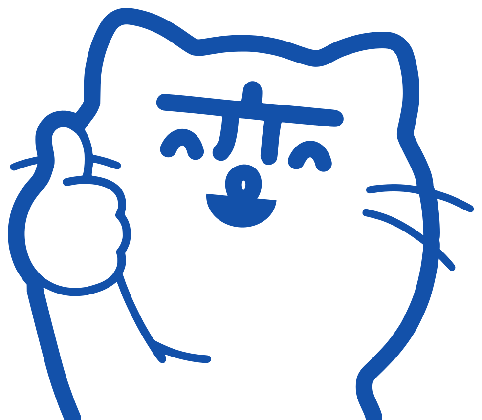
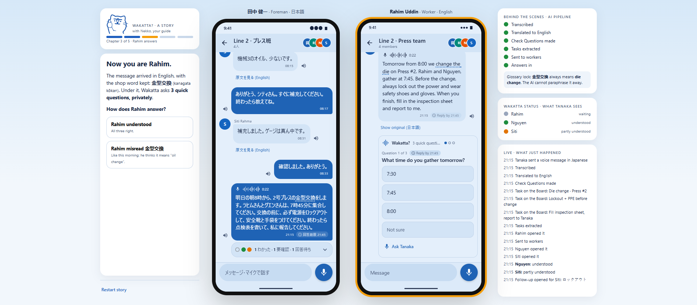
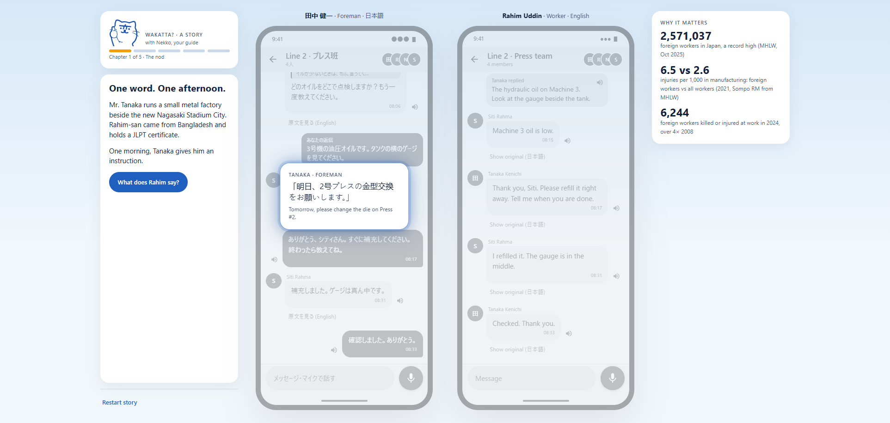
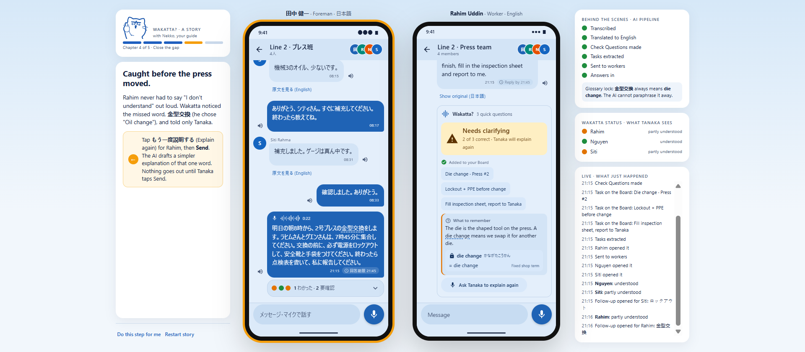
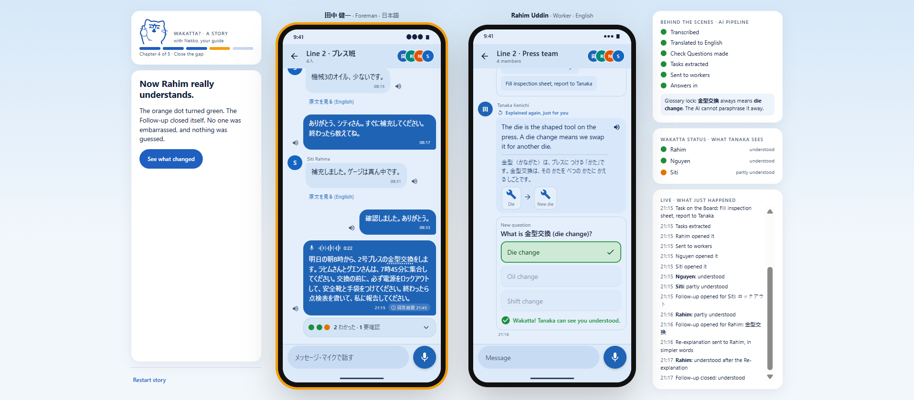

<div align="center">



# Wakatta?

**Turning "understood" into understanding.**

A shop-floor messenger for Japanese factories and their foreign workers.
The foreman speaks Japanese. Each worker reads it in their own language,
answers three private questions, and the foreman sees who truly understood.

[Demo video (coming soon)](#demo-video) · [Web app](https://mango-beach-001af4300.4.azurestaticapps.net) · [Android APK 1.0.3](https://wakattaapk71923.blob.core.windows.net/apk/wakatta-1.0.3.apk) · [Interactive demo](#try-it)

Team **TechTsunagu** · Theme: *TSUNAGU, update the way we connect*

</div>

> **概要** 「わかりました」は、工場で最も危険な言葉です。Wakatta? は、班長の日本語の指示を外国人スタッフ一人ひとりの言語に翻訳し、短い確認問題で「本当に伝わったか」を確かめます。分からなかった言葉だけを、本人にだけ、やさしく説明し直します。誰も人前で「分かりません」と言わずに済み、班長は誰が理解したかを一目で確認できます。



---

## The problem: the most dangerous word on the shop floor

Mr. Tanaka runs a small metal factory beside the new Nagasaki Stadium City. He asks Rahim-san to change the die on Press #2. Rahim nods: *"Wakarimashita."* (Understood.) By the afternoon Rahim is hurt. He misread one shop word, and neither of them knew until it was too late.

Nobody was careless. A worker new to a language does not want to slow the team down or be embarrassed in front of colleagues, so "understood" is the easiest answer. The foreman heard it and trusted it. A JLPT certificate proves someone can pass a test. It cannot prove that one instruction, in fast factory Japanese full of shop words, landed correctly.

| | |
| :--- | :--- |
| **2,571,037** | foreign workers in Japan, a record high (MHLW, Oct 2025) |
| **12,807** | in Nagasaki Prefecture, up **15.4%** in one year; manufacturing is the largest employer |
| **6.5 vs 2.6** | injuries per 1,000 workers in manufacturing: foreign workers vs all workers. **Over twice the risk** |
| **6,244** | foreign workers killed or injured at work in 2024, more than **4×** the 2008 figure |

Today's workaround is copy, paste into a translation app, read, switch back. It adds friction and still gives **no proof**. The translation may be wrong, the key word may still be missed, and the employer never finds out.

**The failure is in the connection between two people, so the fix belongs in that connection too.**

## The answer: close the loop

```
Foreman speaks ─► transcribed ─► translated into each worker's language ─► 3 Check Questions written
                                                                                     │
Foreman sees who understood ◄── answers come back privately ◄── each worker answers ◄┘
        │
        └─► a missed word opens a Follow-up ─► a simpler Re-explanation, for that one worker only
```

<table>
<tr>
<td width="50%"></td>
<td width="50%"></td>
</tr>
<tr>
<td><b>1. The nod.</b> Tanaka gives an instruction in Japanese. Without Wakatta, "wakarimashita" is all he gets back.</td>
<td><b>2. The gap is caught.</b> Rahim picks "Oil change" for 金型交換. Only Tanaka is told, before the press moves.</td>
</tr>
<tr>
<td></td>
<td></td>
</tr>
<tr>
<td><b>3. Speech becomes work.</b> One voice message becomes clear English, three questions and three Tasks on the Board.</td>
<td><b>4. Understood, for real.</b> A simpler Re-explanation with a picture, one new question, and the dot turns green.</td>
</tr>
</table>

## Why people need it

- **Understanding is confirmed, not assumed.** Each worker answers 1–3 quick questions. Green means understood. Orange or red opens a Follow-up.
- **Dignity is kept.** Nobody has to say "I don't understand" in front of the team. The app asks for them, privately.
- **Shop words never drift.** A shop Glossary locks terms such as 段取り or 金型交換, so the AI cannot paraphrase them away.
- **People stay in control.** The AI prepares a draft. Nothing is sent until the foreman approves it.
- **Safety is built in.** At a machine, the worker scans its QR code, reads the instructions and passes a Check. Only then does the machine show **Ready**. Until then it stays **Locked**.
- **Conversation becomes work.** Tasks found in a message go straight to a shared **Task Board**, with assignees, a deadline and a machine.
- **The whole day is covered.** A **Daily Briefing** shows who understood, who only opened it and who has not seen it. Workers report **Near-misses** with a photo. **Ask Wakatta** answers questions from the shop's own notes and flags emergencies.

Translation tools stop at translating. Wakatta checks the answer and repairs the gap. Japan's 14th Accident Prevention Plan aims to bring the foreign-worker injury rate down to the national average by 2027, and a misunderstood instruction is where that gap begins.

## Try it

| | How |
| :--- | :--- |
| **Interactive story demo** (two phones, side by side) | Open [`prototypes/wakatta/index.html`](prototypes/wakatta/index.html) in a browser. Nekko, our guide, walks you through five chapters; every tap in either phone moves the story. No install, no network. |
| **Android app** | Download [APK 1.0.3](https://wakattaapk71923.blob.core.windows.net/apk/wakatta-1.0.3.apk) (SHA-256 `8f2e2ab5…e789e81a`) and install it on Android 8.0 or later. |
| **Web app** (foreman PC and landing page) | [mango-beach-001af4300.4.azurestaticapps.net](https://mango-beach-001af4300.4.azurestaticapps.net) |

<a id="demo-video"></a>
**Demo video:** coming soon.

## How it is built

| Part | Stack |
| :--- | :--- |
| **Android app** ([`android/`](android/)) | Kotlin, Jetpack Compose, Hilt, Room, WorkManager. 15 feature modules on shared core modules; offline outbox, App Links, push notifications, QR scanning, voice input |
| **Web app** ([`frontend/`](frontend/)) | React 19, TypeScript, TanStack Start, Vite, Tailwind CSS v4 |
| **Backend** ([`backend/`](backend/)) | Python 3.12, FastAPI, SQLModel, PostgreSQL (Supabase), on Azure Container Apps; code-first [OpenAPI](docs/openapi.yaml) |
| **AI** | Groq Whisper for speech-to-text; Gemini for translation, Check Questions and Task extraction. Every AI step has a deterministic fallback, so the app keeps working when a model is busy |

**Measured AI quality** ([eval report](docs/ai-eval.md)): 30 of 30 cases passed for machine notes, notices and worker questions. For chat messages, 10 of 10 drafts were valid and 7 of 10 fully correct. That is exactly why the foreman reviews every draft before it is sent.

### Run it locally

```bash
# Backend: http://localhost:8000/api/health
cd backend && uv sync && uv run uvicorn app.main:create_app --factory --reload

# Web app: http://localhost:3000
cd frontend && npm install && npm run dev

# Android debug build
cd android && ./gradlew :app:assembleDebug
```

Details: [backend/README.md](backend/README.md) · [frontend/README.md](frontend/README.md) · [android/release/README.md](android/release/README.md)

### Engineering

- **17 Architecture Decision Records** in [`docs/adr/`](docs/adr/): why a software lock rather than a hardware interlock, why every AI step sits behind a swappable seam, how shop and district scopes keep data apart.
- **Contract-first API** shared by web and Android: [API spec](docs/API_SPEC.md), [mobile contract](docs/MOBILE_API_CONTRACT.md).
- **CI on every push**: lint, type check and tests for backend, web and Android, plus secret scanning ([`.github/workflows/`](.github/workflows/)).
- **Shared vocabulary** in [GLOSSARY.md](GLOSSARY.md): Worker, Foreman, Machine, Note, Check, Sign-off, Confusion, Lock / Ready.

## Team TechTsunagu

| Member | Role | GitHub |
| :--- | :--- | :--- |
| Mohammad Minhazul Abedin | Architecture, Android app | [@minuwu](https://github.com/minuwu) |
| Md. Asif Hossain | Backend, cloud deploy | [@MdAsif-Hossain](https://github.com/MdAsif-Hossain) |
| Md Zahidul Hoque Anim | Backend services, database  | [@anim710](https://github.com/anim710) |
| Wakib Jahan Galib | AI, prompts, evaluation | [@Ga-lib](https://github.com/Ga-lib) |
| Arjun Saha | Web app, design and brand | [@sillyfellow21](https://github.com/sillyfellow21) |

Five people, three days, working in parallel through a shared board of cross-team requests ([AGENTS.md](AGENTS.md)), so frontend, backend and AI moved together. Each member's work log is in [`contributors/`](contributors/).

## Sources

MHLW, 「外国人雇用状況」の届出状況まとめ（令和7年10月末時点）, 2026-01-30 · Nagasaki Labour Bureau, 長崎県における「外国人雇用状況」の集計結果まとめ（令和7年10月末時点）, 2026-01-30 · Sompo Risk Management, Report 277, 外国人労働者の労働災害の現状とその対策, 2025-09-17 · MHLW, 第14次労働災害防止計画.

---

<div align="center"><i>"Wakatta?" means "Understood?" The app makes sure the answer is true.</i></div>
