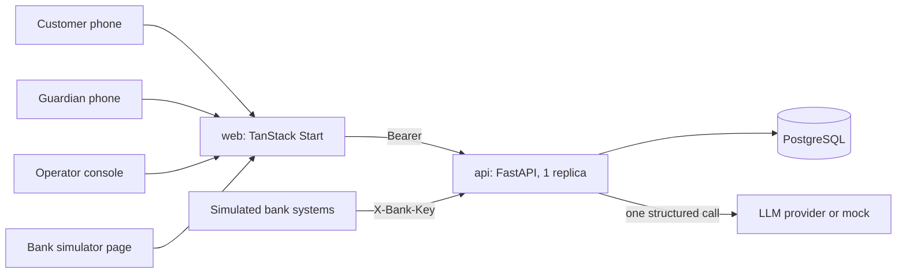
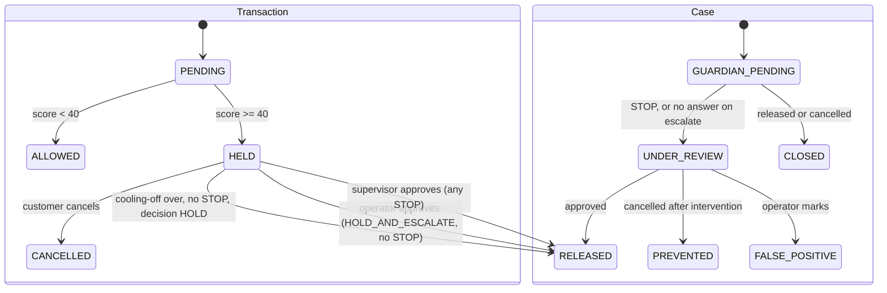

# Matte (待って): Claim Check, Winnability and Suggested System

**Author** Asif (`MdAsif-Hossain`), backend lead · **Date** 2026-11-22 · **Input** Matte Project Spec v2

Status: proposal for the team. Nothing here is built yet.

---

## 1. Verdict

- **Claims:** of 18 checked, 9 confirmed (one with a nuance), 5 partly right or outdated, 3 wrong, 1 not found. Fix the 9 before any number reaches the UI or proposal (section 2).
- **Winnable: yes.** Matte matches every judging criterion, has verified numbers behind the problem, and has a demo moment that is easy to follow. It wins only if the demo runs without a hitch and the proposal states the novelty honestly (section 3).
- **Spec fixes:** 7 changes, one of them serious: a scammer can use a planned payment to bypass the hold (section 4).
- **System:** one FastAPI service, deterministic risk engine, human-approved AI drafts, append-only audit, no background workers (section 5).
- **Plan:** foundation tonight, full flows tomorrow, film and submit on Nov 24 with a 2-hour buffer (section 6).

---

## 2. Claim check (spec v2, section 2 and section 3)

| # | Claim | Result | What the source says | Action |
|---|---|---|---|---|
| 1 | 2025 special fraud incl. SNS investment/romance: ~43,000 cases, ≈ ¥325.7 bn | ✅ | NPA statistics page: 43,000 cases, ¥325,742,587,000 | keep |
| 2 | Special fraud 27,832 cases, ≈ ¥142.3 bn, about 2× 2024 | ✅ | NPA final figures (2026-06-05): 27,832 cases (+32.3%), ¥142.31 bn (+98.0%) | keep |
| 3 | Average ≈ ¥5.24 M per case | ❌ | 142.31 bn ÷ 27,832 = **≈ ¥5.11 M** | change to ≈ ¥5.1 M, or drop |
| 4 | SNS investment/romance ≈ ¥183.3 bn | ⚠️ | ¥325.74 bn − ¥142.31 bn = ¥183.4 bn; provisional figure ¥182.7 bn; SNS investment alone ¥128.8 bn (9,523 cases) | write "≈ ¥183 bn" |
| 5 | Fake-police fraud 11,014 cases, ≈ ¥100.5 bn, doubled | ✅ | NPA data via Nippon.com | keep |
| 6 | Most cases in 30s, then 20s; most damage in 70s, then 60s | ⚠️ | 30s lead by count, 70s by amount: confirmed. "then 20s" and "then 60s": not found | drop the "then" parts |
| 7 | ~80% of special fraud calls use international numbers | ✅ | Suginami City and Tokyo Metropolitan Police leaflet ("7–8割"); Digi Police added international-call blocking on 2025-12-01 | keep, cite "70–80%" |
| 8 | Japan Post Bank ATM AI camera with SocioFuture, nationwide rollout | ✅ | Joint release 2024-03-04 (Japan Post Bank, SocioFuture, Japan ATM Business Service) after a trial begun 2023-05-26 | keep |
| 9 | Camera detects calls "~85% in trial" | ❌ | not found in any release I could reach | drop the number |
| 10 | Camera warns **only the user** | ⚠️ outdated | 2025-12-08 release: **from January 2026 the ATM may stop the transaction** when a call is detected | rewrite the gap (section 4, fix 4) |
| 11 | SocioFuture's operations center (HOC) lists crime prevention, victim relief, lost-card desk, eKYC | ❓ | searched twice in JP and EN; not found | remove unless someone has the page URL |
| 12 | FSA and NPA (2025-09-12) asked banks to detect faster, freeze, stop transfers to crypto exchanges, share between banks, cooperate with police | ✅ | FSA and NPA releases of that date | keep |
| 13 | au Jibun Bank "AI ZeroFraud" holds high-risk transfers, then asks for extra identity verification (live 2025-12-14) | ✅ | announced 2025-12-24, live 2025-12-14 | keep |
| 14 | NTT Data family watch notifies family after a transaction | ✅ | announced 2019-11, first bank 2021-03 (Nishi-Nippon City Bank); notification only | keep |
| 15 | Monzo Trusted Contacts holds a payment until a trusted person reviews it; customer still confirms | ✅ with nuance | held during review; Monzo's FAQ says a "suspicious" verdict does **not** block the payment; contacts must be Monzo users | keep, add the nuance; it strengthens Matte's case |
| 16 | China National Anti-Fraud Center: 627 M warnings, 660 M answered calls, 2.52 bn alerts | ❌ | not found; the reports of that week give other figures (6.747 M in-person interventions, ¥35 bn losses avoided) | drop; it adds nothing for these judges |
| 17 | docomo AI scam-call analysis in development (Jan 2026), no launch found | ⚠️ | Jan 2026: internal trial, >95% accuracy on evaluation data, target FY2026; May 2026: "詐欺対策プラス" launched with scam check, but call-content AI not confirmed in it | update wording |
| 18 | MUFG Trust age-based ATM limits for 70+ | ⚠️ | not age-only: 70+ **and** no ATM card transfer in 3 years → ¥100,000/day cap from 2027-01-25, opt-out possible | write "age-and-history rules" |

---

## 3. Is it winnable?

**Yes, if the demo runs without a hitch and the claims stay honest.** I cannot see the other teams, so this is a judgement against the criteria, not a prediction.

| Criterion | Matte | Why |
|---|---|---|
| Problem definition and theme fit | strong | verified record losses; "scammers disconnect, Matte reconnects" is the theme in one line |
| Technical skill | strong | risk engine, bank isolation, approvals, audit trail, AI with evidence checks: real backend engineering, not a UI on a model |
| Completeness | depends on us | every flow is simulated, so it must actually run end to end on camera (section 6) |
| Originality | moderate | closest prior art is Monzo Trusted Contacts; our differences are automatic triggering, escalation to the bank desk, multiple banks, ATM-camera signal (section 4, fix 7) |
| Proposal clarity | depends on us | the evidence table above is already most of the "Problem" section |

What could lose it:
1. A domain expert spots an inaccurate claim (claims 9–11, 16 above). Fix: use only ✅ facts.
2. The demo breaks or the AI stalls on camera. Fix: mock AI by default, seeded data, a recorded fallback take.
3. Overclaiming ("first in the world", invented prevention rates). Fix: label every estimate; name Monzo ourselves.
4. Too many flows in 3 minutes. Fix: the 6-step script in section 7.

---

## 4. Spec fixes (apply before WS0)

| # | Problem | Fix |
|---|---|---|
| 1 | **Planned payments let a scammer bypass the hold.** Scam scripts coach victims step by step; "register the safe account as a planned payment" removes 40 points. | A planned payment takes effect only **24 h after creation** or after guardian confirmation; it **never** lowers the score while a MEDIUM/HIGH scam signal is active, or for crypto/flagged payees. Test: planned payment created during a scam signal changes nothing. |
| 2 | Conflict: §6F auto-releases a HOLD with no Stop; §7 escalates when the guardian does not answer. | HOLD: release after cooling-off on SAFE **or** no answer. HOLD_AND_ESCALATE: no answer → operator. Any STOP → supervisor. |
| 3 | Cross-bank payee signal counts payees in *held* cases, so one false positive marks an innocent payee (a landlord). | Count only payees in **confirmed** cases (`PREVENTED` with STOP or operator "confirmed fraud"). |
| 4 | Gap table says the ATM camera warns only the user; since Jan 2026 it may stop the transaction. | New wording: "The camera protects one transaction at one ATM. It does not tell the family, open a case at the bank's fraud desk, or follow the customer to the next ATM or to online banking." |
| 5 | Agent rule "every claim needs evidence" lives only in the prompt. | Check in code: every `evidence.ref` must exist in the data the agent was given; otherwise reject and fall back. |
| 6 | Screenshot retention unclear. | OCR, then discard the image; keep only the redacted text (30-day rule). |
| 7 | Novelty is not stated precisely. | Pitch line: "Monzo showed that a trusted-person hold works. Matte starts it automatically from scam signals, takes it to the bank's fraud desk, and works across banks and ATMs." |

Repo alignment (team agreed rules):

| Spec v2 | Repo | Use |
|---|---|---|
| errors `{"error": "..."}` | envelope in `docs/API_SPEC.md` §1 | envelope |
| Next.js, `frontend/{customer,...}` | TanStack Start scaffold and frontend rules (Minhaz) | existing frontend |
| Vercel / Render / Neon | Azure for Students | Azure; Neon only as fallback |
| `docs/API_CONTRACT.md` | `docs/API_SPEC.md` + generated `docs/openapi.yaml` | repo files |

---

## 5. Suggested system

### 5.1 Shape

- One FastAPI service, one Postgres, one LLM provider behind a seam with a mock. No queue, no scheduler, no Redis.
- **Time-based transitions without a scheduler:** cooling-off release and no-answer escalation are applied when someone reads the transaction or the case queue (the bank simulator polls status every 5 s, the console polls every 5 s). Shortcut: transitions run on read, so nothing changes if nothing polls; add a scheduled job if a real bank stops polling.
- Polling every 5 s for guardian alerts, console and transaction status.

### 5.2 Modules (reuses the layout in [docs/BACKEND_ARCHITECTURE.md](../../docs/BACKEND_ARCHITECTURE.md) §2)

| Module | Owns | Pure? |
|---|---|---|
| `domain/risk.py` | `score(signals, rules) -> Decision(score, decision, reasons[])`, rules loaded from `risk/rules.yaml` | yes |
| `domain/phrases.py` | phrase match → `risk_level`, quoted evidence spans | yes |
| `domain/transitions.py` | transaction and case state machines, SAFE/STOP precedence, release authority | yes |
| `domain/masking.py` | `****1234`, phone masking, payee hashing (HMAC with a server key) | yes |
| `services/*` | DB work per area; every case or transaction query takes `bank_scope` from one dependency | no |
| `ai/` | `scam_classifier`, `case_agent`, `ocr` pipelines; Gemini adapter + mock | no |
| `services/audit.py` | `record(actor, action, entity, before, after, evidence)` called inside the same transaction as the change | no |

### 5.3 State machines

Rules in code, each with a test: STOP always beats SAFE; only humans move money states; the agent actor is refused on every state-changing route.

### 5.4 Data model changes to spec v2 §11

- `transactions.reasons_json` holds the rule ids that fired, in plain words for the UI.
- `planned_payments.active_from` (created + 24 h) and `confirmed_by_guardian_at`.
- `confirmed_fraud_payees` (payee_hash, bank_id, case_id, confirmed_at): the only source of the cross-bank signal.
- `sessions` (token_hash, user_id, role, expires_at) for login; passwords hashed with `hashlib.scrypt` (standard library, no new dependency).
- `bank_keys` (bank_id, key_hash) for `X-Bank-Key`.
- `audit_log` is append-only in the database: a trigger rejects `UPDATE` and `DELETE`, tested.
- Every foreign key indexed; `bank_id` on every case and transaction row, used by the isolation dependency.

### 5.5 AI (honest "agent")

- **Scam check:** phrase rules first (instant, offline), then one LLM call for variants and scam type. Final level = the higher of the two (the LLM can only raise it). Evidence = exact spans found in the input; spans not in the input are discarded.
- **Case agent:** a fixed workflow, not a free tool loop. Code gathers the case, signals, payee risk, ATM events and guardian responses, then **one** structured LLM call writes summary, explanation, call script and drafts. The steps are logged in `agent_runs` as tool calls. This is more reliable on camera and uses one request instead of five to eight. Upgrade to real tool calling only if time remains.
- **Output validation in code:** schema; each `evidence.ref` exists; `police_report` and `freeze_request` drafts only when the case has STOP or score ≥ 70.
- **Fallback:** LLM down or slow → rules decide, case opens, console shows "AI unavailable – rules only", drafts come from templates.
- **Prompt injection:** customer and scammer text is passed as quoted data with a fixed instruction; the model has no tools that act, so an injection can at most produce a bad draft that a human rejects.

### 5.6 API

Spec v2 §12 as written, with: envelope responses; `GET /bank/transactions/{id}/status` also applies due transitions; list endpoints paged; contract generated from FastAPI (ADR 0006).

### 5.7 Deploy

As in [docs/BACKEND_ARCHITECTURE.md](../../docs/BACKEND_ARCHITECTURE.md) §12: Azure Container Apps (api + web), PostgreSQL Flexible Server B1ms, images in GHCR, one API replica on demo days, `docker compose up` as the offline backup demo.

---

## 6. Team plan (5 people, deadline Tue Nov 24 23:59 BST)

| Workstream | Owner | Scope |
|---|---|---|
| WS0 Foundation | Asif | skeleton, all tables, typed stubs, generated contract, auth + roles, bank isolation dependency, audit trigger, seed, CI |
| WS1 Risk + transactions | Asif | `domain/risk.py`, rules.yaml, `/bank/risk-check`, holds, release/cancel rules, planned payments |
| WS2 Customer + guardian | Anim | scam check (text + screenshot), guardian invite/accept/revoke with change freeze, alerts, SAFE/STOP, quiet help, report |
| WS3 AI | Galib | scam classifier, case agent workflow, OCR, validation, mock fixtures, fallback templates |
| WS4 Operator console API + simulator | 5th teammate | queue with SLA, case detail, approvals, false positive, dashboard, audit view, `/sim/*` |
| WS5 Frontend | Minhaz | customer and guardian phone screens, operator console, simulator page |

| When (BST) | Milestone | Check |
|---|---|---|
| Nov 22 by 16:00 | team agrees switch + section 4 fixes | spec v3 committed |
| Nov 22 by 24:00 | WS0 merged; risk engine with tests; Azure hello-world; frontend on mocks | `pytest` green, `/api/health` live |
| Nov 23 by 18:00 | all flows A–F work locally end to end | demo script runs on `docker compose up` |
| Nov 23 by 24:00 | deployed; first full demo run on Azure | timed run under 3 min |
| Nov 24 by 18:00 | code freeze; video filmed (plus a backup take) | unlisted YouTube link plays logged out |
| Nov 24 by 22:00 | proposal PDF (≤ 3 pages) | every required item present |
| Nov 24 by 23:00 | submitted; repo public | 59 minutes of buffer |

---

## 7. Demo (3 min) and proposal

1. 0:00 Problem: ¥325.7 bn in 2025; fake-police cases doubled; the script says "tell no one".
2. 0:25 Kenta pastes a fake-police LINE screenshot → HIGH, phrases highlighted.
3. 0:50 He sends ¥2,800,000 to a new account → HELD, reasons in plain words.
4. 1:20 Aya's phone: alert → **Please stop** → Kenta sees "Aya asked you to wait" → cancels.
5. 1:50 Operator console: agent summary with evidence, freeze-request draft → supervisor approves → audit trail. 10-second cut: Michiko's ATM camera case.
6. 2:35 Kenta pays his real rent deposit (planned, active) → allowed instantly. Close: "Scammers disconnect. Matte reconnects."

Proposal (≤ 3 pages): title, team and roles · repo and video links · problem (✅ facts only) · solution · originality vs Monzo, au Jibun Bank, ATM camera, NTT Data · works now vs future · **AI usage disclosure** (where AI tools were used to build it, and the AI inside the product), as the participant guide requires.

---

## 8. Sources

- NPA statistics page (2025 totals): https://www.npa.go.jp/bureau/safetylife/sos47/circumstances/statistics/
- NPA final 2025 figures (2026-06-05): https://www.npa.go.jp/bureau/safetylife/sos47/new-topics/260605/01.html
- Nippon.com, 2025 fraud data: https://www.nippon.com/ja/japan-data/h02795/
- Bengo4, provisional figures: https://www.bengo4.com/c_18/n_19991/
- Suginami City (international numbers): https://www.city.suginami.tokyo.jp/s014/18614.html
- Tokyo Metropolitan Police Digi Police leaflet: https://www.keishicho.metro.tokyo.lg.jp/kurashi/tokushu/furikome/digipolice.files/digi_police_02.pdf
- Sakigake, Digi Police international-call blocking: https://www.sakigake.jp/news/article/20251201CO0172/
- Japan Post Bank et al., nationwide rollout (2024-03-04): https://www.jp-bank.japanpost.jp/aboutus/press/2023/pdf/pr240304_01.pdf
- Japan Post Bank, trial start (2023-05-26): https://www.jp-bank.japanpost.jp/aboutus/press/2023/pdf/pr230526_01.pdf
- Japan Post Bank, stronger measures from Jan 2026: https://www.jp-bank.japanpost.jp/aboutus/press/2025/pr251208.pdf
- FSA request (2025-09-12): https://www.fsa.go.jp/news/r7/sonota/20250912/20250912.html
- NPA request (2025-09-12): https://www.npa.go.jp/bureau/sosikihanzai/tokusyusagi/yotyokin_taisakukyouka20250912.html
- IT Leaders, au Jibun Bank AI ZeroFraud: https://it.impress.co.jp/articles/-/28797
- NTT Data family watch (2019): https://www.nttdata.com/jp/ja/news/release/2019/112700
- NTT Data, first bank (2021): https://www.nttdata.com/jp/ja/news/release/2021/032300/
- Monzo announcement: https://monzo.com/blog/introducing-our-industry-first-security-tools
- Monzo Added Security FAQ: https://monzo.com/help/Account%20Security/addedsecurityfaqs
- Newswitch, docomo scam-call AI: https://newswitch.jp/p/48020
- docomo 詐欺対策プラス (2026-05): https://www.docomo.ne.jp/info/news_release/2026/05/25_00.html
- MUFG Trust ATM limits: https://www.tr.mufg.jp/ippan/topics/20261026_tokusyusagi_atm_hikisage.html
- Xinhua (China figures of June 2026): https://www.news.cn/politics/20260610/aac2c677b2b3464c98b84df2fc945d5d/c.html
