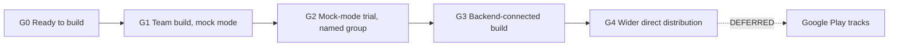

# Android release plan: Wakatta?

**Status** draft for team review. **Written** 2026-11-23, **revised twice** the same day after user decisions (section 1). **Scope** getting the native Android app in `android/` ([ADR 0015](adr/0015-native-android-app-in-android-folder.md)) from a working build to users.

**Primary channel: a signed release APK distributed directly**, kept in the repository under `android/release/`. **The first APK runs in MOCK MODE**: no backend is baked in and it collects no data off the device. **Google Play is deferred**: nothing is uploaded to Play for now; the Play material is kept and marked DEFERRED (section 9).

The team is five students. There are no customers, pilots, revenue or usage metrics, and this document invents none. Every number under "targets" is something to be measured, not a result.

Related documents (link, do not duplicate):

- Architecture and the detailed performance rules: [ANDROID_ARCHITECTURE.md](ANDROID_ARCHITECTURE.md) (owned by another worker).
- Endpoints: [MOBILE_API_CONTRACT.md](MOBILE_API_CONTRACT.md). Push, deep links, version gate, offline queue, uploads: [MOBILE_PLATFORM_CONTRACT.md](MOBILE_PLATFORM_CONTRACT.md) (both owned by other workers; may not exist yet).
- Backend: [BACKEND_ARCHITECTURE.md](BACKEND_ARCHITECTURE.md) section 12 (security, APPI, retention) and section 15 (deployment).
- Drafts in `docs/android/`: [install-guide.draft.md](android/install-guide.draft.md) (active), [privacy-policy.draft.md](android/privacy-policy.draft.md) (active, two parts), [permissions.md](android/permissions.md) (active), [data-safety.md](android/data-safety.md) (DEFERRED), [store-listing.draft.md](android/store-listing.draft.md) (DEFERRED).

## How to read the policy statements

Every Google, Android or GitHub statement below carries a source ID (S1, S2 and so on, listed in section 10 with URL) and was checked on **2026-11-23**, or is marked `UNVERIFIED`. Policies change; recheck the source before each gate. Statements taken from this repository cite a file.

---

## 1. Decisions

### 1.1 Decided by the user (final)

| # | Decision | Consequence |
| :--- | :--- | :--- |
| R1 | **No Google Play upload for now.** | Play tracks, Play App Signing, Data safety form, store listing, content rating, Android vitals and the Play account-deletion rule are DEFERRED (section 9). |
| R2 | **applicationId is `com.techtsunagu.wakatta`, final.** | It is the `package_name` in `assetlinks.json` (S11) and the package name registered under Android developer verification (S10c). Changing it means a new app: users must uninstall and reinstall. |
| R3 | **The signed release APK is distributed directly and kept in the repo under `android/release/`; the keystore is never committed.** | Sections 2 to 6. |
| R4 | **One named release owner** creates the release keystore, keeps **two offline backups**, and builds **every** release APK. | WB-1, WB-3. Accepted risk: one person is a single point of failure and of compromise (section 6.4). The owner's name is `[release owner]` and must be written in the release log. |
| R5 | **Plain git, no Git LFS.** `android/release/` keeps **only the latest** `wakatta-<version>.apk` and its `.sha256` file; the previous APK is deleted at the next release. | WB-4, section 6.3. Deleting a file does not shrink history. |
| R6 | **The release APK runs in MOCK MODE for now**: no backend baked in; the first APK collects no data off the device. Statements about a real backend are marked for when a backend is hosted. | Gates are split into a mock-mode track and a backend-connected track (section 2). Blockers B1 to B13 do **not** block the mock APK. No push, no version gate, no App Links verification are possible in mock mode (section 6.2). |
| R7 | **Push design:** a Contact Thread message sends a generic "New message from `<name>`" push with **no message text**; **Talk Threads never notify.** | B8, B9, WB-17, [permissions.md](android/permissions.md). The sender's display name is in the payload and is personal data sent through Google's push service (section 7). |

### 1.2 Still open: the user must make these

| # | Decision | Why it matters | Recommendation |
| :--- | :--- | :--- | :--- |
| D1 | **Developer identity and registration account** for Android developer verification: a free limited distribution account, or a full account. | Unregistered package names may become uninstallable on certified devices; Japan has no date yet (section 5). Registration links the package name and the key's SHA-256 fingerprint to a verified identity (S10c). The limited account is free, no government ID, but capped at **20** devices (support page and March 2026 blog) or **50** (developer guide) (S10a, S10d, S10e), and is described for students and hobbyists, so eligibility for workplace users is `UNVERIFIED`. A full account costs $25; an organisation needs a D-U-N-S number (up to 28 days) (S10a). | Register `com.techtsunagu.wakatta` before the mock-mode trial reaches Workers. Use the limited account first only if Google's terms allow the use; otherwise a full account. Decide who the verified identity is. |
| D2 | **Support email** | Needed in the privacy policy and install guide. | A shared team mailbox, not one student's address. |
| D3 | **Public domain `[HOST]`** | Needed for the privacy-policy URL now; later for API base URL, App Links `/.well-known/assetlinks.json` (S11) and the account-deletion page. | One domain for all of these. |
| D4 | **Crash-reporting stance** | No Play means **no Android vitals** (S14 counts only Play installs). A mock-mode APK must also send nothing off the device. | Recommended: no crash or analytics SDK; a user-started "Share diagnostic report" (the user sees and sends the log by mail) plus in-person debriefs. See WB-18. |
| D5 | **Where the update download link points, and repo visibility** | A file in the repo has a stable raw URL only if Workers' phones can read the repo. Visibility is `UNVERIFIED` here (BACKEND_ARCHITECTURE section 15.1 calls it public for GHCR; not checked). A public repo means anyone can download the APK. | Decide before the first APK is shared. In mock mode there is no version gate, so the link is only in the install guide. |
| D6 | **Who reviews the privacy policy** | The draft is not legal advice. | A named reviewer before any Worker uses the app. |
| D7 | **AI provider tier for real user data** | Applies when a backend is hosted. The AI plan says free Gemini tier inputs are used to improve Google's products and real Worker data must never go to the free tier (`contributors/galib/AI_PLAN.md` section 5; the pricing page it cites was not rechecked). | The backend-connected gate (G3) requires the paid tier or no real data. |
| D8 | **Account deletion versus the safety record** | Applies when a backend is hosted: it only deactivates and keeps Sign-offs and support records at least one year after contract end (BACKEND_ARCHITECTURE section 12). | Decide what deletion removes and what is retained for regulatory reasons; the reviewer (D6) must agree. |
| D9 | **Production hosting for real data** | Applies when a backend is hosted. Current deployment is Azure for Students, one replica, region "Japan East if the policy allows" (BACKEND_ARCHITECTURE section 15.1). | Decide account, region, backups and on-call before G3. |

---

## 2. Release gates in order

A gate is passed only when each exit criterion has evidence (log, screenshot, link, console page) linked from the gate's tracking issue. WB IDs refer to section 4, B IDs to section 3.

### G0. Ready to build

| Entry | Exit |
| :--- | :--- |
| `android/` builds a debug APK. | The release owner is named and has generated the keystore with two offline backups (R4, WB-1). `.gitignore` blocks keystores and signing files (WB-2). The owner can build a release APK from a clean checkout (WB-3). |

### G1. Team build in mock mode (team phones)

| Entry | Exit |
| :--- | :--- |
| G0 exit. Release build non-debuggable, minified, resource-shrunk (WB-5). `targetSdk` 36 or higher (WB-13). | 1. The release owner signed the APK with the offline keystore; `android/release/` contains exactly `wakatta-<version>.apk` and `wakatta-<version>.apk.sha256`; `sha256sum -c` passes on a second machine. 2. **Zero data leaves the device (WB-26):** the merged manifest of the mock APK has no `INTERNET` permission, or traffic capture shows no outbound connection while every screen is exercised. 3. The APK installs on the device matrix (WB-12, low-end device included) following [install-guide.draft.md](android/install-guide.draft.md) exactly, including the unknown-sources step. 4. **Update in place:** version N installs, then N+1 (higher `versionCode`, same key) installs over it with local data kept. 5. Release-mode startup and scroll measured on the low-end device and recorded (WB-6); numbers are inputs here, not pass or fail. 6. The security review (WB-9) has no open P0 or P1 item for what exists in mock mode. 7. The mock build shows clearly that it is a demo with sample data (so no Worker mistakes it for the real service). |

### G2. Mock-mode trial with a named group (Nagasaki)

Purpose: find install, language, layout and accessibility problems with real phones and real users, using sample data only. Because nothing is shared between phones in mock mode, this gate cannot test Checks across devices, chat between people, push or sync.

| Entry | Exit |
| :--- | :--- |
| G1 exit. Privacy policy Part A (mock mode) published and shown on first run; reviewed (D6). Install guide in ja, en, bn reviewed by native speakers (WB-15). Developer registration started (D1, WB-23). Support mailbox monitored (D2, WB-20). Key-compromise procedure rehearsed (WB-24). | 1. Every trial phone installed the app following the guide; the team recorded how many needed help and why. 2. A real update N to N+1 was delivered **by hand** (section 6.2) to the group. 3. Release-mode Macrobenchmark runs on the low-end device within the budgets in [ANDROID_ARCHITECTURE.md](ANDROID_ARCHITECTURE.md), with Baseline Profile and Startup Profile applied (WB-6, WB-7). 4. Compose compiler stability report reviewed (WB-8). 5. APK under the size budget (WB-10) and under GitHub's 100 MiB file limit (S18). 6. Accessibility audit (WB-11) and localisation QA (WB-15) passed for ja, en, bn. 7. Diagnostic reports and in-person feedback triaged. Play's published thresholds (crash 1.09%, ANR 0.47%, 8% per phone model, S14) are only **reference targets**: vitals does not measure sideloaded installs. |

### G3. Backend-connected build (real data)

| Entry | Exit |
| :--- | :--- |
| G2 exit. Backend hosted (D9, WB-22) with blockers B1 to B9 and B12 live. AI tier decided (D7). Privacy policy Part B (real backend) reviewed by the named reviewer (D6) and replaces Part A; deletion path and retention text agree (D8, B7). Package name registered (WB-23). | 1. A build with `INTERNET` permission, network security config limited to `[HOST]`, and FCM passes the security review again (WB-9). 2. Sign in, scan, Check, Ready, chat, voice, photo work against the real backend on the device matrix. 3. A push for each type reaches a device in the account language and opens the right screen (WB-17). 4. `adb shell pm get-app-links com.techtsunagu.wakatta` shows `verified` for `[HOST]` (S11, WB-19). 5. The version gate returns 426 below `minSupportedVersion` and the app shows the update screen; an update is delivered through it (section 6.2). 6. Release APK size still within budget and 16 KB check passed (WB-13). 7. A rollback was tested: `minSupportedVersion` raised and a build withdrawn. |

### G4. Wider direct distribution

| Entry | Exit |
| :--- | :--- |
| G3 exit. Registration account type covers the number of devices (D1). | 1. Repo growth measured: repository size and the number of past APK commits recorded (section 6.3). 2. Support and on-call named per week (WB-21). 3. A named person checks before each release whether developer verification now applies to Japan (section 5). |

---

## 3. Backend readiness: what blocks the app

**These block G3 (the backend-connected build), not the mock-mode APK (G1, G2).** State when written (from `AGENTS.md` and `.agent-bridge/specs/android/handoff-backend-additions.md`): XREQ-001 to XREQ-007 are all `[PENDING]`; no thread or message code exists; Alembic has one revision. Endpoints in the handoff file are proposals: treat them as `planned (new)`, never live.

| ID | Blocker | Source | Needed for | Owner |
| :--- | :--- | :--- | :--- | :--- |
| B1 | XREQ-001: Bearer auth, string ids, `{items, nextCursor}` lists, roster and PIN login, `mustChangePin`, Idempotency-Key | AGENTS.md | every screen | Backend |
| B2 | XREQ-002: Life contract (Notices, Events, Asks, Senpai, Meet-ups, support log CSV) | AGENTS.md | Notices, Asks, Senpai | Backend |
| B3 | XREQ-005: Threads, messages (voice and text), Wakatta Status answers, Follow-ups, Re-explanation, Nudge, Tasks and Task Board | AGENTS.md | chat, Check loop | Backend |
| B4 | XREQ-006: chat AI pipelines and voice ladder | AGENTS.md | voice messages | AI |
| B5 | XREQ-003: AI model chain, budgets, receipts route, `approvedBy` and `needsEdit` | AGENTS.md | Briefing receipts, provenance | Backend, AI |
| B6 | Handoff additions: group controls; Talk Threads and Contact Threads with My QR (ADR 0014); Periodic Interview; Today's Word | handoff-backend-additions.md | Talk, Contacts, interviews | Backend, AI |
| B7 | **Account deletion**: authenticated delete route plus a public web page. In no current document. | APPI and D8 (Play S5, S6 deferred) | privacy policy accuracy | Backend, Product |
| B8 | **Device registration and version gate**: `PUT /devices/me` (FCM token, version, locale), `GET /app/config` (`minSupportedVersion`, `latestVersion`, maintenance message), `426 UPGRADE_REQUIRED`. **The "store URL" of the platform-contract brief becomes a `downloadUrl` plus the APK `sha256`**, because there is no store (D5). Not in `openapi.yaml`. | MOBILE_PLATFORM_CONTRACT.md (planned) | push, update delivery | Backend |
| B9 | **FCM sending**: HTTP v1 sender, service-account secret as a Container App secret, payloads localised. **Rule R7:** a Contact Thread message sends a generic "New message from `<name>`" with no text; Talk Threads never send a push; no Check answers or care content in any payload. | MOBILE_PLATFORM_CONTRACT.md (planned), R7 | push | Backend |
| B10 | **Public host and assetlinks.json** on `[HOST]` carrying the **release key** fingerprint; HTTPS, `application/json`, no redirects (S11) | S11, D3 | App Links | Ops |
| B11 | **Production AI tier** and Google/Groq terms for real data (D7) | AI_PLAN.md section 5 | G3 | AI, Product |
| B12 | **Retention job** (contract end plus one year; Talk Threads purged 30 days after deactivation by the handoff default) | BACKEND_ARCHITECTURE sections 12 and 18; handoff section 2 | privacy policy accuracy | Backend |
| B13 | **Bulk session revocation** (all users, or all sessions of a client version) for a key-compromise response. Sessions are revocable per user (ADR 0010); a bulk operation is not documented: `UNVERIFIED`. | ADR 0010; WB-24 | WB-24 | Backend |

XREQ-004 (web-only "Dictate instead") does not block Android. XREQ-007 (model bake-off) decides the transcript quality Workers will see.

---

## 4. Work breakdown

Owner roles: **Android**, **Backend**, **AI**, **Design**, **Ops**, **Product**. "Gate" is the first gate at which the item must be done. Detailed engineering rules live in ANDROID_ARCHITECTURE.md and the contract documents.

### 4.1 Signing, naming, checksums, build

| ID | Item | Owner | Gate | Done-check |
| :--- | :--- | :--- | :--- | :--- |
| WB-1 | **Offline keystore (R4).** The named release owner generates one keystore for `com.techtsunagu.wakatta` on an offline machine, protects it with a strong passphrase kept apart from the file, and keeps **two offline backups** on separate physical media in two places. It is never committed, never uploaded to CI, never put in chat. With no Play App Signing there is no Google-held key: this key is the app's identity for ever (section 6.4). Accepted risk: one holder. | Android (release owner) | G0 | `git ls-files` shows no `.jks`, `.keystore`, `.p12`, `keystore.properties` or passphrase file; both backups restored once on a second machine to prove they open; the certificate SHA-256 fingerprint is written in the release log (below) and in `docs/android/install-guide.draft.md`; the owner's name is in the release log. |
| WB-2 | **Keep secrets out of git.** `.gitignore` entries for `*.jks`, `*.keystore`, `*.p12`, `keystore.properties`, `local.properties`, and `google-services.json` if the team treats it as private; `gitleaks` in CI (G-37). At writing, the repository's `.gitignore` has no such lines (checked 2026-11-23); the Android owner adds them (this document may not edit that file). | Android, Ops | G0 | Adding a dummy `test.jks` is blocked by `.gitignore`; CI secret scan passes; no signing secret exists anywhere in CI. |
| WB-3 | **Build and sign (R4).** CI runs lint and unit tests on pull requests; it does not hold the keystore. The release owner builds every release APK locally from a tagged clean checkout, signs it with the offline keystore (`apksigner`, then `apksigner verify --print-certs`), writes the checksum, replaces the files in `android/release/` and commits (WB-4). The R8 mapping file is kept by the owner outside the repo. `apksigner` command details are not verified here: `UNVERIFIED`, the owner takes them from the Android build tools documentation. | Android (release owner) | G0 | A written step list exists and a second person followed it once to reproduce the checksum of an unsigned build; `apksigner verify --print-certs` prints the fingerprint recorded in WB-1. |
| WB-4 | **Versioning, names, folder rule (R5).** `versionName` is `MAJOR.MINOR.PATCH`. `versionCode` is a strictly increasing integer, never reused (Android refuses to update to a lower one: general behaviour, not checked against a source: `UNVERIFIED`). `android/release/` holds **only** `wakatta-<versionName>.apk` and `wakatta-<versionName>.apk.sha256` (content: `<64 hex characters>  wakatta-<versionName>.apk`, usable with `sha256sum -c`). The release commit deletes the previous APK and checksum and adds the new pair, with message `chore(release): <versionName>` and no other change. Plain git, no LFS. The release log (kept in `docs/`, not in the release folder) records per release: date, `versionName`, `versionCode`, commit hash, SHA-256, signer, notes. | Android (release owner) | G1 | The folder lists exactly two files; `sha256sum -c` prints OK; the version in the app's about screen equals the file name. |
| WB-5 | **R8 full mode and resource shrinking**, keep rules only where needed. Mapping file archived per version, outside the repo (it eases reverse engineering). | Android | G1 | `isMinifyEnabled` and `isShrinkResources` true; smoke flow passes on the minified APK. |
| WB-23 | **Developer verification registration.** In the Android Developer Console create an account, register `com.techtsunagu.wakatta` with the release key's SHA-256 fingerprint, and prove ownership by signing an APK with the private key and uploading it with the console's snippet (S10c). Re-register after any key change (WB-24). | Android, Product | G2 (started), G3 (done) | Console shows **Registered**; confirmation email saved; console fingerprint equals the release log. |
| WB-26 | **Mock-mode zero-egress check (R6).** The mock APK collects nothing off the device: recommended, remove the `INTERNET` permission from the mock build's merged manifest and leave out any SDK that contacts a server (including push and Firebase SDKs, which register with Google (S13)). Voice, text and photos stay on the device, and the mock must say so. | Android | G1 | `aapt`/Android Studio APK Analyzer shows the merged manifest without `INTERNET`, or a traffic capture during a full walk-through shows no outbound packets; the privacy policy Part A claim "collects no data off the device" is true only while this check passes and is re-run for every release. |

### 4.2 Performance (ship gate)

The detailed rules are in [ANDROID_ARCHITECTURE.md](ANDROID_ARCHITECTURE.md). All values are targets to measure, not results.

| ID | Item | Owner | Gate | Done-check |
| :--- | :--- | :--- | :--- | :--- |
| WB-6 | **Release-mode measurement only.** Numbers come from a non-debuggable release-like build on a real **low-end device**, never a debug build or an emulator alone. Macrobenchmark runs for cold start and first scroll of the Machine list, chat and Notice list. Record device model, Android version, build and numbers. | Android | G1 (record), G2 (budget met) | A benchmark module runs by one documented command; results attached to the gate issue; budgets from ANDROID_ARCHITECTURE.md. |
| WB-7 | **Baseline Profile and Startup Profile** for the main journeys (cold start, sign-in, scan, Check, chat open), packaged in the APK. | Android | G2 | The APK contains the profile; runs with and without it are compared and both recorded (no pre-claimed gain). |
| WB-8 | **Compose compiler stability report** for the release build reviewed; unstable or non-skippable composables on hot screens fixed or justified in writing. | Android | G2 | Report attached; each remaining unstable parameter on a hot screen has a reason or a fix. |
| WB-10 | **App size budget.** A distributed universal APK carries every CPU architecture, so it is larger than a Play download. Measure the first release APK, then set a budget and enforce it in CI. Hard ceilings: GitHub warns above 50 MiB and blocks files above 100 MiB (S18); with plain git and no LFS (R5) the APK must stay below that. Options if large: restrict ABIs or ship one APK per ABI (more files in the folder, which R5 limits to one APK). | Android | G2 | Budget written in ANDROID_ARCHITECTURE.md; CI fails when the APK exceeds it; size recorded in the release log. |
| WB-13 | **Target API and 16 KB pages.** Play's target-API rule (API 36 from 2026-08-31, S1) does not bind a direct APK, but target 36 or higher anyway. For 16 KB: Play requires support for apps targeting API 35 or higher, and an app that is not rebuilt may not run on 16 KB devices in future Android releases (S3). Kotlin and Java code is compatible, but libraries (barcode scanning, camera) may ship native code: check, do not assume. | Android | G1 (target), G3 (16 KB) | `targetSdk` 36 or higher; APK Analyzer shows no `.so` files, or each is 16 KB aligned and `zipalign -c -P 16 -v 4 <apk>` ends with "Verification successful" (S3); run once on a 16 KB emulator or device. |

### 4.3 Quality, devices, accessibility, localisation

| ID | Item | Owner | Gate | Done-check |
| :--- | :--- | :--- | :--- | :--- |
| WB-11 | **Accessibility audit.** TalkBack walk-through of sign-in, scan, Check, chat, Notices; touch targets at least 48dp; largest system font and display size; Japanese and Bengali scripts render without clipping or missing glyphs; colour never the only carrier of Lock or Ready (PRODUCT.md accessibility). | Design, Android | G2 | Checklist per screen; screenshots at default and largest font for ja and bn; Accessibility Scanner shows no unresolved target-size or contrast finding on the five main screens. |
| WB-12 | **Device matrix.** At least one low-end phone (small RAM, an old supported Android version), one mid-range, one recent Pixel-class, one tablet-size or foldable layout check, one device with Bengali input, and at least one phone on Android 12 or lower (key rotation is not recommended there, S17). List real models tested only. The minimum Android version is in ANDROID_ARCHITECTURE.md. | Android, Ops | G1 | Table of models, versions, results and recordings in the gate issue. |
| WB-15 | **Localisation QA by native speakers** for ja, en, bn (then Indonesian and Vietnamese per `shops.languages`) on a real phone: install guide, permission rationales, errors, privacy summary. The Bengali in these drafts has **not** been reviewed. | Product, Design | G2 | One named native reviewer per language signs the checklist; each fix is a commit. |

### 4.4 Security and privacy

| ID | Item | Owner | Gate | Done-check |
| :--- | :--- | :--- | :--- | :--- |
| WB-9 | **Security review**: (a) **token storage** (backend build): the Bearer token (Worker 30 days, Foreman 12 hours, ADR 0010) encrypted with an Android Keystore key, never in logs; (b) **network security config**: cleartext off; mock build has no network at all (WB-26); backend build only `[HOST]`, system CAs only; (c) **backup rules**: token, outbox and cached personal data excluded from cloud backup and device transfer; (d) **certificate pinning**: recommended **not** in the first backend build, because a rotated Azure certificate would lock every installed copy out and a direct APK is slow to update; revisit after a rotation procedure exists; (e) PIN never logged or cached; exported components and intent filters reviewed; (f) **APK integrity**: signed with the release key only, `apksigner verify --print-certs` shows exactly the recorded fingerprint, release build not debuggable. | Android, Backend | G1 (mock), G3 (backend) | Written review in the gate issue, each point pass, fix or accepted risk; `adb shell dumpsys package com.techtsunagu.wakatta` lists only intended exported components; in the backend build a plain-HTTP call fails. |
| WB-14 | **Privacy and APPI** (section 7): publish policy Part A for mock mode; Part B before the backend-connected build; first-run notice; deletion path when a backend exists. Play's Data safety form is deferred. | Product, Backend | G2 (Part A), G3 (Part B) | Policy URL returns 200 without sign-in; first-run notice and rationales ([permissions.md](android/permissions.md)) match the policy. |
| WB-18 | **Crash and analytics policy.** Recommendation (D4): no crash or analytics SDK. Reason: nothing extra is collected, so the mock-mode claim "nothing leaves the device" stays true and the policy stays short. Cost: no Android vitals; crash data comes only from a user-started **Share diagnostic report** (a redacted log shown to the user and sent by them to the support mailbox) and in-person debriefs. Crashlytics would add Firebase Installations IDs and break the mock-mode claim (S13). | Product, Android | G1 | D4 recorded; dependency list contains no analytics, advertising or crash SDK; a sample diagnostic report contains no names, PINs, transcripts or tokens. |
| WB-17 | **FCM and push (backend build only).** Not present in mock mode (WB-26). Firebase project; server credentials only as a Container App secret (B9). Token registered on sign-in and removed on sign-out, PIN reset and deactivation (B8). `POST_NOTIFICATIONS` requested in context, not at launch (S12). **R7:** Contact Thread message pushes read "New message from `<name>`" with no text; Talk Threads never notify; no Check answers or care content in any payload. FCM behaviour for APKs installed outside Play was not checked: `UNVERIFIED`, test on the pilot devices. | Android, Backend | G3 | A test push arrives for a signed-in Worker and not after sign-out; payload inspection shows a type, an id, the sender's display name for Contact Threads, and nothing else; a Talk Thread entry produces no push. |
| WB-19 | **App Links (backend build only).** Host `https://[HOST]/.well-known/assetlinks.json` with `package_name` `com.techtsunagu.wakatta` and the **release keystore's** SHA-256 fingerprint from `keytool -list -v` (S11). One key, since there is no Play App Signing. HTTPS, `application/json`, no redirects (S11). Android 15 and later re-verify periodically; a changed file can take up to seven days to reach all devices (S11). On a key rotation, list both fingerprints during the transition (S11). | Ops, Android | G3 | `adb shell pm verify-app-links --re-verify com.techtsunagu.wakatta`, then `pm get-app-links com.techtsunagu.wakatta`, shows `verified` for `[HOST]` on the signed APK. |
| WB-24 | **Key compromise and rotation** (section 6.4). | Android, Backend, Ops | G2 (drill) | A drill on test devices following section 6.4 is recorded, including which Android versions needed a reinstall. |

### 4.5 Distribution, support, operations

| ID | Item | Owner | Gate | Done-check |
| :--- | :--- | :--- | :--- | :--- |
| WB-25 | **Install and update guide for Workers** in ja, en, bn with screenshots from the trial phones: download, enabling installs from the source used, install, update, what to do when a phone refuses ([install-guide.draft.md](android/install-guide.draft.md)). | Design, Product | G2 | Each trial Worker installed the app using only the guide; failures are logged and fixed in the guide. |
| WB-20 | **Support, takedown and incident process.** A monitored mailbox (D2); a procedure with an owner and response target for: (a) a user asks to delete data (in mock mode there is nothing on a server; the answer is "uninstall the app"), (b) a user reports content, (c) a lost phone (backend build: PIN reset revokes sessions, ADR 0010), (d) a regulator contacts the team, (e) a bad build must be withdrawn (delete it from `android/release/` and from wherever the link points; backend build also raises `minSupportedVersion`, B8), (f) a breach (APPI Art. 26, S16, criteria not checked), (g) key compromise (WB-24). | Ops, Product | G2 | Dry runs of (a), (e) and (g) recorded with times; two people monitor the mailbox. |
| WB-21 | **Post-release monitoring.** Weekly review of diagnostic reports and support mail; once a backend exists, health and AI-quota dashboards (BACKEND_ARCHITECTURE section 13) and an on-call name per week; a named person checks developer-verification news before each release (section 5). | Ops | G4 | Calendar entries exist; one simulated alert was acted on. |
| WB-22 | **Hosting readiness for real data** (D9): region, backups, database access, secret rotation, who can read production data. | Backend, Ops | G3 | Written note in the gate issue; a restore from backup tested once. |

---

## 5. Android developer verification and a sideloaded APK

All from Google's pages, checked 2026-11-23 (S10a to S10e). This matters because the primary channel is a sideloaded APK.

- **What it is.** Apps must be registered to a verified developer to be installed and updated on **certified** Android devices. For developers who distribute only outside Play, registration is done in the Android Developer Console: create an account, register the package name, enter the SHA-256 fingerprint of the signing key, and for an existing package name prove ownership by signing an APK with the private key and uploading it (S10c).
- **Dates.** Protections begin **2026-09-30** in **Brazil, Indonesia, Singapore and Thailand** on certified devices running Android 8 (API 26) or higher, and verification "will be expanded globally for all apps on certified Android devices in 2027" (S10b). **Japan is not named** and no Japan date was found. (One Google support page lists only Indonesia, Singapore and Thailand; the developer page also lists Brazil and is used here, S10a, S10b.)
- **What happens to an unregistered APK.** In the listed regions, a package name not registered by the date "will no longer be installable on certified Android devices" (S10d). Google also says unregistered apps can be sideloaded with ADB or an "advanced flow" for power users (S10b, S10e); the flow's steps and any waiting time were not fetched (one news report mentions a 24-hour lock: `UNVERIFIED`). A Worker is not a power user: assume the advanced flow is not a workable install path for them.
- **Open questions.** Whether the regional rule follows the device's country, the SIM, the account or the user's location is `UNVERIFIED`; Indonesian Workers in Nagasaki may carry phones from a listed region. One page describes protections for installs "from participating stores" (S10b), others say all apps on certified devices from 2027 (S10b); treat the 2027 global rule as covering sideloaded APKs until Google says otherwise.
- **Account choice.** Limited distribution account: free, no government ID, apps shared with devices the end user explicitly authorises by a QR-code or link handshake and consent (S10d); cap **20** devices (S10a, S10e) or **50** (S10d), `UNVERIFIED` which is current; described for students, teachers and hobbyists, so workplace use may not qualify. Full account: $25 (S10a); an organisation needs a D-U-N-S number (S10a).
- **Recommendation.** Register `com.techtsunagu.wakatta` and the release fingerprint before the trial reaches Workers (WB-23, D1). It costs nothing on the limited account, helps keep the package name from being claimed by someone else (duplicate-name rules favour the key with the most known installs, S10c), and avoids a scramble when Japan is added.
- **Plan B for a blocked install.** If a phone refuses an unregistered APK, the options are registration (preferred), the advanced flow, or Play (deferred, section 9). Do not promise Workers an install path the platform may remove.

---

## 6. APK delivery: install, update, repository and key risks

### 6.1 Install (Worker)

Full text in ja, en and bn: [install-guide.draft.md](android/install-guide.draft.md). Outline:

1. A team member or Foreman gives the Worker the download link or the file.
2. The phone asks to allow installs from that source. On Android 8 and higher this is a per-app setting; the usual path is Settings > Apps > Special app access > Install unknown apps, then the source app, then "Allow from this source". Menu names differ by phone maker. This came from phone-maker and news pages, not a Google page: **`UNVERIFIED` against an official Google source**; test it on each trial phone model and screenshot the real screens.
3. Open the file and tap Install. Afterwards turn the setting off again for that source (advice from a security vendor, secondary source).
4. Mock mode: the app opens with sample data. Backend build: sign in with the name list and PIN the Foreman gave.

Before handing out a file, a team member or Foreman checks it: `sha256sum -c`, and `apksigner verify --print-certs` must show the fingerprint in the release log. Workers are not expected to do this; a Foreman or team member supervises the first install.

### 6.2 Update delivery

- **Mock mode (now): by hand.** There is no backend, so no `GET /app/config`, no version gate and no update prompt. The release owner commits the new APK (R5), the team tells the group, and the Foreman or team hands over the new file. Android installs it over the old app if the new `versionCode` is higher and the **signing key is the same**; local data is kept. Old versions stay in use on phones that are not updated; nothing can stop them.
- **Backend build (later), through the version gate.** At start and on resume the app calls `GET /app/config` (B8) and compares its `versionCode`. A newer version: a non-blocking card with a button that opens `downloadUrl` (D5). Below `minSupportedVersion`, or any `426 UPGRADE_REQUIRED`: a blocking screen with the same button and a link to the install guide. This protects Check logic: a stale client must not decide Lock or Ready (BACKEND_ARCHITECTURE section 7.3). The `sha256` returned with the config lets the team verify the file.
- Recommended: the app opens the link in the browser and the system installer finishes the job, rather than downloading and installing the APK itself. Self-installing needs `REQUEST_INSTALL_PACKAGES`, whose handling was not checked: `UNVERIFIED`; fewer permissions keep the privacy story short.
- Because `android/release/` keeps only the latest APK (R5), a withdrawn or previous build is recoverable only from git history by commit hash (release log).

### 6.3 An APK committed to git: what it costs (plain git, no LFS)

| Risk | Fact | Handling |
| :--- | :--- | :--- |
| Repository growth | R5 keeps one APK in the tree, but **every committed APK stays in git history for ever**; deleting the old file does not shrink the repository. GitHub warns above 50 MiB per file, blocks above 100 MiB, and recommends repositories ideally under 1 GB and strongly under 5 GB (S18). The APK size is not measured yet, so no forecast is made here. | Measure the first APK. Record repository size in the release log at each release. Write down a cap (releases or MiB) at which the team must choose again: GitHub names releases as the alternative to tracking binaries (S18); that would be a new user decision because R5 says plain git. |
| Removing a bad APK | Erasing a committed APK from history means rewriting history and force-pushing, which the team's rules discourage (AGENTS.md 3.5: pull first, pre-push hook). | Never commit an APK that failed a G1 check. If a defective or leaked-key APK is committed, delete it from the tree, say so in the release log with the commit hash, and (backend build) raise `minSupportedVersion`. |
| Integrity and trust | Anyone with push rights can replace the APK; the `.sha256` file sits beside it, so it does not protect against a repo compromise. Android blocks an update signed by a different key, but a **fresh install** of an attacker's APK is not stopped. | Protect `main` (reviews, two-factor accounts). Publish the certificate fingerprint in at least two other places (the privacy page on `[HOST]`, a printed card from the Foreman). Sign release commits (GPG or SSH). Verify on a second machine before announcing. |
| Public repo | Visibility is `UNVERIFIED` (D5). If public, anyone can download the APK and read `android/`. | Keep no secret in the APK or the repo; any secret inside a client is public; keep sample data fictional. |
| Merge noise | A binary in a shared repo causes large clones and conflicts for five students. | Only the release owner touches `android/release/`, in a commit of its own. |

### 6.4 Key compromise and rotation (WB-24)

The signing key is the app's permanent identity. **If the keystore or its passphrase leaks, an attacker can build an APK that Android accepts as an update to the real app.** With one owner holding the keystore (R4) and two backups, a loss of all copies has the same effect as a compromise: no more updates under that key. What is verified (S17, 2026-11-23): APK Signature Scheme v3 supports key rotation through a proof-of-rotation lineage, from Android 9, and the page says rotation "is not recommended for Android 12 (API level 31) and earlier"; older platforms ignore v3 signatures. The lineage is built by each certificate signing the next, so creating it needs the previous key. The page gives no `apksigner` commands (`UNVERIFIED`; rehearse them from the build tools documentation).

Procedure (rehearse before G2):

1. **Declare an incident.** Stop distributing: delete the APK from `android/release/` and the download location, tell the group, record the commit hash. The file stays in history (6.3).
2. **Contain on the server (backend build).** Raise `minSupportedVersion` so old builds get 426 (B8). Consider revoking sessions (B13). The backend cannot tell a genuine app from a forged one: assume sessions made through a suspect build may be hostile. In mock mode there is no server and the damage is limited to what a forged APK does on the user's phone.
3. **Generate a new keystore** offline, with two new backups (R4, WB-1).
4. **Choose the update route.** On phones where lineage rotation works (Android 9 or higher, caveat above) a new APK signed with the new key plus a proof of rotation signed by the old key can update the installed app. That needs the **old key**, which is the key just compromised, so it is safe only if the attacker has shipped nothing yet. In all other cases, and always on Android 12 or lower, users must **uninstall and reinstall**, losing local data (in mock mode, everything the user entered; in the backend build, the offline outbox and caches; the server account remains and the Worker signs in again).
5. **Update the identity outside the app.** Add the new fingerprint to `assetlinks.json` (keep the old one only during the transition, S11); register the new fingerprint under the package name in the Android Developer Console (S10c, WB-23); update the release log; publish the new fingerprint in the two places in 6.3.
6. **Tell people.** Foremen reach Workers in person; reissue the install guide with the warning to uninstall the old app first.
7. **Review** how the key leaked and who had access.

---

## 7. Privacy, APPI and what the app handles

This is an engineering summary for the legal reviewer. It is **not legal advice**; points not confirmed by a source below are left open for D6. The privacy policy is still needed without Play: the Act requires notification of purpose of use (S16, Art. 21(1)), and Workers deserve to know what is sent where. The draft has two parts: [Part A for the mock-mode APK](android/privacy-policy.draft.md) and Part B for a backend-connected build.

### 7.1 Mock mode (the first APK, R6)

Nothing leaves the device: no account on a server, no network, no push, no analytics, no crash SDK (WB-26, WB-18). Data the user enters, or that is bundled as sample data, stays in the app's own storage on the phone and is removed when the app is uninstalled. The claim is true only while the zero-egress check passes for that exact APK. Backup rules (WB-9 c) decide whether Android's cloud backup could copy app data off the phone, so mock mode must also exclude app data from backup (a data-leaving path outside the app's own network access).

### 7.2 Backend-connected build: what the app handles

Everything below applies **when a backend is hosted**.

| Data | Where it comes from | Where it goes |
| :--- | :--- | :--- |
| Name (display), role, language, shop or district id | Foreman creates the account; user signs in with name and PIN | Backend (Azure) |
| PIN | typed at sign-in | Backend over HTTPS, stored hashed (ADR 0010); never kept on the phone |
| Session token | backend | phone (encrypted, WB-9) |
| Check answers and results (Sign-offs, Confusion, Wakatta Status) | user taps | Backend; visible to the Foreman |
| Chat and Ask text, translations | user | Backend; translated by an AI provider |
| Voice audio (chat, Asks, Notices, Briefings, Near-miss, Talk Threads) | microphone | Backend, which does not store it (section 11), and **AI processors** for transcription |
| Voice transcripts and translations | AI | Backend, stored as messages |
| Photos (Near-miss, flyer) | camera or Photo Picker | Backend; EXIF and GPS removed; stored up to 2 MB |
| Talk Thread content: what a third party (for example an elderly person) said, its meaning, the owner's understanding, a "tell staff" flag derived from pain or appetite words | owner's recording or typing | Backend in a user scope the employer cannot read (ADR 0014); audio and text sent to AI processors. **Never triggers a push (R7).** |
| Contact data: My QR token, Contact Threads, blocks | users | Backend; the QR carries an opaque revocable token, never an id or PIN |
| FCM token | Firebase | Backend (planned, B8); Google delivers the push |
| Push payload for a Contact Thread message | backend | Google's push service to the recipient: type, thread id and **the sender's display name**, no text (R7) |
| Firebase Installations ID | FCM SDK | Google (S13) |
| Diagnostic report (only if the user presses Share) | the app | support mailbox |

**Processors named in the repository:** Google (Gemini API for transcription, translation, drafts; Firebase Cloud Messaging for push) and, optionally, Groq (Whisper transcription, US; `AI_PLAN.md` sections 2 and 5). Naming them is a disclosure.

**Points for the legal reviewer (D6), all left open:**

1. **要配慮個人情報 (special care-required personal information), APPI Art. 2(3).** Talk Threads may hold health-related signals about a third party. Whether stored data is 要配慮個人情報 and what that requires is not decided here (S16; the English term was not confirmed).
2. **Provision to a third party in a foreign country, Art. 28(1)** requires the person's consent (with information under Art. 28(2)) unless the recipient has a conforming system or the country is recognised as equivalent (S16). Whether sending audio, text or a push containing a sender's name to Google or Groq falls under Art. 28 or under entrusted handling (Art. 27(5)(i), S16) depends on contracts and settings.
3. **Purpose notification, Art. 21(1)** (S16): policy and first-run notice. ADR 0014 already commits to a one-time notice before first use of Talk Threads.
4. **Breach reporting, Art. 26(1)** to the Personal Information Protection Commission when its criteria are met (S16); criteria not checked.
5. **Deletion.** Art. 35(1) lets a person ask a business to stop using or delete data handled in violation of certain articles (S16). Broader rights were **not verified**: `UNVERIFIED`.
6. **Retention conflict (D8).** The backend keeps Sign-offs and support records at least one year after contract end (BACKEND_ARCHITECTURE section 12); the policy must list exactly what is retained and why.
7. **Free AI tier.** The AI plan says free-tier inputs may be used to improve Google's products; not processing only on the developer's behalf. G3 requires the paid tier or no real data (D7, B11).
8. **Children.** The product is for adult employees and care workers; the draft says so. Play's Families rules matter only if Play is used (deferred): `UNVERIFIED`.

---

## 8. Permissions in one table

Rationale text and denied-state behaviour in three languages: [android/permissions.md](android/permissions.md).

| Permission | Why | Handling |
| :--- | :--- | :--- |
| `CAMERA` | scan Machine and My QR codes; take Near-miss and flyer photos | Runtime; asked at first scan after an in-app rationale. |
| `RECORD_AUDIO` | record voice for chat, Asks, Notices, Talk Threads | Runtime; asked at first recording; foreground only. Foreground-service types were not checked (`UNVERIFIED`), so keep recording in the foreground. In mock mode the recording must not leave the device. |
| `POST_NOTIFICATIONS` | push (Android 13 and higher); backend build only | Runtime; the app controls when the dialog appears when targeting 13 or higher; notifications are off by default until granted (S12). Absent from the mock build. |
| Photos | attach a photo | Use the system Photo Picker; do not request `READ_MEDIA_IMAGES`. Play allows those permissions only when system pickers are insufficient and requires a declaration (S15); without Play it is still the least-collecting choice. |
| `INTERNET`, `ACCESS_NETWORK_STATE` | API calls, offline queue; backend build only | Normal permissions. **Absent from the mock build** (WB-26). |
| `REQUEST_INSTALL_PACKAGES` | only if the app installs APKs itself | Not requested (section 6.2). |

---

## 9. Deferred: Google Play

Nothing here is deleted; it applies if the team later publishes on Play (R1). Reuse the drafts in `docs/android/` (marked DEFERRED).

| Topic | What was verified (2026-11-23) | Where |
| :--- | :--- | :--- |
| Target API | New apps and updates must target API 36 or higher from 2026-08-31; the extension to 2026-11-01 has passed (S1). | S1 |
| App bundle and signing | New apps must publish an Android App Bundle; using one requires Play App Signing (S8). Google holds the app signing key, the developer holds an upload key, and a lost upload key can be reset (S7). Google can generate the Play signing key or you can supply your own (S7): supplying the same key as the direct APK would keep in-place updates working; whether the team's key can be used was not checked: `UNVERIFIED`. | S7, S8 |
| Testing tracks | Personal accounts created after 2023-11-13 need a closed test with at least 12 testers opted in for 14 days before production access (S2). Organisation exemption `UNVERIFIED`. Never buy tester services. | S2 |
| Data safety, privacy policy, deletion | Form required for closed, open and production tracks, not internal-only (S4); privacy policy in Play Console and in the app, public non-PDF URL (S6); in-app deletion plus web link, deactivation does not count (S5, S6). | [data-safety.md](android/data-safety.md) |
| Content rating | Questionnaire per app, redone when content or features change (S9). | S9 |
| Android vitals | Crash 1.09% overall, ANR 0.47% overall, 8% per phone model, 28-day window; memory and code-optimisation visibility impact from February 2027; counts only certified devices and Play installs (S14). | S14 |
| 16 KB pages | Required for Play updates from 2027-02-01 (S3). | S3 |
| Store listing | Limits 30, 80 and 4,000 characters; 2 to 8 phone screenshots. | [store-listing.draft.md](android/store-listing.draft.md) |
| Sensitive permissions | Photos permission needs a declaration if requested (S15). | S15 |

If Play is added later, put internal testing, closed test and production (with a staged rollout, `UNVERIFIED`) on top of G3, submit Data safety, make the deletion link live, and put the Play app signing key fingerprint from Play Console in `assetlinks.json` beside the direct-APK key (S11).

---

## 10. Sources checked

All checked **2026-11-23** by reading the page unless noted. Recheck before each gate.

| ID | Statement relied on | URL |
| :--- | :--- | :--- |
| S1 | Play: new apps and updates must target API 36 or higher from 2026-08-31; extension request to 2026-11-01. | https://support.google.com/googleplay/android-developer/answer/11926878 |
| S2 | Play: personal accounts created after 2023-11-13 need a closed test, 12 testers, 14 days. Organisation accounts not addressed. | https://support.google.com/googleplay/android-developer/answer/14151465 |
| S3 | 16 KB page size: Play requirement, 2027-02-01 for updates, Java and Kotlin code compatible, native-code checks, `zipalign -P 16`. | https://developer.android.com/guide/practices/page-sizes |
| S4 | Play Data safety form scope and definitions. | https://support.google.com/googleplay/android-developer/answer/10787469 |
| S5 | Play account deletion requirement. | https://support.google.com/googleplay/android-developer/answer/13327111 |
| S6 | Play User Data policy (privacy policy, disclosure, deletion, security). | https://support.google.com/googleplay/android-developer/answer/10144311 |
| S7 | Play App Signing, upload key, key reset. | https://support.google.com/googleplay/android-developer/answer/9842756 |
| S8 | Play: new apps must use the Android App Bundle; requires Play App Signing. | https://support.google.com/googleplay/android-developer/answer/9844279 |
| S9 | Play content rating questionnaire. | https://support.google.com/googleplay/android-developer/answer/188189 |
| S10a | Developer verification (support page): dates, $25 full account, D-U-N-S, 20-device limited account, sideloading remains possible. Lists Indonesia, Singapore, Thailand. | https://support.google.com/android-developer-console/answer/16561738 |
| S10b | Developer verification overview: protections begin 2026-09-30 in Brazil, Indonesia, Singapore and Thailand on certified devices running Android 8 or higher; global expansion in 2027; advanced flow; limited distribution accounts. | https://developer.android.com/developer-verification |
| S10c | Registering package names for apps distributed outside Play: package name, SHA-256 key fingerprint, ownership proof by signing an APK; duplicate-name rules. | https://developer.android.com/developer-verification/guides/android-developer-console.md.txt |
| S10d | Limited distribution account: free, no government ID, device handshake, "up to 50 devices"; unregistered package names not installable from 2026-09-30 in the listed regions. | https://developer.android.com/developer-verification/guides/limited-distribution.md.txt |
| S10e | Android Developers Blog, March 2026: unregistered apps can be sideloaded with ADB or the advanced flow; limited accounts up to 20 devices; global in 2027; Japan not mentioned. | https://android-developers.googleblog.com/2026/03/android-developer-verification-rolling-out-to-all-developers.html |
| S11 | App Links: assetlinks.json location, content type, no redirects, multiple fingerprints, `keytool` fingerprint, verification commands, re-verification latency. | https://developer.android.com/training/app-links/configure-assetlinks and https://developer.android.com/training/app-links/verify-android-applinks |
| S12 | `POST_NOTIFICATIONS` on Android 13 and higher. | https://developer.android.com/develop/ui/views/notifications/notification-permission |
| S13 | FCM and Firebase Installations data. | https://firebase.google.com/docs/android/play-data-disclosure |
| S14 | Android vitals thresholds, 28-day window, only certified devices and Play installs. | https://developer.android.com/topic/performance/vitals |
| S15 | Play sensitive permissions: photo permissions need a declaration; Photo Picker recommended. | https://support.google.com/googleplay/android-developer/answer/16558241 |
| S16 | APPI English translation (consolidated text as of 2023-04-01; only the Japanese has legal effect): Arts. 2(3), 21(1), 26(1), 27(5)(i), 28(1)-(2), 35(1); first 100,000 characters read. | https://www.japaneselawtranslation.go.jp/en/laws/view/4241/en |
| S17 | APK Signature Scheme v3: key rotation via proof-of-rotation lineage, Android 9 and higher, not recommended on Android 12 and lower. | https://source.android.com/docs/security/features/apksigning/v3 |
| S18 | GitHub: warning above 50 MiB, block above 100 MiB, repositories ideally under 1 GB, releases as the alternative to tracking binaries. | https://docs.github.com/en/repositories/working-with-files/managing-large-files/about-large-files-on-github |

**UNVERIFIED in this document:** the install-unknown-apps menu path (secondary sources only); the limited-account device cap (20 vs 50) and whether a workplace trial qualifies; whether the regional verification rule follows device country, SIM, account or location, and whether it covers sideloaded APKs before 2027; the advanced flow's steps and waiting time; `apksigner` signing and rotation commands; `versionCode` must increase; FCM behaviour for non-Play installs; `REQUEST_INSTALL_PACKAGES` handling; foreground-service types for the microphone; repository visibility; bulk session revocation in the backend; broader APPI deletion rights; the official English term for 要配慮個人情報; Play Families rules; organisation-account exemption from the 12-tester rule; Play staged rollout; the free-tier training statement (taken from the repository's AI plan, not rechecked).
