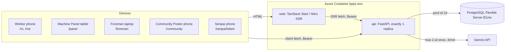
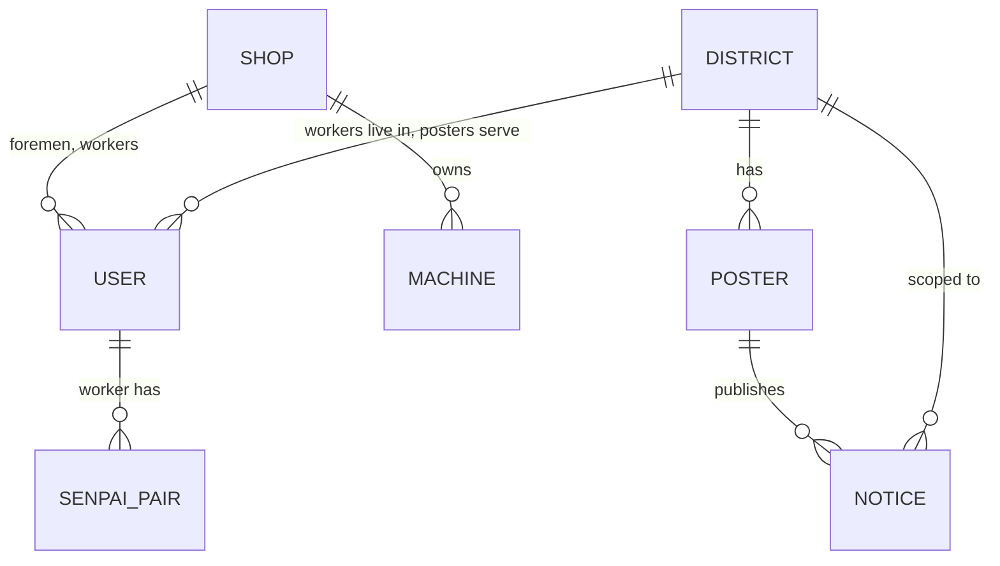
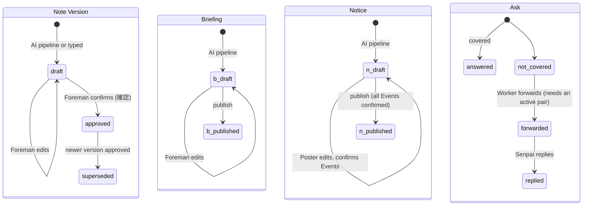

# Backend Architecture — Wakatta?

**Owner** Asif (`MdAsif-Hossain`) · **Status** v2, proposed for team review · **Updated** 2026-11-22

How the backend and database work for every feature in the [plan](superpowers/plans/2026-11-22-wakatta.md), for **many shops and many users at once**. Terms in **bold** are from [GLOSSARY.md](../GLOSSARY.md). Decisions that are hard to undo are ADRs in [adr/](adr/): 0005–0008 (v1) and 0009–0011 (v2). Where this file and the plan disagree, this file wins for the backend.

v2 replaces v1 completely. What changed and why is in §0; nothing has been migrated yet, so the first migration is written from this file.

Contents: 0 Decisions · 1 Shape · 2 Scopes and tenancy · 3 Identity and access · 4 Code layout · 5 Stack · 6 Data model · 7 Domain rules · 8 Transactions and concurrency · 9 API · 10 AI subsystem · 11 Media · 12 Security · 13 Observability · 14 Testing · 15 Deployment · 16 Build order · 17 Frontend contract changes · 18 Risks and open items

---

## 0. Decisions (v2)

Decided with a four-voice review (architect, skeptic, pragmatist, critic), each voice given the same brief without this conversation.

| # | Decision | Rejected | Why |
| :--- | :--- | :--- | :--- |
| D1 | **Two scopes in one database.** Work data belongs to a **shop** (`shop_id`); Life data belongs to a **district** (`district_id`), because a 自治会 or city serves Workers of several employers. Isolation is enforced in one repository layer and by composite foreign keys. [ADR 0009](adr/0009-shop-and-district-scopes.md) | Row Level Security; schema per tenant | RLS on a pooled sync session needs `SET LOCAL` in every transaction and `FORCE ROW LEVEL SECURITY`; a mistake leaks silently. One tested filter plus database-level FKs gives the same guarantee we can prove in a test. |
| D2 | **Every person has their own account.** Name + PIN → opaque Bearer session. The Worker id always comes from the token, never from the request body. Machine Panels get a device token; Senpai links are hashed, expiring and revocable. [ADR 0010](adr/0010-personal-accounts-and-pins.md) | Shared role PINs (v1); email + password; JWT | Unauthenticated Workers could forge a **Sign-off**, the safety record the product sells. A shared Foreman PIN cannot say who approved a Note Version. Names + PINs keep the shop-floor flow fast for low-literacy users. |
| D3 | **AI calls stay inline**, behind a global limit (2 at once, 4 per minute) and a daily budget counted in Postgres. Over the limit, the fallback ladder answers at once. No database session is held during an AI call. One API replica. | Job table + worker + polling | The frontend already expects `POST …/notes` to return the draft. A queue adds no quota (the real limit is about 20 calls a day); it only queues failures. |
| D4 | **The wire format follows the built frontend:** camelCase JSON, ids as strings, cursor-paged lists. [ADR 0011](adr/0011-camelcase-string-ids-cursor-lists.md) | snake_case + page numbers (API_SPEC template) | The frontend's types and screens already use camelCase and string ids; changing one Pydantic setting costs nothing, rewriting the frontend costs a day. Cursors stay fast as feeds grow. |
| D5 | **Gaps from the founder board** ([board.md](../contributors/asif/founder/board.md)): Panel Override with a name and reason (§7.1); safety vs wording change so re-approval doesn't force everyone to re-check (§7.1); per-shop languages beyond Bengali and English (§6.1); effort metrics (§9.3) and a measured AI eval and cost model (§10.6); performance budgets with a load test (§8.5) | a hard lock with no override; one language set for every shop | A lock that can stop production gets switched off by the first busy shift; a lock that can be overridden by a named Foreman keeps its record. Factories employ workers from many countries (figures: [research.md](../contributors/asif/founder/research.md)), so Bengali and English only would shrink the market. Judges trust measured numbers over claims. |

---

## 1. Shape of the system



- One API process, one database, one AI provider. No queue, no Redis, no object storage: all state is in Postgres, so a restart loses nothing except in-memory rate-limit buckets.
- Synchronous `def` endpoints on a sync SQLModel session ([ADR 0007](adr/0007-sync-fastapi-sqlmodel.md)). FastAPI runs them in AnyIO's thread pool (40 threads), so a slow AI call blocks its own thread, not the server.
- Real-time screens poll: Machine Panel every 2 s, Foreman board every 5 s. Both are single indexed reads (§6.6).
- How it grows past one replica is in §15.3; nothing in this design blocks it.

---

## 2. Scopes and tenancy



| Scope | Owns | Who belongs |
| :--- | :--- | :--- |
| **Shop** (one factory) | Machines, Note Versions, Glossary, Checks, Confusions, Sign-offs, Shift Assignments, Briefings, Near-miss Reports, Senpai pairs, Meet-ups, Asks, Support Log | Foremen and Workers (`users.shop_id`) |
| **District** (one 自治会 / city area) | Posters, Notices, Events | Community Posters (`users.district_id`); Workers *read* it through `users.district_id` |

Rules:
1. Every shop-owned table has `shop_id not null`; every district-owned table has `district_id not null`.
2. Every shop-owned table has `unique (shop_id, id)`, and every reference between shop tables is a **composite foreign key** `(shop_id, x_id) references x (shop_id, id)`. The database itself refuses a Sign-off whose Machine belongs to another shop. Same pattern for districts.
3. Rows that cross scopes (a Worker's Check of a Notice, an Ask grounded in Notices) belong to the **Worker's shop**; their link to the district row is checked in the service against `worker.district_id`.
4. The scope always comes from the session (§3), never from the URL or body. A URL id from another scope returns **404**, not 403, so ids cannot be probed.
5. Shops and districts are created by a CLI (`python -m app.cli create-shop|create-district|create-user`), not an API. Self-service onboarding is out of scope.

---

## 3. Identity and access

### 3.1 Principals

| Principal | Signs in with | Session | Scope |
| :--- | :--- | :--- | :--- |
| Foreman | shop code → pick name → 6-digit PIN | 12 h | their shop |
| Worker | shop code (on every QR sticker) → pick name → 4-digit PIN, once per phone | 30 days, sliding | their shop; reads their district |
| Community Poster | district code → pick name → 6-digit PIN | 12 h | their district, their Poster organisation |
| Machine Panel | a Foreman taps "Use this device as the Panel" | 180 days, revocable | one Machine, read-only |
| Senpai | the link `/senpai/{token}` (128-bit, stored as SHA-256) | until the pair is revoked or 180 days | one Senpai pair |

- The name list comes from `GET /api/auth/roster?code=…&role=…`: display names and ids only, rate-limited. The shop code is 8 random characters printed on the QR stickers inside the factory, so the roster is visible only to people standing in the shop.
- A Worker phone keeps its session, so the next QR scan opens the Machine at once. "Not me" on the Worker screen logs out (shared phones).
- Sessions are opaque tokens (`secrets.token_urlsafe(32)`), stored as SHA-256 in `sessions`, sent as `Authorization: Bearer` ([ADR 0005](adr/0005-bearer-session-tokens.md)). Deleting the row revokes it.

### 3.2 Access matrix

✅ own scope · 👤 own rows only · — refused (404 for another scope's id, 403 for a wrong role)

| Area | Foreman | Worker | Poster | Panel | Senpai link |
| :--- | :--- | :--- | :--- | :--- | :--- |
| Workers (create, reset PIN, deactivate) | ✅ | 👤 read self | — | — | — |
| Machines, Note Versions (record, edit, approve) | ✅ | read current version, no answers | — | — | — |
| Scan (Presence), take a Check | — | 👤 | — | — | — |
| Panel state | ✅ | — | — | its Machine | — |
| Confusions, Board, Skill Matrix, Heatmap, Library | ✅ | 👤 Skill Passport | — | — | — |
| Shift Assignments, Glossary | ✅ write | read own shifts | — | — | — |
| Briefings | ✅ write | 👤 read + Check | — | — | — |
| Near-miss Reports | ✅ read, ack | 👤 create | — | — | — |
| Notices, Events | — (Notice Check results reach the Support Log) | read own district, published only | ✅ own Poster's | — | read their Worker's district |
| Asks | — | 👤 | — | — | forwarded to them |
| Senpai pairs, Support Log | ✅ | 👤 own pair | — | — | own pair |
| Meet-ups | ✅ read | 👤 create | — | — | create |
| Photos (`/blobs/{id}`) | own shop | own uploads | own district | — | — |

### 3.3 How it is enforced

```python
@router.post("/machines/{machine_id}/scan")
def scan(machine_id: Id, me: Annotated[Principal, Depends(require(Role.WORKER))], svc: MachinesSvc) -> Envelope[None]:
    svc.scan(me, machine_id)     # me.user_id and me.shop_id come from the session row
```

- `require(*roles)` resolves the Bearer token to a frozen `Principal(user_id, role, shop_id, district_id, machine_id)`; no route reads identity anywhere else.
- Every repository method takes the `Principal` (or its scope id) as its first argument and adds `where shop_id = :shop` itself. There is no unscoped query method; `import-linter` forbids services from building queries outside `repositories/`.
- **Guard test:** a test walks `app.routes`, and for each route checks 401 without a token, 403 for every role outside its allow list, and 404 when the id belongs to the other seeded shop. A new route cannot ship without passing it.

### 3.4 Account lifecycle (Workers and Foremen)

Every Worker and every Foreman (the manager, 班長) has their own account. Nobody shares a login.

| Event | Who acts | What happens |
| :--- | :--- | :--- |
| New shop | operator, CLI | `create-shop` (also sets the shop's default district), then `create-user --role foreman` for the first Foreman |
| New Foreman | a Foreman of the shop | `POST /foremen {displayName, language, pin}` |
| New Worker | a Foreman | `POST /workers {displayName, language, pin}`. The Foreman hands over the first PIN on paper. The Worker's district defaults to the shop's. |
| First sign-in | the new user | login returns `mustChangePin: true`; every other route returns 403 `PIN_CHANGE_REQUIRED` until `PUT /auth/me/pin` is done, so the Foreman never knows a Worker's working PIN |
| Change own PIN | the user | `PUT /auth/me/pin {currentPin, newPin}`; their other sessions are revoked |
| Forgotten PIN, lost or shared phone | a Foreman | `PATCH /workers/{id} {pin}` or `PATCH /foremen/{id} {pin}`: sets a new first PIN, `mustChangePin`, revokes every session of that user, clears a lockout, writes `audit_events` |
| Locked after 5 wrong PINs | — | unlocks by itself after 15 min, or at once by a Foreman's reset |
| Leaves the company | a Foreman | `active: false`: sessions revoked, removed from the roster, history (Checks, Sign-offs) kept as the safety record |
| Last Foreman | — | the last active Foreman of a shop cannot be deactivated (409), so a shop is never locked out; the CLI `reset-pin` is the last resort |
| Community Poster | operator, CLI | `create-user --role poster --district … --poster …` (district onboarding is out of scope) |

Rules: display names are unique per shop among active users (the roster shows names). A user cannot change their own role or active flag. PIN rules: digits only, exact length per role, and not all the same digit or a straight run (`0000`, `1234`).

---

## 4. Code layout and module rules

```
backend/
  pyproject.toml, uv.lock          uv-managed, versions pinned at WS0
  Dockerfile, .dockerignore        multi-stage, non-root, python:3.12-slim pinned by digest
  docker-compose.yml               postgres 16 for dev (db) and tests (db_test)
  alembic.ini, migrations/         Alembic only (G-45)
  .env.example
  app/
    main.py                        create_app(): middleware, routers, error handlers
    config.py                      pydantic-settings, validated at startup, fail fast
    db.py                          engine (pool 5 + 5 overflow), session dependency
    api/                           envelope, errors, auth (require, Principal), pagination, ids
    routers/                       one file per area, thin: parse → service → envelope
    services/                      one file per area: rules, transactions, orchestration
    repositories/                  one file per area: every SQL query, always scoped
    domain/                        pure functions, stdlib only, no I/O
    models/                        SQLModel table classes (never returned to clients)
    schemas/                       request/response models (the contract, camelCase)
    ai/                            client.py (seam), gemini.py, fake.py, limiter.py, cache.py, pipelines
    prompts/                       <name>.v<N>.md, versioned in git (G-34)
    media.py                       upload validation, image re-encode
    cli.py                         create-shop, create-district, create-user, reset-pin
    seed.py                        demo data, `python -m app.seed --reset`
  tests/
    domain/  repositories/  api/  ai/
```

Areas (router + service + repository each): `auth`, `users`, `machines` (incl. Presence and Panel), `notes`, `checks`, `board`, `shifts`, `skills` (Matrix, Passport, Heatmap), `glossary`, `briefings`, `receipts`, `near_misses`, `library`, `notices`, `events`, `asks`, `senpai`, `meetups`, `support_log`, `blobs`, `demo`.

**Import rules (G-12), enforced by `import-linter` in CI:**

| Layer | May import | Never imports |
| :--- | :--- | :--- |
| `routers` | `services`, `schemas`, `api` | `repositories`, `models`, `db`, `ai` |
| `services` | `repositories`, `schemas`, `domain`, `ai`, `media` | `routers`, `sqlalchemy` / `sqlmodel` query builders |
| `repositories` | `models`, `db` | `services`, `routers`, `ai` |
| `ai` | `domain` (validators), `prompts`, `schemas` | `routers`, `services`, `repositories`, `models` |
| `domain` | stdlib, `dateutil` | anything in `app` outside `domain` |

Why: the rules the demo depends on (Sign-off validity, Lock, grading, Glossary lock, recurrence, Ask grounding) are pure functions in `domain/` with most of the tests; scoping lives in exactly one layer (`repositories/`), so tenant isolation is reviewed in one place; response models are separate from table models, so `correctIndex` reaching a Worker is a type error, not a review miss.

---

## 5. Stack

| Concern | Choice | Why |
| :--- | :--- | :--- |
| Runtime | Python 3.12, FastAPI, Uvicorn | ADR 0002 |
| ORM | SQLModel (SQLAlchemy 2) sync sessions, psycopg 3 | ADR 0007 |
| Migrations | Alembic, autogenerate reviewed by hand | G-45 |
| Settings | pydantic-settings | fail fast on missing env |
| PIN hashing | **argon2id** via `argon2-cffi`, with a server-side pepper (HMAC-SHA256 of the PIN with `PIN_PEPPER` before hashing) | Engineering manual requires Argon2id or bcrypt; the standard library has no Argon2. **New dependency, needs team OK**; fallback is stdlib `hashlib.scrypt`. The pepper matters more than the hash: a 4–6 digit PIN space is small, so a leaked table without the pepper is useless. |
| AI | `google-genai` SDK, structured output with Pydantic schemas | ADR 0001 |
| Recurrence | `python-dateutil` (`rrulestr`) | RRULE parsing and expansion |
| Calendar export | `icalendar` | correct escaping and folding for `.ics` |
| Images | Pillow | re-encode uploads, strip EXIF (GPS) |
| Multipart | `python-multipart` | FastAPI uploads |
| Tooling | uv, ruff (`E,F,I,B,UP,S,ASYNC,T20,ERA`), pyright strict, import-linter, pytest, pytest-cov, httpx, Hypothesis | G-11, G-12 |

Exact versions are pinned in `uv.lock` at WS0 after checking each package's current release; this file does not guess them.

---

## 6. Data model

Conventions:
- Primary keys `bigint generated always as identity`; serialised as **strings** in JSON (ADR 0011). Internal, sequential, small indexes; enumeration is harmless because every lookup is scoped (§2 rule 4).
- `text` + `CHECK` instead of Postgres enums (cheaper migrations). `timestamptz` everywhere in UTC; dates shown in the shop's `timezone` (`Asia/Tokyo`).
- Translated text is `jsonb` `{ja, <each shop language>}` (the shop's `languages`, §6.1), validated by Pydantic before it is written. With the demo shop's languages (`bn`, `en`) it is exactly the frontend's `Tri`; a shop with Vietnamese workers adds `vi` with no schema change. Question sets are `jsonb` on their owner row (they are written once with the draft and frozen on approval), each question carrying a stable `id` (`q1`…) and an optional `termId`.
- Every foreign key column has an index (a composite FK is covered by an index that starts with `shop_id`). Lowercase snake_case names.
- Actor columns (`created_by`, `approved_by`, `acknowledged_by`) reference `users`, so every safety-relevant action has a person.

### 6.1 Scopes and identity

| Table | Columns (constraints) | Indexes |
| :--- | :--- | :--- |
| `shops` | id, code text not null unique check `^[A-Z0-9]{8}$`, name text not null, timezone text not null default `'Asia/Tokyo'`, default_district_id fk districts not null, languages text[] not null default `'{bn,en}'` check (languages <@ `'{bn,en,vi,id,ne,my,tl,zh}'` and cardinality between 1 and 4), created_at | |
| `districts` | id, code text not null unique (same check), name text not null, prefecture text not null, municipality text not null, created_at | |
| `posters` | id, district_id fk, name text not null, kind text check in (`jichikai`,`city`,`employer`); unique (district_id, id) | district_id |
| `users` | id, role text not null check in (`foreman`,`worker`,`poster`), display_name text not null check (length 1–40), language text not null check in (`ja`,`bn`,`en`,`vi`,`id`,`ne`,`my`,`tl`,`zh`) (service: `ja` or one of the shop's languages), shop_id null fk, district_id null fk, poster_id null, pin_hash text not null, pin_must_change bool not null default true, pin_failed_count smallint not null default 0, pin_locked_until timestamptz null, active bool not null default true, created_at; **check**: foreman → shop_id not null; worker → shop_id and district_id not null; poster → district_id and poster_id not null, shop_id null; unique (shop_id, id); unique (district_id, id); fk (district_id, poster_id) → posters | unique (shop_id, display_name) where active and shop_id is not null; unique (district_id, display_name) where active and role = 'poster'; district_id |
| `sessions` | token_hash bytea pk, kind text check in (`user`,`panel`), user_id null fk, machine_id null, shop_id null, created_at, expires_at not null, last_seen_at, revoked_at null; check (kind = 'user') = (user_id is not null); check (kind = 'panel') = (machine_id is not null and shop_id is not null) | user_id; expires_at |
| `audit_events` | id, shop_id null, district_id null, actor_user_id null fk, action text not null (`login`, `login_failed`, `pin_reset`, `note_approved`, `pair_created`, `pair_revoked`, `panel_token_issued`, `demo_reset`), subject_id bigint null, at timestamptz not null default now() | (shop_id, at desc); (district_id, at desc) |

`audit_events` is insert-only: the app role gets `insert, select`, never `update` or `delete`.

### 6.2 Work (shop scope)

| Table | Columns (constraints) | Indexes |
| :--- | :--- | :--- |
| `machines` | id, shop_id fk, code text not null check `^[a-z0-9-]{1,32}$`, name jsonb Tri not null, current_version_id null, recheck_version_no int null (the newest approved **safety change**, §7.1), present_worker_id null, present_at null, created_at; unique (shop_id, code); unique (shop_id, id); fk (shop_id, current_version_id) → note_versions **deferrable initially deferred**; fk (shop_id, present_worker_id) → users | |
| `glossary_terms` | id, shop_id fk, ja text not null, reading text not null, translations jsonb not null (one non-empty entry per shop language), note text null; unique (shop_id, ja); unique (shop_id, id) | |
| `note_versions` | id, shop_id, machine_id, version_no int not null, status text check in (`draft`,`approved`), needs_edit bool not null default false, recorded_by fk users, approved_by null fk users, source_kind text check in (`voice`,`text`), audio_sha256 bytea null, transcript_ja text not null, steps jsonb not null (1–12 `{text: Tri, icon}`), back_translation jsonb not null `{bn, en}`, questions jsonb not null (2–3), change_kind text null check in (`safety`,`wording`) (set on approval; the first version of a Machine is always `safety`), edit_count int not null default 0, ai_outcome text not null check in (`ok`,`retried`,`fallback_seed`,`degraded`,`typed`), idempotency_key uuid not null, created_at, approved_at null; unique (shop_id, machine_id, version_no); unique (shop_id, idempotency_key); unique (shop_id, id); fk (shop_id, machine_id) → machines; check (status = 'approved') = (approved_at is not null and approved_by is not null) | (shop_id, machine_id, version_no desc) |
| `checks` | id, shop_id, worker_id, note_version_id null, briefing_id null, notice_id null, language text check, answers smallint[] not null, passed bool not null, idempotency_key uuid not null, created_at; check num_nonnulls(note_version_id, briefing_id, notice_id) = 1; unique (shop_id, worker_id, idempotency_key); composite fks to users, note_versions, briefings; fk notice_id → notices | (shop_id, worker_id, created_at desc); note_version_id; briefing_id; notice_id |
| `confusions` | id, shop_id, check_id, worker_id, machine_id, question_id text not null, term_id null, created_at, acknowledged_at null, acknowledged_by null fk users; composite fks to checks, users, machines, glossary_terms | partial (shop_id, created_at desc) where acknowledged_at is null; (shop_id, term_id); (shop_id, machine_id) |
| `sign_offs` | id, shop_id, worker_id, machine_id, note_version_id, check_id not null, passed_at not null; unique (check_id); composite fks to users, machines, note_versions, checks | (shop_id, worker_id, machine_id, passed_at desc) |
| `shift_assignments` | id, shop_id, worker_id, machine_id, shift_date date not null, shift text check in (`day`,`night`), assigned_by fk users; unique (shop_id, machine_id, shift_date, shift); composite fks | (shop_id, shift_date); (shop_id, worker_id, shift_date) |
| `panel_overrides` | id, shop_id, machine_id, worker_id null (null = anyone), reason text not null check (length 3–200), created_by fk users, starts_at timestamptz not null default now(), ends_at timestamptz not null check (ends_at > starts_at and ends_at <= starts_at + interval '8 hours'), revoked_at null; composite fks | (shop_id, machine_id, ends_at desc) |
| `briefings` | id, shop_id, status text check in (`draft`,`published`), recorded_by fk users, transcript_ja text not null, text jsonb Tri not null, question jsonb not null, needs_edit bool not null default false, idempotency_key uuid not null, created_at, published_at null; unique (shop_id, idempotency_key); unique (shop_id, id); check (status = 'published') = (published_at is not null) | partial (shop_id, published_at desc) where status = 'published' |
| `receipts` | id, shop_id, worker_id, briefing_id null, notice_id null, opened_at not null, passed bool null; check num_nonnulls(briefing_id, notice_id) = 1; composite fks to users, briefings; fk notice_id → notices | unique (worker_id, briefing_id) where briefing_id is not null; unique (worker_id, notice_id) where notice_id is not null; briefing_id; notice_id |
| `near_miss_reports` | id, shop_id, worker_id, machine_id, source_kind text check in (`voice`,`text`), text_src text not null, text jsonb Tri not null, photo_blob_id null fk blobs, idempotency_key uuid not null, created_at, acknowledged_at null, acknowledged_by null; unique (shop_id, idempotency_key); composite fks | partial (shop_id, created_at desc) where acknowledged_at is null; (shop_id, machine_id) |

### 6.3 Life (district scope, plus shop-owned links)

| Table | Columns (constraints) | Indexes |
| :--- | :--- | :--- |
| `notices` | id, district_id, poster_id, created_by fk users, category text check in (`garbage`,`disaster`,`event`,`duty`,`other`), source_kind text check in (`text`,`voice`,`photo`), source_ja text not null, source_blob_id null fk blobs, title jsonb Tri, steps jsonb not null (1–8 Tri), question jsonb not null, status text check in (`draft`,`published`), needs_edit bool not null default false, idempotency_key uuid not null, created_at, published_at null; unique (district_id, idempotency_key); unique (district_id, id); fk (district_id, poster_id) → posters; check (status = 'published') = (published_at is not null) | partial (district_id, published_at desc) where status = 'published'; (district_id, poster_id, created_at desc) |
| `events` | id, district_id, notice_id, title jsonb Tri, starts_at timestamptz not null, ends_at null, rrule text null check (length ≤ 200), confirmed bool not null default false; fk (district_id, notice_id) → notices on delete cascade | (district_id, notice_id) |
| `senpai_pairs` | id, shop_id, worker_id, senpai_name text not null, kind text check in (`coworker`,`jichikai`), token_hash bytea not null unique, created_by fk users, created_at, expires_at not null, revoked_at null; composite fk to users | unique (shop_id, worker_id) where revoked_at is null |
| `asks` | id, shop_id, worker_id, source_kind text check in (`text`,`voice`), text_src text not null check (length ≤ 1000), text_ja text null (the question in Japanese, filled when forwarded, so a Senpai who reads only Japanese can answer), language text check, covered bool not null, answer jsonb null, source_notice_ids bigint[] not null default '{}', pair_id null, forwarded_at null, senpai_reply_ja text null, senpai_reply jsonb null, replied_at null, idempotency_key uuid not null, created_at; unique (shop_id, idempotency_key); composite fks to users, senpai_pairs; check covered = (answer is not null and cardinality(source_notice_ids) > 0) | (shop_id, worker_id, created_at desc); partial (pair_id) where forwarded_at is not null and replied_at is null |
| `meetups` | id, shop_id, pair_id, kind text check in (`coffee`,`event`,`drill`,`other`), happened_on date not null, note text check (length ≤ 500), logged_by text check in (`worker`,`senpai`), created_at; composite fk to senpai_pairs | (shop_id, pair_id, happened_on desc) |

### 6.4 Platform

| Table | Columns | Why |
| :--- | :--- | :--- |
| `blobs` | id, shop_id null, district_id null, created_by fk users, mime text, size_bytes int check ≤ 2 MB, sha256 bytea, bytes bytea, created_at; check num_nonnulls(shop_id, district_id) = 1 | Photos in their own table so list queries never drag bytes; access is checked against the blob's scope |
| `ai_cache` | key text pk, scope text not null (`shop:<id>` or `district:<id>`), pipeline text, prompt_version int, model text, response jsonb, created_at | Replay and quota protection (§10). The scope is part of the key, so one shop never receives another's cached output |
| `ai_usage` | day date, model text, calls int not null default 0; pk (day, model) | The daily budget survives restarts. `day` is the Pacific-time date, because the free-tier quota resets at midnight Pacific (14:00 Bangladesh, 17:00 Tokyo) |
| `login_limits` | key text pk (`ip:<addr>` or `user:<id>`), window_start timestamptz, attempts int | PIN lockouts survive restarts and are shared if the API ever scales out |

### 6.5 Derived, never stored
- **Current Note Version** is `machines.current_version_id`, set in the approval transaction (§8.1). **Superseded** = approved and not current.
- **Sign-off status** (valid / expiring / expired / none) is computed (§7.1). Approving a new version updates no Sign-off rows: a **safety change** raises `machines.recheck_version_no`, and older Sign-offs stop counting; a **wording change** leaves them valid.
- **Panel state** is computed from Presence, Shift Assignments and Sign-offs on every poll.

### 6.6 Query patterns and their indexes

| Screen / call | Query | Index used |
| :--- | :--- | :--- |
| Panel poll (2 s, per tablet) | machine by (shop, id) → newest Sign-off for (shop, worker, machine) | machines pk; `sign_offs (shop_id, worker_id, machine_id, passed_at desc)` |
| Foreman board (5 s) | machines of shop + today's assignments + newest Sign-off per pair + open Confusions count | `shift_assignments (shop_id, shift_date)`; sign_offs index; confusions partial |
| Skill Matrix | `distinct on (worker_id, machine_id)` newest Sign-off per cell | sign_offs index |
| Heatmap | `count(*) group by term_id, machine_id` over shop's Confusions | `confusions (shop_id, term_id)` |
| Worker Life feed | published Notices of the district, newest first, cursor | notices partial index |
| Ask | ≤ 30 newest published Notices of the district | notices partial index |

No N+1: board, matrix and heatmap are one query each (CTEs), never a loop of queries per Machine.

---

## 7. Domain rules (`app/domain/`, pure, unit-tested)

### 7.1 Sign-off and Lock
```
status(newest_sign_off, recheck_version_no, now) ->
  "none"     no Sign-off
  "expired"  sign_off.version_no < recheck_version_no, or now - passed_at >= 90 days
  "expiring" valid with <= 14 days left
  "valid"    otherwise
panel_state = "override" if an active Panel Override covers this Worker (or anyone)
              else "ready" if status in {valid, expiring} else "locked"
```
A Machine with no approved Note Version is `locked` for everyone with reason `no_note`. Only the newest Sign-off per (Worker, Machine) counts.

**Safety change vs wording change** (from the founder board: re-approval friction). When the Foreman approves a new version they choose: **safety change** (new steps, new hazard, new tool: everyone must pass the new Check) or **wording change** (typo, clearer phrasing, a better translation: existing Sign-offs stay valid, and Workers see the new text next time). The default is safety change, the first version of a Machine is always one, and the choice is audited. Workers who sign off after a wording change take that version's Check as usual.

**Panel Override** (from the founder board: "a lock will stop production when we are busy"). A Foreman can let one Worker (or anyone) run a Machine without a valid Sign-off for up to 8 hours, with a reason. The Panel shows amber `override` with the Foreman's name, the board lists every active override, and each one is in `audit_events` and the Support Log. The lock never silently blocks production, and every bypass has a name on it, which also answers "what happens when someone walks past LOCK": the record shows whether a Foreman allowed it.

### 7.2 Who the Machine Panel shows (Presence)
`POST /machines/{id}/scan` by a signed-in Worker sets `present_worker_id = me`, `present_at = now()`. The Panel shows the present Worker if `present_at` is within 10 minutes, else today's Shift Assignment for the current shift (shop timezone), else `idle`. Last scan wins; that is the physical truth at a shared machine.

### 7.3 Grading
- `answers` is an array of chosen option indexes in question order. Its length must equal the number of questions and each value must be 0–2, else **422** (not a wrong answer).
- A Check passes only if every answer is correct.
- Each wrong answer on a Note Version creates one Confusion with the question's `termId` and the Machine.
- A pass on a Note Version writes a Sign-off. A Briefing or Notice Check upserts the Worker's receipt with `passed`.
- The response lists the wrong questions **without** `correctIndex`, so a retry is not a lookup.
- Grading a Note Version that is no longer current returns **409 `VERSION_CHANGED`**. This happens when the Foreman approves a new version while the Worker is mid-Check, and the Worker gets the new one.

### 7.4 Glossary lock (with Galib's review, point 4)
NFKC-normalise all text. A Glossary Term is **in scope** when its `ja` **or its `reading`** appears in `transcript_ja`; the prompt also tells the model to write Glossary Terms in their `ja` form. For every in-scope term:
- `easy_ja` keeps `ja` (a reading in brackets is allowed). やさしい日本語 keeps shop words, because the Worker must learn the floor word.
- Every shop language's text contains the term's translation for that language: substring after NFC normalisation (Bengali case endings are suffixes; Vietnamese keeps its diacritics), case-insensitive for Latin scripts (`en`, `vi`, `id`, `tl`).

Questions: 2–3 per Note Version, exactly 3 options each, `correctIndex` 0–2. Icon ids come from the fixed set (the frontend's `IconId`), at most one per step.

### 7.5 Recurrence (Events)
`rrulestr(rrule, dtstart=starts_at in shop/district timezone)`. Only `FREQ=WEEKLY` with `BYDAY` (and optional `UNTIL`/`COUNT`) is accepted, matching the frontend. Rejected when it does not parse, a one-off Event is in the past, or there is no occurrence within 366 days. Japan has no daylight saving time, so UTC storage expands exactly. A Notice publishes only when every Event is `confirmed` (409 `EVENTS_NOT_CONFIRMED`).

### 7.6 Ask grounding
`covered = true` needs a non-empty `source_notice_ids` that is a subset of the Notice ids sent to the model, all published in the Worker's district. Anything else is rewritten to `covered = false` with the fixed answer 「掲示された案内にはありません」 (and BN/EN) plus the forward-to-Senpai offer. The database check in §6.3 backs this up.

### 7.7 State charts (G-28)

AI output only ever creates `draft` rows (G-33). Published and approved rows are immutable; editing means a new version.

---

## 8. Transactions and concurrency

### 8.1 Writes that must be atomic

| Operation | Transaction |
| :--- | :--- |
| Approve a Note Version | `select … from machines where shop_id = :s and id = :m for update` → the draft must be `draft` and belong to the Machine (else 409) → set `approved`, `approved_at`, `approved_by`, `change_kind` → set `machines.current_version_id`, and for a safety change `machines.recheck_version_no` → insert `audit_events`. One transaction; the row lock serialises two Foremen approving at once. |
| Create a draft | `version_no = max + 1` is assigned under the same Machine row lock, so two drafts never collide on `unique (shop_id, machine_id, version_no)`. |
| Submit a Check | read the target → check it is current (§7.3) → insert `checks` + `confusions` + `sign_offs` or the receipt upsert. One transaction. |
| Publish a Notice | lock the Notice row → every Event confirmed and valid → set published. |
| Shift Assignment | `insert … on conflict (shop_id, machine_id, shift_date, shift) do update` (or delete when `workerId` is null). |
| Create a Senpai pair | revoke the Worker's active pair and insert the new one in one transaction (the partial unique index enforces one active pair). |

### 8.2 Idempotency (retried creates)
Every create that can be retried (Checks, Note/Briefing/Notice drafts, Asks, Near-miss Reports) takes an `Idempotency-Key` header (a UUID the frontend makes per user action). It is stored in the row under `unique (scope, idempotency_key)`. A repeat returns the existing row with 200 and does **not** call the AI again. A missing key is a 422 on these routes.

### 8.3 AI calls and the database
**No transaction or pooled connection is held across a model call.** The service reads its inputs (Machine, Glossary, Notices) in transaction 1 and closes it. It calls the pipeline (§10), then writes the result in transaction 2. So a 45-second Gemini call holds a thread, never one of the 10 database connections, and the Panel and board stay fast while Foremen record.

### 8.4 Capacity, measured against the limits we have

| Resource | Limit | Our setting |
| :--- | :--- | :--- |
| Postgres connections (B1ms) | small; check `max_connections` on our server at WS0 | pool 5 + 5 overflow, `pool_timeout` 10 s → 503 `BUSY`, `pool_pre_ping` |
| Threads | 40 (AnyIO default) | at most 2 held by AI calls (§10.3) |
| Request time | ingress 240 s | AI budget 45 s per call, 60 s per request |
| Polling load | 10 Panels × 0.5 req/s + 3 boards × 0.2 req/s ≈ 6 req/s | single indexed reads, well inside one replica |

### 8.5 Performance budgets (checked by the load test in §14)

| Path | Budget (p95, server time) | How |
| :--- | :--- | :--- |
| Panel poll | 50 ms; `304` with no body when unchanged | one indexed read; `ETag` = hash of (state, worker, version, override) |
| Foreman board | 200 ms; `304` when unchanged | one CTE query; `ETag` |
| Worker Machine page, Check submit | 150 ms | two indexed reads; one transaction |
| Lists | 150 ms for 50 items | keyset cursor, no `count(*)` |
| AI draft (note, notice, ask) | 15 s typical, 45 s hard cap, cache hit 100 ms | §10.3; the frontend shows progress |
| Any SQL statement | 5 s hard stop | `statement_timeout = 5s` on the app role; `idle_in_transaction_session_timeout = 30s` |

Also: GZip for responses over 1 KB (Starlette's `GZipMiddleware`, no new dependency); `orjson` is not added (the payloads are small). Load test target: 30 Panels + 5 boards polling and 2 AI drafts at once on the B1ms server stay inside these budgets. If not, measure first (`EXPLAIN ANALYZE`, `pg_stat_statements`) before changing anything.

---

## 9. API

### 9.1 Conventions (ADR 0011; [API_SPEC.md §1](API_SPEC.md#1-conventions) is updated to match)
- Envelope on every JSON response: `{success: true, data, message}` / `{success: false, error: {code, message, details}}`.
- **camelCase** keys (Pydantic `alias_generator=to_camel`, `populate_by_name`). **Ids are strings** on the wire; a non-numeric id is a 404.
- Unknown request fields are rejected (`extra="forbid"`), 422.
- UTC ISO 8601 timestamps; dates `YYYY-MM-DD` in the shop timezone; nullable fields always present.
- **Lists are cursor-paged:** `?limit=` (default 50, max 200) and `?cursor=`; `data` is `{items, nextCursor}` (`null` on the last page). The cursor is opaque (base64 of the last sort key and id).
- Auth: `Authorization: Bearer <token>` on every route except `/api/health*`, `/api/auth/roster`, `/api/auth/login` and the `/api/senpai/{token}` family.

### 9.2 Errors

| HTTP | `error.code` | When |
| :--- | :--- | :--- |
| 400 | `BAD_REQUEST` | parseable input the schema cannot express |
| 401 | `UNAUTHORIZED` | no, expired or revoked token; wrong PIN |
| 403 | `FORBIDDEN`, `PIN_CHANGE_REQUIRED` | wrong role; first-login PIN not yet changed (§3.4) |
| 404 | `NOT_FOUND` | unknown id, id of another shop or district, wrong Senpai token |
| 409 | `CONFLICT`, `VERSION_CHANGED`, `EVENTS_NOT_CONFIRMED`, `NO_ACTIVE_PAIR` | state does not allow the action |
| 413 | `PAYLOAD_TOO_LARGE` | upload over its limit |
| 415 | `UNSUPPORTED_MEDIA_TYPE` | magic bytes are not an allowed type |
| 422 | `VALIDATION_ERROR` | schema validation; `details` lists fields |
| 423 | `PIN_LOCKED` | account locked after failed PINs; `details.until` |
| 429 | `RATE_LIMITED` | over a rate limit; `Retry-After` set |
| 503 | `BUSY` | database pool exhausted; `Retry-After: 2` |
| 500 | `INTERNAL_ERROR` | anything else; generic message, request id in the log |

AI trouble is never a 5xx: pipelines degrade (§10.4).

### 9.3 Endpoints (paths match `frontend/src/services/wakatta.ts`)

Roles: F Foreman · W Worker · P Poster · D Panel device · S Senpai link · pub public. All under `/api`.

**Health and auth**

| Method | Path | Role | Body → `data` |
| :--- | :--- | :--- | :--- |
| GET | `/health`, `/health/ready` | pub | liveness; readiness checks the DB |
| GET | `/auth/roster?code=&role=` | pub | `[{id, displayName}]` active users of that shop or district and role; 20/min per IP |
| POST | `/auth/login` | pub | `{userId, pin}` → `{token, expiresAt, mustChangePin, user: {id, displayName, role, language, shopId, districtId}}` |
| GET | `/auth/me` | F W P | the user above |
| PUT | `/auth/me/pin` | F W P | `{currentPin, newPin}`; clears `mustChangePin`, revokes the user's other sessions |
| POST | `/auth/logout` | any | revokes the session |

**People and setup (Foreman)**

| Method | Path | Role | Body → `data` |
| :--- | :--- | :--- | :--- |
| GET | `/workers` | F | paged Workers of the shop |
| POST | `/workers` | F | `{displayName, language, pin}` → Worker |
| PATCH | `/workers/{id}` | F | `{displayName?, language?, pin?, active?}`; a PIN reset revokes that Worker's sessions (§3.4) |
| GET / POST | `/foremen` | F | Foremen of the shop; create `{displayName, language, pin}` |
| PATCH | `/foremen/{id}` | F | `{displayName?, language?, pin?, active?}`; not on yourself for `active`; never the last active Foreman |
| GET / POST | `/machines` | F (GET also W) | Machines; create `{code, name}` |
| POST | `/machines/{id}/panel-token` | F | → `{token, expiresAt}` (kind `panel`) |
| GET / POST / PATCH | `/glossary`, `/glossary/{id}` | F (GET also W) | Glossary Terms |
| GET / PUT | `/shift-assignments?date=` | F (GET also W: own) | PUT `{machineId, shift, date?, workerId \| null}` |

**Work flow**

| Method | Path | Role | Body → `data` |
| :--- | :--- | :--- | :--- |
| GET | `/machines/{id}` | F W | Machine + current Note Version; for W, questions without `correctIndex` |
| POST | `/machines/{id}/scan` | W | (no body) sets Presence for the signed-in Worker |
| GET | `/machines/{id}/panel` | D F | `{state: idle\|locked\|ready\|override, worker, reason, versionNo, override: {by, until, reason} \| null}`; sends an `ETag`, answers `304` when nothing changed |
| POST | `/machines/{id}/overrides` | F | `{workerId \| null, minutes ≤ 480, reason}` → Panel Override (§7.1) |
| DELETE | `/machines/{id}/overrides/{overrideId}` | F | ends it early |
| POST | `/machines/{id}/notes` | F | multipart `audio` or `text`, `Idempotency-Key` → draft NoteVersion |
| GET | `/machines/{id}/versions` | F | Knowledge Library, paged, newest first |
| GET / PATCH | `/note-versions/{id}` | F | read; PATCH a draft `{index, ja}` (step edit) |
| POST | `/note-versions/{id}/approve` | F | `{changeKind: safety \| wording}` (default `safety`; the first version is always `safety`) → approved NoteVersion |
| GET | `/metrics/effort` | F | for the shop: median seconds from draft to approval, median edits per draft, share of drafts the AI produced cleanly (`ok`), Checks passed first time; the evidence for "how long does a foreman spend" |
| POST | `/checks` | W | `{target: {kind, id}, language, answers[]}`, `Idempotency-Key` → `{passed, wrong: [{id, termId, prompt}], signOff \| null}` |
| GET | `/sign-offs` | F (W: own) | paged |
| GET | `/confusions?open=true` | F | paged, newest first |
| POST | `/confusions/{id}/ack` | F | acknowledges |
| GET | `/board`, `/skill-matrix`, `/heatmap` | F | one aggregate object each (§6.6) |
| GET | `/workers/{id}/passport` | F, W (self) | Skill Passport |
| POST | `/briefings/draft` | F | multipart `audio` or `text`, `Idempotency-Key` → draft Briefing |
| PATCH | `/briefings/{id}` | F | edit a draft `{text?, question?}` |
| POST | `/briefings/{id}/publish` | F | publishes |
| GET | `/briefings` | F W | published, paged |
| POST | `/receipts` | W | `{target: {kind: briefing\|notice, id}}` → marks opened (idempotent) |
| GET | `/receipts?target=` | F | who opened and passed |
| POST | `/near-misses` | W | multipart `machineId`, `text` or `audio`, optional `photo` file, `Idempotency-Key` |
| GET | `/near-misses?open=true` | F | paged |
| POST | `/near-misses/{id}/ack` | F | acknowledges |
| GET | `/blobs/{id}` | by scope | image bytes, `Content-Type` from the row, `nosniff`, `Cache-Control: private` |

**Life flow**

| Method | Path | Role | Body → `data` |
| :--- | :--- | :--- | :--- |
| GET | `/posters` | P | the Poster's organisation |
| POST | `/notices` | P | multipart `sourceKind`, `text` / `audio` / `photo`, `Idempotency-Key` → draft Notice with Events |
| PATCH | `/notices/{id}` | P | edit a draft (title, steps, category, question) |
| PATCH | `/notices/{id}/events/{eventId}` | P | `{confirmed, startsAt?, rrule?}` |
| POST | `/notices/{id}/publish` | P | 409 `EVENTS_NOT_CONFIRMED` if any Event is unconfirmed or invalid |
| GET | `/notices` | P (own), W (district, published) | paged, newest first; for W each item carries `opened` and `passed` from the Worker's receipt |
| GET | `/notices/{id}/reach` | P (own) | `{workers, opened, understood, notOpened}`: counts over all Workers of the district, across shops; counts only, never names |
| GET | `/events?from=&to=` | W | expanded occurrences of confirmed district Events in the range (max 62 days), for "today / tomorrow" |
| GET | `/workers/{id}/calendar.ics` | W (self) | **P2** (the browser builds the file today with `toIcs`; Anim's council decision 2026-11-22). When built: not enveloped, stdlib only, 75-octet line folding and a `VTIMEZONE` for Asia/Tokyo, RRULE kept |
| POST | `/asks` | W | multipart `text` or `audio`, `Idempotency-Key` → Ask |
| GET | `/asks` | W (own) | paged |
| POST | `/asks/{id}/forward` | W | 409 `NO_ACTIVE_PAIR` without a Senpai |
| GET / POST | `/senpai-pairs` | F | list; create `{workerId, senpaiName, kind}` → pair + **link token shown once** |
| DELETE | `/senpai-pairs/{id}` | F | revokes the link |
| POST | `/meetups` | W | `{kind, date, note}` (pair from the session) |
| GET | `/senpai/{token}` | S | their Worker (display name, language), forwarded Asks, district Events, Meet-ups |
| POST | `/senpai/{token}/asks/{id}/reply` | S | `{replyJa}` → translated for the Worker |
| POST | `/senpai/{token}/meetups` | S | `{kind, date, note}` |
| GET | `/support-log.csv?from=&to=` | F | not enveloped; UTF-8 BOM; one row per Worker per supported event in the range, for the shop, grouped by the official support item it evidences ([research.md §1](../contributors/asif/founder/research.md)): **item 7 相談・苦情への対応** ← forwarded Asks and Senpai replies (date, what was asked, how it was answered; the on-site consultation record, 参考様式5-4号); **item 8 日本人との交流促進** ← Meet-ups (date, kind, with whom); **生活オリエンテーション / information** ← Notices opened and understood (date, Notice, passed); plus Panel Overrides (date, Machine, Foreman, reason) for the safety record. Not covered and stated in the export: item 10 定期的な面談 (every 3 months) and the yearly report form 参考様式第3-6号, which asks for counts, not these details |

**Demo**

| Method | Path | Role | Body → `data` |
| :--- | :--- | :--- | :--- |
| POST | `/demo/reset` | F, only when `DEMO_MODE=true` | re-runs the seed for the caller's shop only; audited |

### 9.4 Contract flow ([ADR 0006](adr/0006-code-first-openapi.md))
FastAPI generates `docs/openapi.yaml` (`uv run python -m app.openapi > ../docs/openapi.yaml`). WS0 lands every route above as a typed stub, so the frontend can generate types on day one. The stub has its real request and response models and returns a 501 `NOT_IMPLEMENTED` envelope. CI regenerates the file and fails on a diff.

---

## 10. AI subsystem (`app/ai/`)

### 10.1 Seam
```python
class AiClient(Protocol):
    def generate(self, *, prompt: Prompt, parts: Sequence[Part], schema: type[T]) -> T: ...
```
`GeminiClient` (production) and `FakeAiClient` (tests and day-to-day work; fixture JSON keyed by prompt name and input hash) ([ADR 0008](adr/0008-ai-client-seam-and-fake.md)). `AI_MODE=gemini|fake`, default `fake`.

### 10.2 Pipelines

| Function | Input | Output |
| :--- | :--- | :--- |
| `build_note(source, glossary, icons)` | audio bytes or Japanese text | `NoteDraft`: transcript_ja, steps (Tri + icon), back-translation, 2–3 questions, needs_edit |
| `build_briefing(source, glossary)` | same | text Tri + 1 question |
| `build_notice(source)` | text, audio or photo | `NoticeDraft`: source_ja, category, title, steps ≤ 8, events, 1 question |
| `answer_ask(question, notices, glossary)` | text or audio, ≤ 30 newest published district Notices | `AskAnswer`: covered, answer Tri, source_notice_ids |
| `translate(text, source, target)` | Near-miss Reports, Senpai replies | text |

Each pipeline owns: cache lookup → limiter → model call → schema parse → domain validation (§7.4–7.6) → one retry with the validation error → fallback. Services never see Gemini types, prompts or retries.

### 10.3 Models and limits (XREQ-003, [AI_PLAN.md](../contributors/galib/AI_PLAN.md) §2–§4)

The models and every budget live in one table, [`app/ai/chains.py`](../backend/app/ai/chains.py); changing a model is one line there.

| Setting | Values | Meaning |
| :--- | :--- | :--- |
| `AI_MODE` | `fake` (default) / `gemini` | `fake`: no network, every AI step takes its fallback |
| `AI_CHAIN` | `dev` (default) / `demo` | `dev`: 3.5 → 3.1 Flash-Lite (prompt work, eval). `demo`: 3.8 Flash → 3.6 Flash → 3.5 → 3.1 Flash-Lite (filming, live demo) |
| `AI_TIER` | `free` (default) / `paid` | `free`: budgets just under each free quota; `paid`: the same table as a cost cap |
| `GROQ_API_KEY` | empty (default) / key | when set, the Groq backup is last in every chain: Whisper turns audio into text, then `openai/gpt-oss-120b` writes the draft |
| `AI_MAX_CONCURRENT` | 2 | process semaphore across all models |
| `AI_TIMEOUT_SECONDS` | 45 | per call |

| Limit | Value | When hit |
| :--- | :--- | :--- |
| Calls per day, per model | `chains.BUDGETS[tier][model][0]` (free: 18 for the Flash models, 450 for the Flash-Lites, 40 for Groq) in `ai_usage`, taken in its own short transaction before the call | that model is skipped, no call |
| Calls per minute, per model | `chains.BUDGETS[tier][model][1]` (free: 4, 12, 1), in-memory limiter per model | that model is skipped |
| Per user | 10 AI requests per minute per user | 429 |

- **A busy or failing model is skipped at once** (5xx such as 503 "high demand", a per-minute 429, a timeout): the next model of the chain answers. **A daily-quota 429 is never retried**: the model is marked exhausted in `ai_usage` and skipped for the rest of the day (resets at midnight Pacific, 14:00 Bangladesh time).
- The only retry is the **validation retry** (§10.4 step 3), on the model that answered, and it spends that model's budget.
- The limiter is in memory, which is correct only because the API runs exactly one replica (§15). The daily budget is in Postgres, so a restart cannot reset it.
- Free-tier numbers are Galib's, read from AI Studio on 2026-11-22; recheck on the day.

### 10.4 Fallback ladder (G-32)
1. Cache hit (`ai_cache`), looked up under **every model of the chain, best first**, so a filmed 3.8 Flash take is reused even when 3.8 Flash is out of quota. Key = `sha256(scope + pipeline + prompt version + model + input bytes + glossary hash)`, so a Glossary edit (or a new prompt version) misses the cache.
2. Live call to each model of the chain in order (§10.3), validated; a model that is out of budget, busy or failing is skipped.
3. One retry with the validation error, on the model that answered (only while within its budget); if that also fails, the next model.
4. Seeded result for the demo Machines and the demo flyer (put in `ai_cache` by `seed.py` from `tests/fixtures/ai/`).
5. Degraded result, 200, never a 500:
   - **Notes, Briefings, Notices:** a `needs_edit` draft holding whatever was usable (at least the transcript or typed text). The Foreman or Poster can edit it.
   - **Asks:** `covered = false` with the forward-to-Senpai offer.
   - **Translations:** the Japanese original, with a "not translated" flag.

### 10.5 Calls and inputs
- Structured output: `response_mime_type="application/json"` with a **simple** schema (objects, lists, strings, ints, enums; no unions, Galib point 5). Our Pydantic models parse it again (G-36).
- Audio and photos go inline (`Part.from_bytes`). Safari records `audio/mp4`: we send it to Gemini as `audio/m4a` (Galib point 1).
- **Untrusted text:** flyer text, Notice text, Ask text and Near-miss text are data. Every prompt puts them in a delimited block, and the prompt says that text inside the block is never an instruction (Galib point 6). Output is validated, so injected text can only produce a draft that a person still approves.
- Prompts are `app/prompts/<name>.v<N>.md`. Changing a prompt bumps `N` (which changes the cache key) and updates its fixture test (G-34).
- Pipelines translate into the shop's `languages` (§6.1); each extra language adds output tokens, so the cost model below counts languages.

### 10.6 Measured quality and cost (from the founder board: "nobody has measured the error rate")
- **Eval set:** `tests/fixtures/ai/eval/` holds about 20 cases: typed and recorded Foreman notes covering every seeded Glossary Term (玉掛け, 段取り, 寸法…), plus 4 flyers and 6 Asks (2 not covered by any Notice).
- **Runner:** `python -m app.ai.eval --model <name>` runs each case once against the live model, within the daily budget, and writes `docs/ai-eval.md`. It reports, per prompt version and model:
  - schema-valid rate
  - Glossary-lock pass rate per term
  - question validity
  - for Asks, grounding precision (a not-covered Ask must return `covered=false`)
  - median latency
- **Use:** that file is the number we show judges instead of claiming accuracy. Galib owns it in WS1, and it is re-run after every prompt change.
- **Cost model:** `docs/ai-eval.md` also records the median input and output tokens per pipeline. Monthly AI cost per factory = Σ pipelines (calls per month × tokens × the model's paid price per token). The prices and the audio token rate come from Google's pricing page ([research.md §5](../contributors/asif/founder/research.md)), never from memory. As read on 2026-11-22: `gemini-3.8-flash` $0.75 input / $3.75 output per 1M tokens (doubling on 2027-01-01), `gemini-3.5-flash-lite` $0.30 / $2.50, audio 32 tokens per second. Worked example, to be replaced by measured tokens: one 20-second note ≈ 640 audio + about 2,000 prompt tokens in and about 1,500 out ≈ $0.008 on 3.8 Flash, so even 200 notes, notices and asks a month is under $2 per factory at today's price.

---

## 11. Media

| Upload | Allowed (magic bytes, not the header) | Max | Processing |
| :--- | :--- | :--- | :--- |
| Audio (notes, briefings, notices, asks, near-miss) | webm/opus, ogg/opus, mp4/m4a | 8 MB (≈ 60 s) | hashed for the cache and idempotency, **never stored** |
| Flyer photo | jpeg, png, webp (heic → 415 with "use JPEG") | 5 MB in | Pillow: auto-rotate, max 2048 px, re-encode JPEG, EXIF and GPS removed, ≤ 2 MB stored |
| Near-miss photo | jpeg, png, webp | 5 MB in | same |

A 10 MB body limit applies before multipart parsing. Pillow's decompression-bomb guard stays on (`Image.MAX_IMAGE_PIXELS`).

---

## 12. Security

| Area | Rule |
| :--- | :--- |
| PINs | 4 digits for Workers, 6 for Foremen and Posters. Stored as argon2id of HMAC-SHA256(`PIN_PEPPER`, pin). 5 wrong PINs lock the account for 15 min (`423 PIN_LOCKED`, stored in `users`). 10 attempts per minute per IP (`login_limits`). Seed and demo PINs are not reused in production. |
| Sessions | opaque 256-bit tokens, SHA-256 at rest, expiry by kind (§3.1), sliding refresh for Workers at most once an hour, revoked on logout and PIN reset. |
| Isolation | scope from the session only; repository layer adds the scope; composite FKs; cross-scope ids are 404; the guard test (§3.3) and a two-shop isolation test suite (§14). |
| Answer leak | Worker response models have no `correctIndex`; a test asserts that the field is absent in every Worker-facing schema. |
| Senpai links | 128-bit, hashed, expiring, revocable, one active per Worker; `Referrer-Policy: no-referrer`; a wrong token is 404. |
| CORS | only `FRONTEND_ORIGIN`; methods `GET, POST, PUT, PATCH, DELETE`; headers `Authorization, Content-Type, Idempotency-Key`; no credentials. |
| Headers | `X-Content-Type-Options: nosniff`, `Referrer-Policy: no-referrer`, `Cache-Control: no-store` on authenticated JSON. |
| Database role | the app connects as `wakatta_app`. It has DML on the app tables, no DDL, and only `insert, select` on `audit_events`. Migrations run as `wakatta_owner`. The `public` schema is revoked from `PUBLIC`. |
| Secrets | env only (`DATABASE_URL`, `MIGRATION_DATABASE_URL`, `PIN_PEPPER`, `GEMINI_API_KEY`); `.env.example` lists every variable with a dummy value; gitleaks in CI (G-37). |
| Personal data (APPI) | names, language, Check results, Asks. Audio is never stored. Photos have EXIF removed. No PII, Ask text, prompts or answers in logs. Deactivating a Worker keeps their Sign-off history (safety record) but ends their sessions. **Retention:** support records (Asks forwarded, Senpai replies, Meet-ups, Notice receipts) must be kept at least 1 year after the Worker's 特定技能 employment contract ends (特定技能基準省令 第2条第2項第3号, [research.md §1.2](../contributors/asif/founder/research.md)), so nothing tied to a Worker is deleted before that; a deletion job after that is post-hackathon. |
| AI input | untrusted text is delimited as data (§10.5); AI output is validated and only creates drafts. |

---

## 13. Observability

- JSON logs to stdout: one line per request (method, route template, status, latency, request id, user id, role, shop id). `X-Request-ID` is generated if absent and returned.
- One line per AI call: pipeline, prompt version, model, latency, cache hit, outcome (`ok`, `retried`, `fallback_seed`, `degraded`, `budget_exhausted`), daily calls used. No prompt, answer or user text.
- Login events go to `audit_events` (success and failure, never the PIN).
- `GET /api/health` liveness (no DB); `GET /api/health/ready` runs `select 1` (readiness probe).
- Exceptions are logged once with the request id and re-raised to the handler; nothing is swallowed.

---

## 14. Testing

| Suite | What | How |
| :--- | :--- | :--- |
| `tests/domain` | §7: validity windows (89/90/91 days, the 14-day edge), new version invalidates, grading (length, range, all-correct), Glossary lock (passing, missing term, Bengali suffix, term found only by `reading`), RRULE (Mon/Thu weekly, invalid, past), Ask grounding | plain pytest; Hypothesis for grading and validity |
| `tests/repositories` | **isolation**: with two seeded shops and two districts, every repository read and write with shop A's principal never returns or touches shop B's rows; composite FKs reject cross-shop references | real Postgres |
| `tests/api` | every route: success, 422, the 401/403/404 guard matrix (§3.3), idempotent repeat returns the same row; Review focus 1–8 from the plan as named tests; `VERSION_CHANGED` race; approval by two Foremen at once | real Postgres (`db_test` locally, service container in CI), each test in a rolled-back transaction, `FakeAiClient` |
| `tests/ai` | each pipeline: valid; invalid then fixed; invalid twice → degraded; timeout → seed; cache hit skips the client; daily budget exhausted → no call; daily-quota 429 → no retry | `FakeAiClient` scripted per test |
| contract | `docs/openapi.yaml` equals the generated schema; no Worker schema has `correctIndex` | CI |
| `tests/domain` additions | wording change keeps Sign-offs valid, safety change expires them; an active Override turns the Panel `override` and ends on time; Glossary lock for a `vi` shop | plain pytest |
| `tests/load/poll.py` | §8.5 budgets: 30 Panels + 5 boards polling, 2 AI drafts (fake AI with a 10 s delay); prints p50/p95 per path | `httpx` (already a test dependency) with threads; run against the Azure server before demo day |
| `app.ai.eval` | §10.6 quality numbers | live model, manual run, not in CI |

Coverage target 80% on `domain`, `services`, `repositories`, `ai` (G-22). CI `backend-ci.yml`: ruff → pyright → import-linter → pytest + coverage → openapi diff → gitleaks.

---

## 15. Deployment (Azure for Students)

### 15.1 Resources

| Piece | Setting | Cost |
| :--- | :--- | :--- |
| Resource group | Japan East if the student subscription's region policy allows it, else the nearest allowed region | — |
| PostgreSQL Flexible Server | Burstable B1ms, 32 GB, SSL required, database `wakatta`, roles `wakatta_owner` and `wakatta_app` | free 12 months (750 h/month) under Azure for Students |
| Container Apps environment | Consumption plan | free monthly grant (180,000 vCPU-s, 360,000 GiB-s) |
| `api` app | external ingress, port 8000, 0.5 vCPU / 1 GiB, **min 1 max 1** from Nov 24 to Nov 26 (no cold start on stage), min 0 while developing | an always-on replica exceeds the grant: a few dollars for the demo week from the $100 credit; check in the pricing calculator |
| `web` app | Minhaz's Nitro build, same environment | same |
| Images | GitHub Actions → GHCR (public repo) | free |
| Secrets | Container App secrets mapped to env | — |
| Migrations | the `wakatta-migrate` Container Apps Job runs `alembic upgrade head` as `wakatta_owner` before each rollout (`backend/deploy/azure-deploy.ps1`); the API container only serves, as `wakatta_app`, and never holds the owner credential. | — |
| Seed | `python -m app.seed --reset` via `az containerapp exec`, again before filming | — |

### 15.2 Demo-day checklist
- `AI_MODE=gemini`, `AI_CHAIN=demo` (`AI_TIER=paid` once billing is on), `GEMINI_API_KEY` and `GROQ_API_KEY` set as secrets, `ai_cache` holds every filmed take, `ai_usage` checked that morning (the quota resets at 14:00 Bangladesh time).
- min = max = 1 replica; `/api/health/ready` green; seed reset; Panel token issued on the tablet.

### 15.3 Scaling past one replica (not needed for the hackathon)
Move the in-memory AI limiter and per-IP buckets to Postgres. Run migrations as a Job. Then raise `max replicas`. Sessions, idempotency, budgets and lockouts are already in Postgres, so nothing else changes. If AI volume grows beyond inline calls, add a `jobs` table claimed with `for update skip locked`; the pipelines do not change.

---

## 16. Build order (each step has its check)

WS0 (Asif) lands on `asif/ws0-foundation` and merges to `main` before other backend work starts. Target: Nov 23 02:00 Bangladesh time.

| # | Step | Verified by |
| :--- | :--- | :--- |
| 1 | Skeleton: config (fail fast), envelope, error handlers, request id, CORS, `/api/health`, `/api/health/ready` | `curl` both; test for an unknown env var at startup |
| 2 | First migration: **all** tables of §6, roles and grants | `alembic upgrade head` then `downgrade base` on a fresh DB; composite-FK test rejects a cross-shop row |
| 3 | Auth and accounts (§3.4): roster, login, lockout, first-login PIN change, sessions, `require()`, `Principal`, Workers and Foremen create/reset/deactivate | tests for login, lockout, `PIN_CHANGE_REQUIRED`, reset revokes sessions, last-Foreman 409; guard test on a sample route |
| 4 | Repository base with scope + every route as a typed stub; generated `docs/openapi.yaml` | guard test over all routes; openapi diff in CI |
| 5 | AI seam: `FakeAiClient`, fixtures, limiter, budget; Gemini adapter behind `AI_MODE` | `tests/ai` green |
| 6 | Seed: 2 shops, 1 shared district, the plan's story in shop A, a small shop B for isolation | `python -m app.seed --reset` twice (idempotent); isolation suite green |
| 7 | `docker-compose.yml`, `.env.example`, `backend-ci.yml`, README run steps | CI green on the PR |
| 8 | Hello-world `api` on Azure | public `/api/health/ready` returns ok |

Then in parallel (owners from the plan): WS1 AI pipelines (Galib) · WS2 Notes, Checks, Sign-offs, Lock (Asif) · Life (Anim) · frontend wiring (Minhaz).

Rules after WS0:
- Each workstream edits only its own `routers/`, `services/`, `repositories/`, `schemas/` and `tests/` files for its area.
- **Schema changes go through Asif** (one Alembic head at a time).
- `docs/openapi.yaml` is never hand-edited.
- `seed.py` and `domain/` changes are small, reviewed PRs.

---

## 17. Frontend contract changes

Tracked as `XREQ-001` in [AGENTS.md](../AGENTS.md#2-active-cross-functional-request-queue-xreq) for Minhaz:

| # | Frontend today | Backend contract |
| :--- | :--- | :--- |
| 1 | `credentials: 'include'`, PIN unlock stored as `'1'` | Bearer token from `POST /auth/login`, sent as `Authorization: Bearer`; the stored flag is only a UI hint |
| 2 | `verifyPin(role, pin)` → `{ok}` | roster → pick name → `POST /auth/login {userId, pin}` → `{token, expiresAt, mustChangePin, user}`; when `mustChangePin`, show a "choose your PIN" screen (`PUT /auth/me/pin`) before anything else |
| 3 | `workerId` in bodies (`scan`, `checks`, `receipts`, `near-misses`, `asks`, `meetups`) | removed; the Worker comes from the token |
| 4 | `list(key)` expects an array | `{items, nextCursor}` |
| 5 | `POST /briefings` with the whole Briefing object | `POST /briefings/draft` → `PATCH /briefings/{id}` → `POST /briefings/{id}/publish` |
| 6 | Senpai reply sends `Tri` | sends `{replyJa}`; the backend translates |
| 7 | Near-miss and flyer photo as a data URL string | multipart file field `photo` |
| 8 | `receipts` body `{targetId, workerId}` | `{target: {kind, id}}` |
| 9 | none | `Idempotency-Key` header (UUID per user action) on Checks, drafts, Asks, Near-miss Reports |
| 10 | QR URL `/m/$machineId` | `/m/$machineId?s=<shopCode>` so a phone without a session can show the right name list |
| 11 | `Machine.activeWorkerId` | `GET /machines/{id}/panel` returns the Worker; Panels use a device token |
| 12 | Panel states `idle / locked / ready` | adds `override` (amber, with Foreman name, until, reason); Foreman board gets "Allow without Sign-off" (`POST /machines/{id}/overrides`) |
| 13 | Approve is one button | Approve asks "Safety change (everyone re-checks)" or "Wording only (Sign-offs stay)"; default safety |
| 14 | `Tri` = `{ja, bn, en}` | unchanged for the demo shop; a shop's `languages` may add `vi`, `id`, `ne`, `my`, `tl`, `zh` (keys appear only when the shop has them) |
| 15 | Panel and board polling | send `If-None-Match` with the last `ETag`; treat `304` as "no change" |

---

## 18. Risks and open items

| Risk / item | Mitigation / owner | Due |
| :--- | :--- | :--- |
| Daily Gemini quota gone during rehearsal or on stage | fake by default, `ai_usage` budget, cache every filmed take, Flash-Lite for prompt work, new Google Cloud project used only for Wakatta? (Galib) | before filming |
| Scope (per-user auth + two scopes) eats the 50 hours | WS0 lands auth and scoping first; feature workstreams only add routes on top; if late, cut breadth features per the plan, never the guard tests | Nov 23 |
| Frontend rework for XREQ-001 | the changes are in `services/wakatta.ts` and the PIN gate, not the screens | Minhaz, Nov 23 |
| `argon2-cffi` dependency | team OK, else stdlib scrypt | WS0 |
| B1ms `max_connections` and the student subscription's allowed regions | check on the server at WS0 (Asif) | WS0 |
| Galib's suggestion to cut WS7/WS8 | team decision; the team decided "keep every feature" | open |
| Prototype "Chat" terms in GLOSSARY.md (Thread, Task, Board…) | not in this design; "Board" already means the Foreman board. Minhaz to confirm scope | open |
| Worker data retention (Asks, photos) | no automatic deletion yet; add a retention job after the hackathon | after |
