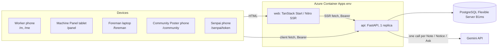
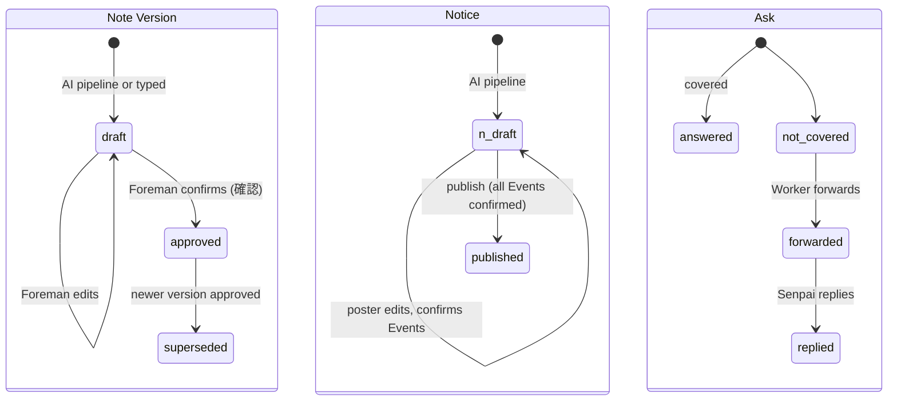

# Backend Architecture — Wakatta?

**Owner** Asif (`MdAsif-Hossain`) · **Status** proposed for team review · **Updated** 2026-11-22

How the backend works for every feature in the [plan](superpowers/plans/2026-11-22-wakatta.md). Terms in **bold** are from [GLOSSARY.md](../GLOSSARY.md). Decisions that are hard to undo are ADRs 0005–0008 in [adr/](adr/). Where this file and the plan disagree, this file wins for the backend; the plan is updated to match.

Contents: 1 Shape · 2 Code layout · 3 Stack · 4 Data model · 5 Domain rules · 6 API · 7 AI subsystem · 8 Media · 9 Security · 10 Observability · 11 Testing · 12 Deployment · 13 WS0 and ownership · 14 Changes to the plan · 15 Open items

---

## 1. Shape of the system



- One API process, one database, one AI provider. No queue, no Redis, no object storage: every piece of state lives in Postgres.
- The browser and the frontend server both call the API directly (frontend rule S-11), so the API has external ingress and CORS for the frontend origin.
- Auth is a Bearer token in the `Authorization` header ([ADR 0005](adr/0005-bearer-session-tokens.md)), never a cross-site cookie.
- Endpoints are synchronous `def` functions on a sync SQLModel session ([ADR 0007](adr/0007-sync-fastapi-sqlmodel.md)). AI calls run inline with a hard timeout; there is no background job system.
- Real-time screens (Machine Panel 2 s, Foreman board 5 s) poll. At this scale polling is cheaper to build and debug than SSE or WebSockets.

---

## 2. Code layout and module rules

```
backend/
  pyproject.toml, uv.lock          uv-managed, versions pinned at WS0
  Dockerfile, .dockerignore        multi-stage, non-root, python:3.12-slim
  docker-compose.yml               postgres for dev (db) and tests (db_test)
  alembic.ini, migrations/         Alembic only (G-45)
  .env.example
  app/
    main.py                        create_app(): middleware, routers, error handlers
    config.py                      pydantic-settings, validated at startup, fail fast
    db.py                          engine, get_session dependency
    api/                           envelope.py, errors.py, auth.py (role deps), pagination.py
    routers/                       one file per area, thin: parse → service → envelope
    services/                      one file per area: transactions, queries, orchestration
    domain/                        pure functions, stdlib only, no I/O
    models/                        SQLModel table classes (never returned to clients)
    schemas/                       request/response models (the contract)
    ai/                            client.py (seam), gemini.py, fake.py, cache.py, pipelines
    prompts/                       <name>.v<N>.md, versioned in git (G-34)
    media.py                       upload validation, image re-encode
    seed.py                        demo data, `python -m app.seed --reset`
  tests/
    domain/                        pure unit tests, no DB
    api/                           HTTP tests against real Postgres
    ai/                            pipeline tests with FakeAiClient
```

Areas (one router + one service each): `health`, `auth`, `workers`, `machines` (incl. Presence and Panel), `notes`, `checks`, `board`, `shifts`, `skills` (Skill Matrix, Passport, Heatmap), `glossary`, `briefings`, `near_misses`, `library`, `notices`, `events`, `asks`, `senpai`, `meetups`, `support_log`, `blobs`.

**Import rules (G-12), enforced by `import-linter` in CI:**

| Layer | May import | Never imports |
| :--- | :--- | :--- |
| `routers` | `services`, `schemas`, `api` | `models`, `db` queries, `ai` |
| `services` | `models`, `schemas`, `domain`, `ai`, `db`, `media` | `routers` |
| `ai` | `domain` (validators), `prompts`, `schemas` | `routers`, `services`, `models` |
| `domain` | stdlib, `dateutil` | anything in `app` outside `domain` |

Why `domain/` exists: the rules that the demo story depends on (Sign-off validity, Lock, grading, Glossary lock, recurrence, Ask grounding) are pure functions over plain values. They are the deepest modules in the system, they carry most of the test suite, and they run in milliseconds without a database.

**Response models are separate from table models.** A route declares a `schemas` response model; it never returns a `models` row. That makes the answer-leak rule (`correct_index` never sent to a Worker) a property of the type, not of someone remembering to drop a field.

---

## 3. Stack

| Concern | Choice | Why |
| :--- | :--- | :--- |
| Runtime | Python 3.12, FastAPI, Uvicorn | ADR 0002 |
| ORM | SQLModel (SQLAlchemy 2) sync sessions, psycopg 3 | ADR 0007 |
| Migrations | Alembic, autogenerate reviewed by hand | G-45 |
| Settings | pydantic-settings | fail fast on missing env |
| AI | `google-genai` SDK, structured output with Pydantic schemas | ADR 0001 |
| Recurrence | `python-dateutil` (`rrulestr`) | RRULE parsing and expansion |
| Calendar export | `icalendar` | correct escaping and line folding for `.ics` |
| Images | Pillow | re-encode uploads, strip EXIF (GPS) |
| Multipart | `python-multipart` | FastAPI uploads |
| Tooling | uv, ruff (`E,F,I,B,UP,S,ASYNC,T20,ERA`), pyright, import-linter, pytest, pytest-cov, httpx | G-11, G-12 |

Exact versions are pinned in `uv.lock` at WS0 after checking each package's current release; this file does not guess them.

---

## 4. Data model

Conventions: `bigint generated always as identity` primary keys (Machines keep a text slug, used in the QR URL); `text` with a `CHECK` instead of Postgres enums (easier migrations); `timestamptz` everywhere, stored in UTC, shown in `Asia/Tokyo`; translated text as `jsonb` `{ja, bn, en}`; every foreign key has an index; lowercase snake_case names.

### 4.1 Work

| Table | Columns (constraints) | Indexes |
| :--- | :--- | :--- |
| `workers` | id, name text not null, language text not null check in (`bn`,`en`,`ja`) | |
| `machines` | id text pk (slug, `^[a-z0-9-]+$`), name_ja text not null, current_version_id bigint null fk → note_versions (added after note_versions), present_worker_id bigint null fk → workers, present_at timestamptz null | present_worker_id |
| `glossary_terms` | id, ja text not null unique, reading text not null, bn text not null, en text not null, note text null | |
| `note_versions` | id, machine_id fk, version_no int not null, status text check in (`draft`,`approved`), needs_edit bool not null default false, recorded_by text not null, audio_hash bytea null, transcript_ja text not null, easy_ja text, bn text, en text, back_bn_ja text, back_en_ja text, icons text[] not null default '{}', created_at, approved_at null; unique (machine_id, version_no); check (status = 'approved') = (approved_at is not null) | machine_id |
| `briefings` | id, recorded_by text, transcript_ja, easy_ja, bn, en, needs_edit bool, created_at | created_at desc |
| `check_questions` | id, note_version_id null fk, briefing_id null fk, notice_id null fk, position smallint not null, term_id null fk → glossary_terms, prompt jsonb not null, options jsonb not null (array of 3 `{ja,bn,en}`), correct_index smallint not null check between 0 and 2; check num_nonnulls(note_version_id, briefing_id, notice_id) = 1 | each fk |
| `checks` | id, worker_id fk, note_version_id null fk, briefing_id null fk, notice_id null fk, language text check, answers jsonb not null (`[{question_id, chosen_index}]`), passed bool not null, created_at; same `num_nonnulls = 1` check | worker_id, each owner fk |
| `confusions` | id, check_id fk, question_id fk, term_id null fk, machine_id null fk, worker_id fk, created_at, acknowledged_at null | partial (created_at) where acknowledged_at is null; term_id, machine_id |
| `sign_offs` | id, worker_id fk, machine_id fk, note_version_id fk, check_id fk unique, passed_at timestamptz not null | (worker_id, machine_id, passed_at desc) |
| `shift_assignments` | id, worker_id fk, machine_id fk, shift_date date not null, shift text check in (`day`,`night`); unique (machine_id, shift_date, shift) | worker_id, (shift_date) |
| `briefing_receipts` | briefing_id fk, worker_id fk, opened_at, check_id null fk; pk (briefing_id, worker_id) | worker_id |
| `near_miss_reports` | id, worker_id fk, machine_id fk, transcript_src text, text_ja text, photo_blob_id null fk → blobs, created_at, acknowledged_at null | partial where acknowledged_at is null; machine_id |

### 4.2 Life

| Table | Columns (constraints) | Indexes |
| :--- | :--- | :--- |
| `posters` | id, name text not null, kind text check in (`jichikai`,`city`,`employer`) | |
| `notices` | id, poster_id fk, category text check in (`garbage`,`disaster`,`event`,`duty`,`other`), source_kind text check in (`text`,`voice`,`photo`), source_ja text, source_blob_id null fk → blobs, easy_ja, bn, en, steps jsonb not null (array ≤ 8 `{ja,bn,en}`), status text check in (`draft`,`published`), needs_edit bool, created_at, published_at null; check (status = 'published') = (published_at is not null) | poster_id; partial (published_at desc) where status = 'published' |
| `events` | id, notice_id fk, title jsonb, starts_at timestamptz not null, ends_at null, rrule text null, confirmed bool not null default false | notice_id |
| `notice_receipts` | notice_id fk, worker_id fk, opened_at, check_id null fk; pk (notice_id, worker_id) | worker_id |
| `senpai_pairs` | id, worker_id fk unique, senpai_name text, senpai_kind text check in (`coworker`,`jichikai`), token_hash bytea not null unique, created_at | |
| `asks` | id, worker_id fk, text_src text, language text check, covered bool not null, answer jsonb not null, source_notice_ids bigint[] not null default '{}', forwarded_to_pair_id null fk, forwarded_at null, senpai_reply_ja text null, senpai_reply_tr jsonb null, replied_at null, created_at | worker_id; partial where forwarded_at is not null and replied_at is null |
| `meetups` | id, pair_id fk, kind text check in (`coffee`,`event`,`drill`,`other`), happened_on date, note text, logged_by text check in (`worker`,`senpai`), created_at | pair_id |

### 4.3 Platform

| Table | Columns | Why |
| :--- | :--- | :--- |
| `blobs` | id, mime text, size_bytes int check ≤ 5 MB, sha256 bytea, bytes bytea, created_at | Photos live in their own table so list queries never drag image bytes along; one place for limits (ADR 0002 keeps them in Postgres) |
| `sessions` | token_hash bytea pk, role text check in (`foreman`,`community`), created_at, expires_at | Opaque Bearer tokens, revocable (ADR 0005) |
| `ai_cache` | key text pk, model text, prompt text, response jsonb, created_at | Replay and quota protection (§7) |

Notes:
- **Current Note Version** is the `machines.current_version_id` pointer, set in the same transaction as the approval. Approval locks the Machine row (`select … for update`), so two approvals cannot interleave, and `version_no` is assigned under the same lock.
- **Sign-off validity is computed, never stored** (§5.1). Approving a new Note Version needs no `UPDATE` on Sign-offs: they stop matching `current_version_id` and become invalid automatically.
- **Row Level Security** is not used: there is one shop and one community, no tenants. Authorization is enforced in the API (§9). The app connects with a non-superuser role that owns only its schema.

---

## 5. Domain rules (`app/domain/`, pure, unit-tested)

### 5.1 Sign-off and Lock
```
status(sign_offs_for(worker, machine), current_version_id, now) ->
  "valid"    newest Sign-off matches current_version_id and now - passed_at < 90 days, more than 14 days left
  "expiring" same, 14 days or less left
  "expired"  newest Sign-off is older than 90 days or matches an older Note Version
  "none"     no Sign-off
panel_state = "ready" if status in {valid, expiring} else "locked"
```
A Machine with no approved Note Version is `locked` for everyone with reason `no_note`.

### 5.2 Who the Machine Panel shows (Presence)
The plan's `/panel/$machineId` has no Worker, so the backend decides: **Presence** is set when a Worker picks their name on `/m/$machineId` (`POST /machines/{id}/presence`). The Panel shows the present Worker if `present_at` is within 10 minutes, else today's Shift Assignment for that Machine (Asia/Tokyo date, current shift), else `idle`. This matches the demo: Rahim scans, the Panel shows Rahim and LOCK; he passes, it turns READY.

### 5.3 Grading
A Check passes only if every answer is correct. Each wrong answer creates one Confusion carrying the question's Glossary Term and the Machine (for Note Versions). Answers are matched by `question_id`; a missing, duplicate or unknown `question_id` is a 422, not a wrong answer. A pass on a Note Version writes a Sign-off; on a Briefing or Notice it updates the receipt's `check_id`.

### 5.4 Glossary lock
Text is NFKC-normalised before comparing. For every Glossary Term whose `ja` appears in `transcript_ja`:
- `easy_ja` must still contain `ja` (a reading in brackets is allowed). やさしい日本語 keeps shop words, because the Worker must learn the word used on the floor.
- `bn` must contain the term's `bn` as a substring. Bengali case endings are suffixes (মাপ → মাপের), so a substring match accepts them.
- `en` must contain the term's `en`, case-insensitive (accepts plurals).

Questions: 2–3 per Note Version, exactly 3 options each, `correct_index` 0–2 (a single index, so "exactly one correct option" holds by type). Icon ids must exist in the fixed set, at most one per step.

### 5.5 Recurrence (Events)
`rrulestr(rrule, dtstart=starts_at in Asia/Tokyo)`. Rejected when: it does not parse, `starts_at` is in the past for a one-off Event, or there is no occurrence within 366 days. The preview is the next 3 occurrences. Japan has no daylight saving time, so storing UTC and expanding in `Asia/Tokyo` is exact. An Event publishes only with `confirmed = true`.

### 5.6 Ask grounding
`covered = true` requires a non-empty `source_notice_ids` that is a subset of the Notice ids sent to the model. Anything else is rewritten to `covered = false` with the fixed answer 「掲示された案内にはありません」 (and its BN/EN), plus the forward-to-Senpai offer.

### 5.7 State charts (G-28)

`superseded` is derived (approved and not current); it is not a stored status. AI output only ever creates `draft` rows (G-33).

---

## 6. API design

Conventions are [API_SPEC.md §1](API_SPEC.md#1-conventions): envelope on every response, snake_case, UTC ISO 8601, nullable fields always present, list endpoints paged (`items, page, page_size, total`).

### 6.1 Principals

| Principal | How | Can |
| :--- | :--- | :--- |
| Worker | none; sends `worker_id` | Worker routes only (`/m`, `/me`, `/life`). Shortcut: anyone can act as any Worker; replace with per-Worker login after the hackathon. |
| Foreman | `POST /auth/pin` with `SHOP_PIN` → Bearer token, role `foreman` | everything marked 🔒 and 🏘 |
| Community Poster | `POST /auth/pin` with `COMMUNITY_PIN` → Bearer token, role `community` | only 🏘 routes; 403 on every 🔒 route |
| Senpai | 128-bit token in the path, stored hashed | only their own pair; wrong token is 404 |

### 6.2 Errors

| HTTP | `error.code` | When |
| :--- | :--- | :--- |
| 400 | `BAD_REQUEST` | malformed but parseable input the schema cannot express |
| 401 | `UNAUTHORIZED` | no or expired token |
| 403 | `FORBIDDEN` | wrong role (Community Poster on a shop route) |
| 404 | `NOT_FOUND` | unknown id, wrong Senpai token |
| 409 | `CONFLICT` | approving a non-draft, publishing with unconfirmed Events, duplicate Shift Assignment |
| 413 | `PAYLOAD_TOO_LARGE` | upload over its limit |
| 415 | `UNSUPPORTED_MEDIA_TYPE` | upload whose magic bytes are not an allowed type |
| 422 | `VALIDATION_ERROR` | schema validation; `details` lists fields |
| 429 | `RATE_LIMITED` | PIN attempts or AI endpoints over limit; `Retry-After` set |
| 500 | `INTERNAL_ERROR` | anything else; message is generic, the log has the request id |

AI trouble is never a 5xx: the pipelines degrade to a `needs_edit` draft (§7.4).

### 6.3 Endpoints

The plan's API table stands, with these backend decisions:

| Change | Detail |
| :--- | :--- |
| `POST /auth/pin` | Body `{pin}` → `{token, role, expires_at}` (12 h). New: `DELETE /auth/session` logs out. |
| New `POST /machines/{id}/presence` | Body `{worker_id}` → sets Presence (§5.2). Called by `/m/$machineId` after the name pick. |
| `GET /machines/{id}/panel` | No `worker_id` query; returns `{state, worker, reason, note_version_no}` using Presence. |
| `GET /machines/{id}?language=` | Questions without `correct_index` (type-enforced, tested). |
| `POST /machines/{id}/notes`, `POST /briefings`, `POST /notices`, `POST /asks`, `POST /near-misses` | Synchronous, 60 s budget, multipart for audio and photos (§8). Return the draft or answer directly. |
| New `GET /blobs/{id}` 🏘 | Serves a stored photo (flyer to its poster and Foreman, Near-miss photo to Foreman). `Content-Type` from the row, `X-Content-Type-Options: nosniff`. |
| Lists | `GET /workers`, `/machines`, `/glossary`, `/notices`, `/near-misses`, `/confusions`, `/machines/{id}/versions` are paged. `/board`, `/skill-matrix`, `/heatmap` return one aggregate object. |
| `GET /workers/{id}/calendar.ics` and `GET /support-log.csv` | Not enveloped (file downloads). CSV starts with a UTF-8 BOM. |

### 6.4 Contract flow ([ADR 0006](adr/0006-code-first-openapi.md))
FastAPI is the source of `docs/openapi.yaml`: `uv run python -m app.openapi > ../docs/openapi.yaml`. WS0 lands every route as a typed stub (real request and response models, body returns a 501 `NOT_IMPLEMENTED` envelope), so the frontend can generate types from day one. CI regenerates the file and fails on a diff. `API_SPEC.md` keeps the prose (roles, endpoint status, examples).

---

## 7. AI subsystem (`app/ai/`)

### 7.1 Seam
```python
class AiClient(Protocol):
    def generate(self, *, prompt: Prompt, parts: Sequence[Part], schema: type[T]) -> T: ...
```
Two adapters, so the seam is real ([ADR 0008](adr/0008-ai-client-seam-and-fake.md)): `GeminiClient` (production) and `FakeAiClient` (tests and day-to-day development; returns fixture JSON keyed by prompt name and input hash). `AI_MODE=gemini|fake`, default `fake` in `.env.example`, because the free tier's daily request limit is small and unclear (as low as about 20 requests per day has been reported for some models).

### 7.2 Pipelines (the interface services use)

| Function | Input | Output |
| :--- | :--- | :--- |
| `build_note(source, glossary, icons)` | audio bytes or Japanese text | `NoteDraft` (transcript_ja, easy_ja, bn, en, back-translations, icons, 2–3 questions, needs_edit) |
| `build_briefing(source, glossary)` | same | draft with 1 question |
| `build_notice(source, glossary)` | text, audio or photo | `NoticeDraft` (source_ja, category, steps ≤ 8, events with rrule or starts_at, 1 question) |
| `answer_ask(question, notices, glossary)` | text or audio, ≤ 30 newest published Notices | `AskAnswer` (covered, answer ja/bn/en, source_notice_ids) |
| `translate(text, source_lang, target_lang)` | Near-miss reports, Senpai replies | translated text |

Each pipeline owns: cache lookup → model call → schema parse → domain validation (§5.4–5.6) → one retry with the validation error appended → fallback. Services never see Gemini types, prompts or retries.

### 7.3 Calls
- Structured output: `response_mime_type="application/json"` with the Pydantic schema; output is parsed again by our own model (G-36).
- Audio and photos go inline (`Part.from_bytes`), well under the inline limit; no Files API.
- Timeouts: `AI_TIMEOUT_SECONDS=45` per call. `AI_MAX_CONCURRENT=2` (a semaphore). One retry with jitter on 429/5xx from Gemini.
- **No database transaction stays open across a model call**: the service reads its inputs, ends the transaction, calls the pipeline, then opens a new transaction to write.
- Model name from `GEMINI_MODEL`, checked against `models.list` at WS0.

### 7.4 Fallback ladder (G-32)
1. Cache hit (`ai_cache`): key is `sha256(prompt name + prompt version + model + input bytes + glossary hash)`. The glossary hash makes edits to Glossary Terms miss the cache.
2. Live call, validated.
3. One retry with the validation error.
4. Seeded result for the 4 demo Machines and the demo flyer (stored in `ai_cache` by `seed.py` from fixtures in `tests/fixtures/ai/`).
5. `needs_edit` draft holding whatever was usable (at least the transcript or source text), returned with 200. Never a 500.

Prompts are `app/prompts/<name>.v<N>.md`; changing a prompt bumps `N` (which also changes the cache key) and updates its fixture test (G-34).

---

## 8. Media

| Upload | Allowed types (checked by magic bytes, not the header) | Max | Processing |
| :--- | :--- | :--- | :--- |
| Foreman / Briefing / Notice / Ask audio | webm/opus, ogg/opus, mp4/m4a | 8 MB (≈ 60 s) | hashed for the cache; not stored |
| Notice flyer photo | jpeg, png, webp (heic is rejected with 415 and a message to use JPEG) | 5 MB in, 2 MB stored | Pillow: auto-rotate, max 2048 px, re-encode JPEG, EXIF and GPS removed |
| Near-miss photo | jpeg, png, webp | 2 MB (client resizes first) | same re-encode |

A body-size limit (10 MB) is applied before parsing multipart, so an oversized request is refused early.

---

## 9. Security

- **PINs:** 6 digits (the plan says 4; 10,000 combinations is guessable). Compared with `hmac.compare_digest`. `POST /auth/pin` is limited to 5 attempts per minute per IP, with a 5-minute lockout after 10 failures.
- **Tokens:** `secrets.token_urlsafe(32)`, only the SHA-256 is stored, 12 h expiry, role inside the session row.
- **Authorization:** each route declares its role with a dependency (`require_role("foreman")`, `require_role("foreman", "community")`). A test walks `app.routes` and checks every protected route returns 401 without a token and 403 with the wrong role, so a new route cannot ship unprotected.
- **CORS:** only `FRONTEND_ORIGIN`; methods `GET, POST, PATCH, DELETE`; headers `Authorization, Content-Type`; no credentials (Bearer, not cookies).
- **AI endpoints:** 10 requests per minute per IP, to protect the Gemini quota.
- **Limiter state is in memory.** This is correct only with one API replica, which §12 fixes. Shortcut: in-memory limiter, move to Postgres or Redis if the API ever runs more than one replica.
- **Headers:** `X-Content-Type-Options: nosniff`, `Referrer-Policy: no-referrer` (the Senpai token is in the URL), `Cache-Control: no-store` on authenticated responses.
- **Secrets:** env only, `.env.example` lists every variable with a dummy value, gitleaks in CI (G-37).
- **Known shortcut:** Workers are not authenticated (§6.1). The demo data is fictional; real Workers would need their own login before any real use.

---

## 10. Observability

- JSON logs to stdout (Container Apps collects them), one line per request: method, route, status, latency, request id (`X-Request-ID`, generated if absent and returned in the response).
- One line per AI call: pipeline, prompt version, model, latency, cache hit, outcome (`ok`, `retried`, `fallback_seed`, `needs_edit`). No prompt or answer text, no Ask text, no photos in logs.
- `GET /api/health` is liveness (no DB); `GET /api/health/ready` checks the database (used as the readiness probe).

---

## 11. Testing

| Suite | What | How |
| :--- | :--- | :--- |
| `tests/domain` | §5 rules: validity windows (89/90/91 days, 14-day edge), new version invalidates, grading, glossary lock (passing output, missing locked term, Bengali suffix accepted), RRULE (Mon/Thu weekly in Asia/Tokyo, invalid, past), Ask grounding | plain pytest; Hypothesis for grading and validity |
| `tests/api` | every route: success, validation error, 401/403 matrix, 404; the plan's Review focus 1–8 as named tests | real Postgres (`db_test` from compose locally, service container in CI), each test in a rolled-back transaction, `FakeAiClient` |
| `tests/ai` | each pipeline: valid output, invalid then fixed on retry, invalid twice → `needs_edit`, timeout → seed fallback, cache hit skips the client | `FakeAiClient` scripted per test |
| contract | `docs/openapi.yaml` equals the generated schema | CI diff |

Coverage target: 80% on `domain`, `services`, `ai` (G-22). CI job `backend-ci.yml`: ruff → pyright → import-linter → pytest with coverage → openapi diff → gitleaks.

---

## 12. Deployment (Azure for Students)

| Piece | Setting | Cost |
| :--- | :--- | :--- |
| Resource group | one, region Japan East if the student subscription's region policy allows it, else the nearest allowed region | — |
| PostgreSQL Flexible Server | Burstable B1ms, 32 GB, SSL required, database `wakatta`, app role without superuser | free for 12 months (750 h/month) under Azure for Students |
| Container Apps environment | Consumption plan | free monthly grant (180,000 vCPU-s, 360,000 GiB-s) |
| `api` app | external ingress, port 8000, 0.5 vCPU / 1 GiB, **min 1 max 1 replica** on demo days (Nov 24–26), min 0 while developing | an always-on replica exceeds the free grant: roughly a few dollars per demo week, paid from the $100 credit; check in the pricing calculator |
| `web` app | Minhaz's Nitro build, same environment | same as above |
| Images | built by GitHub Actions, pushed to GHCR (public repo, no registry cost) | free |
| Secrets | `DATABASE_URL`, `GEMINI_API_KEY`, `SHOP_PIN`, `COMMUNITY_PIN` as Container App secrets mapped to env | — |
| Migrations | entrypoint runs `alembic upgrade head` before Uvicorn. Shortcut: safe only with one replica; move to a Container Apps Job if the API scales out | — |
| Seed | `python -m app.seed --reset` run once via `az containerapp exec`, and again before filming | — |

Ingress timeout (240 s) is above the 60 s AI budget. A hello-world `api` with `/api/health` goes to Azure on day 1, not day 3.

---

## 13. WS0 deliverables and ownership of shared files

WS0 (owner Asif) lands, in this order, on one branch merged to `main` before any other backend workstream starts:
1. Project skeleton (§2), config, envelope, error handlers, request id, CORS, `/api/health` and `/api/health/ready`.
2. **All** tables of §4 in the first Alembic migration.
3. Every route as a typed stub (§6.4) and the generated `docs/openapi.yaml`.
4. `AiClient` seam with `FakeAiClient` and fixtures; Gemini adapter behind `AI_MODE`.
5. `seed.py` with the plan's seed story.
6. `docker-compose.yml`, `.env.example`, `backend-ci.yml`, README run steps.

After WS0, to avoid conflicts between five people working in parallel:
- Each workstream edits only its own `routers/<area>.py`, `services/<area>.py`, `schemas/<area>.py`, `tests/**/<area>*`.
- **Schema changes go through the WS0 owner** (one Alembic head at a time). Ask in your WORK_LOG or an XREQ.
- `docs/openapi.yaml` is never hand-edited; regenerate it.
- `seed.py` and `domain/` changes are small, reviewed PRs.

---

## 14. Changes to the plan (all features kept)

| Plan says | Backend decision | Why |
| :--- | :--- | :--- |
| httpOnly cookie with role | Bearer token from `POST /auth/pin` (ADR 0005) | API_SPEC already uses Bearer; SSR fetches cannot carry the browser's API cookie; cross-site cookies are blocked by Safari on iPhones |
| 4-digit PIN | 6 digits + rate limit + lockout | guessable in minutes otherwise |
| `GET /machines/{id}/panel?worker_id=` | Presence + `POST /machines/{id}/presence` | the Panel URL has no Worker |
| `docs/openapi.yaml` written by hand | generated from FastAPI (ADR 0006) | one source of truth, CI-checked |
| Photos as `bytea` columns | `blobs` table referenced by id | keeps list queries light, one place for limits |
| `checks` for Note Version or Briefing | Note Version, Briefing **or Notice** with a `num_nonnulls` check | the plan's Notice Check had no table |
| Glossary lock on "the Japanese text" | checked against `transcript_ja`, `easy_ja` must keep the term, Bengali by substring | defines the rule precisely (§5.4) |
| Gemini always called | `AI_MODE=fake` by default, real calls only when needed | free-tier daily limits |

---

## 15. Open items

| Item | Owner | Due |
| :--- | :--- | :--- |
| Confirm the current Gemini Flash model accepts audio input together with a response schema, and its daily limit on our key | Galib | WS0 |
| Azure for Students allowed regions for the subscription | Asif | before the hello-world deploy |
| Frontend: send `Authorization: Bearer` from `src/services/api.ts`, store the token (frontend decides where), call `/presence` after the name pick | Minhaz (XREQ) | after this design is agreed |
| 6-digit PINs in the demo script and seed | Minhaz, Anim | WS0 |
