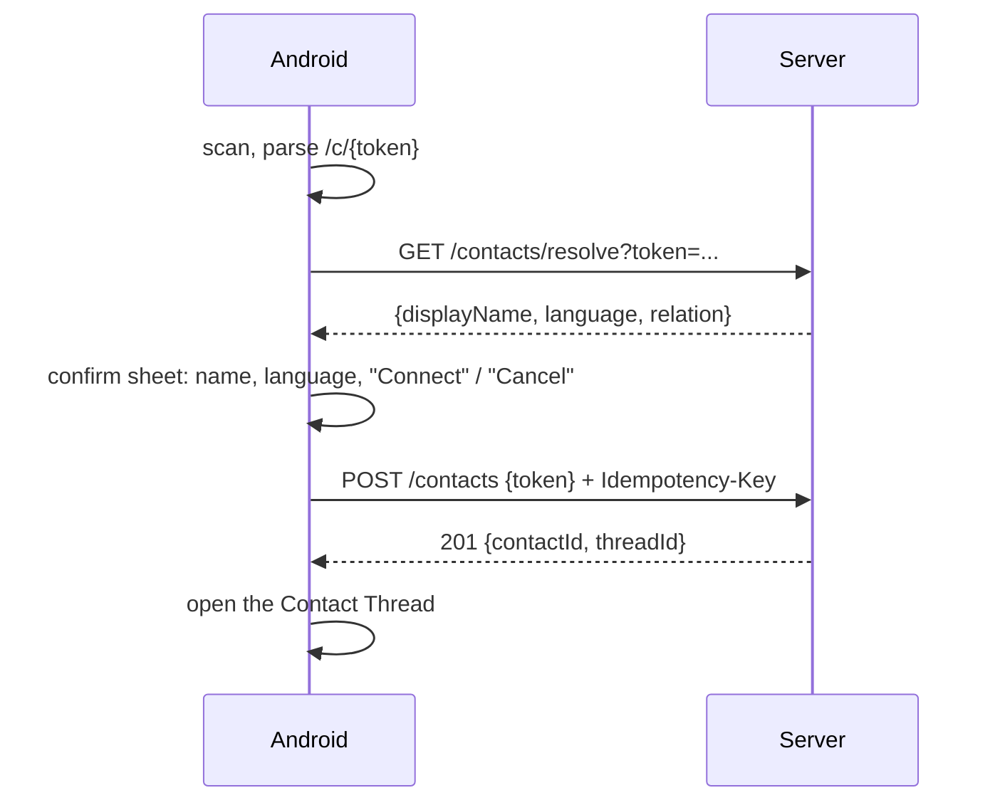

# Mobile platform contract: push, deep links, version gate, offline queue, uploads

**Status** proposal for team review, 2026-11-23 · **Audience** the Android client (Kotlin, Jetpack Compose) and the backend · **Decision** [ADR 0015](adr/0015-native-android-app-in-android-folder.md)

This is the mobile-only half of the contract between the native Android app and the backend. Endpoints and schemas for the normal screens are in [MOBILE_API_CONTRACT.md](MOBILE_API_CONTRACT.md); this file does not repeat them. Terms follow [GLOSSARY.md](../GLOSSARY.md). Backend rules it builds on are in [BACKEND_ARCHITECTURE.md](BACKEND_ARCHITECTURE.md) (called "arch" below).

Contents: 0 Read this first · 1 Push · 2 Deep links and QR · 3 Version gate and offline queue · 4 Audio and photo upload · 5 Backend asks · 6 Android build tasks

---

## 0. Read this first

### 0.1 Status tags

| Tag | Meaning |
| :--- | :--- |
| **LIVE** | In `backend/` code today. A `path:line` is given. |
| **PLANNED** | Written in arch, [AGENTS.md](../AGENTS.md) XREQ cards, or `docs/openapi.yaml`, but not in code yet. |
| **NEW** | Proposed by the approved handoff (`.agent-bridge/specs/android/handoff-backend-additions.md`, 2026-11-23) or by this document. Not in any backend doc. Never treat as live. |

Every device, push, `/app/config` and QR endpoint below is **NEW**. The Contact, block, Talk Thread and Periodic Interview endpoints come from the handoff and are **NEW**.

### 0.2 Decisions the user must make (placeholders used in this file)

| Placeholder | Decision | Why it cannot wait |
| :--- | :--- | :--- |
| `[HOST]` | The public web host that serves links such as `https://[HOST]/m/12`. Undecided. | It is baked into the app manifest, `assetlinks.json` and every printed QR sticker. On Android 14 and lower a changed `assetlinks.json` is only picked up when the app is installed or updated; on Android 15 and higher it can take up to seven days (see 7.1). A host change after release means an app update. Prefer a custom domain over a default Container Apps hostname. |
| `[APP_ID]` | Android application id (package name). | Needed in `assetlinks.json`, the Play URL and the FCM Android app registration. |
| `[SHA256_FINGERPRINT]` | Signing certificate SHA-256. With Play App Signing it is the one shown in Play Console, not the local keystore (see 7.1). | `assetlinks.json` fails verification without it. |
| `[FCM_PROJECT_ID]` | Firebase project id. | The backend sender URL and the app's `google-services.json`. |
| Distribution | Google Play, or direct APK for the pilot (ADR 0015 allows both). | Sets `storeUrl` in `/app/config`, and whether `assetlinks.json` needs a second fingerprint. |

### 0.3 Conventions this file assumes (all from arch)

- JSON envelope `{success, data, message}` / `{success:false, error:{code,message,details}}`, camelCase, string ids, cursor lists (arch §9.1, ADR 0011).
- Bearer session in `Authorization`. The Worker id comes from the token, never the body (ADR 0010).
- Idempotency: `Idempotency-Key` header, a UUID per user action; a missing key is 422 (arch §8.2). LIVE: the header is a typed UUID on the routers (`backend/app/routers/work.py:42`).
- Errors: arch §9.2 (`UNAUTHORIZED`, `FORBIDDEN`, `PIN_CHANGE_REQUIRED`, `NOT_FOUND`, `CONFLICT`, `VERSION_CHANGED`, `PAYLOAD_TOO_LARGE`, `UNSUPPORTED_MEDIA_TYPE`, `VALIDATION_ERROR`, `PIN_LOCKED`, `RATE_LIMITED`, `BUSY`). New codes added here: `UPGRADE_REQUIRED`, `MAINTENANCE`.
- Times: UTC ISO 8601 on the wire, dates `YYYY-MM-DD` in the shop timezone (arch §9.1).

### 0.4 Verification log (web checks, date checked 2026-11-23)

I read the official pages below on 2026-11-23. Each was read through a page-to-text tool, so quoted constants come from that text, not from a browser. Anything not on this list and tagged Android, Firebase or Play is **UNVERIFIED**.

| Fact | Source |
| :--- | :--- |
| `POST_NOTIFICATIONS` runtime permission exists from Android 13 (API 33); app targeting 33+ controls when to ask; notifications are off by default on a fresh install; if the user swipes the dialog away the state does not change; `areNotificationsEnabled()` reports the state | https://developer.android.com/develop/ui/views/notifications/notification-permission |
| Notification channels: required from Android 8 (API 26); after creation importance cannot be changed by the app, only the user can; recreating a channel with the same values is a no-op; only name and description may change; importance values `IMPORTANCE_NONE(0)` to `IMPORTANCE_HIGH(4)` | https://developer.android.com/develop/ui/views/notifications/channels |
| FCM HTTP v1: `POST https://fcm.googleapis.com/v1/projects/PROJECT_ID/messages:send`, header `Authorization: Bearer <OAuth2 token>`, scope `https://www.googleapis.com/auth/firebase.messaging`, token minted from a service account | https://firebase.google.com/docs/cloud-messaging/send/v1-api |
| FCM `data` is a map of string keys to string values; `android.priority` is `NORMAL` or `HIGH` (NORMAL default for data messages, HIGH default for notification messages); `ttl` max and default 4 weeks; at most 4 distinct `collapse_key` values at a time; `android.notification.channel_id` must exist on the device before the message arrives | https://firebase.google.com/docs/reference/fcm/rest/v1/projects.messages |
| Notification messages in the background go to the tray and the app gets the data payload only when the user taps; data messages go to app code; max payload 4096 bytes; reserved keys `from`, `message_type`, and any key starting `google.` or `gcm.` | https://firebase.google.com/docs/cloud-messaging/customize-messages/set-message-type |
| Token hygiene: FCM treats a registration as expired after 270 days of inactivity on Android; default stale after a month without connect; store a timestamp with every upload; error `UNREGISTERED` (HTTP 404) and `INVALID_ARGUMENT` (400) mean delete it (only if the payload is valid); example cleanup job uses 30 days. The same page now describes Firebase installation ids (FID) next to legacy registration tokens (see 1.3) | https://firebase.google.com/docs/cloud-messaging/manage-tokens |
| App Links: `android:autoVerify="true"`, action `VIEW`, categories `BROWSABLE` and `DEFAULT`, scheme `http` or `https`; file at `https://hostname/.well-known/assetlinks.json`; `adb` verify commands; re-verification latency 7 days on Android 15+ and none on 14 and lower | https://developer.android.com/training/app-links/verify-android-applinks |
| `assetlinks.json` format, hosting rules (`application/json`, HTTPS, no redirects), Play App Signing fingerprint note | https://developer.android.com/training/app-links/configure-assetlinks |
| ML Kit barcode scanning: bundled `com.google.mlkit:barcode-scanning:17.3.0` (about 2.4 MB), unbundled `com.google.android.gms:play-services-mlkit-barcode-scanning:18.3.1` (about 200 KB, model downloaded), minSdk 23 | https://developers.google.com/ml-kit/vision/barcode-scanning/android |
| Google code scanner: `com.google.android.gms:play-services-code-scanner:16.1.0`, works without the CAMERA permission, needs Google Play services | https://developers.google.com/ml-kit/vision/barcode-scanning/code-scanner |
| CameraX `camera-core`, `camera-camera2`, `camera-lifecycle`, `camera-view` latest stable `1.7.0`, released 2026-11-18 | https://developer.android.com/jetpack/androidx/releases/camera |
| `SpeechRecognizer`: needs `RECORD_AUDIO`; main thread only; must call `destroy()`; "likely to stream audio to remote servers" and not for continuous recognition; `<queries>` for `android.speech.RecognitionService` when targeting API 30+; `isRecognitionAvailable` (API 8), `isOnDeviceRecognitionAvailable` and `createOnDeviceSpeechRecognizer` (API 31), `checkRecognitionSupport` and `triggerModelDownload` (API 33), `ERROR_LANGUAGE_UNAVAILABLE` (API 31) | https://developer.android.com/reference/android/speech/SpeechRecognizer |
| `MediaRecorder.AudioEncoder.AAC` is AAC-LC, added in API 10; `OPUS` API 29 | https://developer.android.com/reference/android/media/MediaRecorder.AudioEncoder |

**Not verified (UNVERIFIED):** `MediaRecorder.OutputFormat.MPEG_4` producing `ftyp` at byte 4 on real devices (checked only by the acceptance test in 4.7); `RecognizerIntent.EXTRA_LANGUAGE` constant and ja-JP model availability on factory phones; `CAMERA` runtime permission text on the CameraX page; Android photo picker and `TakePicture` permission behaviour; WorkManager and Room current versions; a QR **generation** library and version; the Firebase Android SDK class that delivers the registration (token or FID, see 1.3); `android.notification.click_action` and `visibility` behaviour; whether Play Install Referrer can carry a link through installation; Google Play target API level rules and Data safety form wording.

---

## 1. PUSH (Firebase Cloud Messaging, Android)

### 1.1 Rule

1. Push is a **wake-up and a nudge, never a source of truth**. Delivery is best effort. Every screen must reach the correct state by polling (ETag, 304) alone. A push only tells the app to look now. (Arch §1: real-time screens poll.)
2. Push never carries answers, health or care content, message bodies, Check answers or ids of people. See 1.7.
3. The server localises the visible text by the **account language** (`users.language`, arch §6.1), not the phone language.
4. The backend sends through FCM **HTTP v1** only.

### 1.2 What the backend plan lacks today (state of 2026-11-23)

I searched `backend/app`, `docs/openapi.yaml` and arch. None of the following exists, and none is in arch, the plan or any XREQ card:

- no `devices` table and no device registration route; no FCM project, sender module or secret;
- no `/app/config`, no `X-App-Version` handling (grep for `fcm`, `firebase`, `push`, `X-App`, `app/config`, `426` in `backend/app` only hits unrelated words);
- no notification inbox or notification-centre endpoint (the prototype keeps notifications only in browser memory: `prototypes/wakatta/parts/skeleton.html:350-354`);
- no scheduler. Arch §1 says "No queue, no Redis"; there is no cron or timer, so **Check due**, **Event reminder** and **Periodic Interview due** have no trigger;
- no event source for chat (XREQ-005, pending), Nudge (`POST /messages/{id}/nudge`, XREQ-005 item 5, pending), group member changes or Periodic Interviews (handoff, "not yet in code");
- arch §3.4 revokes sessions on logout, PIN reset and deactivation but nothing links a session to a device, so a revoked session would keep receiving pushes.

All of 1.3 to 1.9 is therefore **NEW**.

### 1.3 Device registration

`PUT /devices/me` (NEW; roles Foreman and Worker; Poster and Panel are not Android roles per ADR 0015)

```http
PUT /api/devices/me
Authorization: Bearer <session>
Content-Type: application/json

{
  "installId": "6f0c1e4a-5b7d-4c0e-9d57-3c1f0a1b2c3d",
  "platform": "android",
  "fcmToken": "<string from the Firebase SDK>",
  "appVersion": "1.4.0",
  "osApiLevel": 34,
  "locale": "ja-JP",
  "notificationsEnabled": true
}
```

```json
{ "success": true, "data": { "registered": true, "lastSeenAt": "2026-11-23T01:20:00Z" }, "message": null }
```

Field rules:

| Field | Rule |
| :--- | :--- |
| `installId` | UUID the app generates once at first launch and keeps until uninstall. It identifies the app install across token rotation, so a new token replaces the old row instead of adding one. |
| `fcmToken` | Opaque string, at most 4096 characters (proposal). Send whatever the Firebase SDK gives as the send target. **UNVERIFIED:** the manage-tokens page now documents Firebase installation ids (FID, delivered by `onRegistered()`) alongside legacy registration tokens (`getToken()`). The Android developer must check the current Firebase Android SDK and use the supported one; the wire field name stays `fcmToken`. |
| `appVersion` | `MAJOR.MINOR.PATCH`, same as `X-App-Version` (3.2). |
| `locale` | Phone locale as a BCP 47 tag. Informational. Used only if the account language is missing from the server's templates. |
| `notificationsEnabled` | `NotificationManagerCompat.areNotificationsEnabled()` (verified API name). The server skips sending when false. It does not see per-channel blocks. |

Server rules:

1. Upsert on `(user_id, install_id)`. Store `session_token_hash` (the session that made the call), `last_seen_at = now()`.
2. If another row already holds the same `fcmToken` (shared phone: Worker A logged out, Worker B logged in) delete that row. A token belongs to one user at a time.
3. A device row is **removed when its session ends**: logout, expiry, the Foreman's PIN reset, deactivation, and "change own PIN" (which revokes the user's other sessions, arch §3.4). Proposal: `devices.session_token_hash` references `sessions(token_hash)` with `on delete cascade`, and `sessions.revoked_at` triggers the delete in the same transaction. This is what makes "unregister on PIN reset and deactivation" automatic and testable.
4. Rate limit: 6 calls per minute per user (proposal; `429 RATE_LIMITED` with `Retry-After`).

`DELETE /devices/me?installId=<uuid>` (NEW). The app calls it **before** `POST /auth/logout`, while the token is still valid. Best effort: if it fails (offline), the logout still proceeds and rule 3 cleans up on the server. Response `200 {"success":true,"data":null}`. Unknown id is also 200 (idempotent).

**When the app uploads:** after login; on every new token callback from the Firebase SDK (token rotation); on cold start if more than 7 days passed since the last upload or any field changed; when the user flips notifications on or off. The manage-tokens page says refreshing more often than weekly gives no benefit and suggests about monthly (verified, 0.4).

**Server cleanup:** a daily job deletes rows with `last_seen_at` older than 30 days (the example in the manage-tokens page). Also delete on FCM response `UNREGISTERED` (404). Delete on `INVALID_ARGUMENT` (400) only when the payload itself is valid (verified, 0.4).

**Error handling (app):**

| Response | App action |
| :--- | :--- |
| 200 | store `lastUploadAt`, `lastUploadedToken` |
| 401 | pause; the session is gone; the outbox rules in 3.7 apply; upload again after the next login |
| 403 `PIN_CHANGE_REQUIRED` | upload after the PIN change |
| 422 | log, do not retry the same body (a bug) |
| 426 | hard gate (3.2) |
| 429, 503, network | retry with backoff (3.6); registration is not an outbox item, a plain retry on next start is enough |

### 1.4 Notification types

Send **notification + data** messages (see 1.5 for why). `link` is a deep link from section 2.

| `type` | Audience | Trigger (source) | Channel | Link |
| :--- | :--- | :--- | :--- | :--- |
| `chat_message` | members of the Thread except the sender | a message is sent into a Thread (XREQ-005; prototype `A.js:729,782,788`) | `messages` | `https://[HOST]/t/{threadId}` |
| `check_due` | one Worker | a Check waits: a safety-change Note Version for a Machine (`recheck_version_no`, arch §7.1), a Briefing, a Notice, or a message Check with a deadline. Prototype: `C.js:212`, `E.js:448`. Sent when assigned and once more before the deadline | `safety` | Machine: `/m/{machineId}?s={shopCode}`; message Check: `/t/{threadId}?m={messageId}`; Briefing: `/b/{briefingId}`; Notice: `/n/{noticeId}` |
| `nudge` | one Worker | Foreman's Nudge (`POST /messages/{id}/nudge`, XREQ-005 item 5; prototype `A.js:899`) | `safety` | `/t/{threadId}?m={messageId}` |
| `notice_new` | Workers of the district | a Notice is published (prototype `D.js:426`) | `life` | `/n/{noticeId}` |
| `event_reminder` | Workers of the district | an Event occurrence is near. Lead time is a server setting, proposal 1 day before and 1 hour before. No prototype call exists; this is NEW | `life` | `/n/{noticeId}?e={eventId}` |
| `interview_due` | Foremen of the shop | a Periodic Interview becomes `soon` (14 days or less) and again `overdue` (handoff section 3). Body gives a count only | `updates` | `/i/due` |
| `nearmiss_ack` | the Worker who reported | the Foreman acknowledged a Near-miss Report (prototype `C.js:482`) | `updates` | `/nm/{reportId}` |
| `briefing_published` | Workers of the shop | a Briefing is published (prototype `C.js:549`) | `safety` | `/b/{briefingId}` |
| `thread_member_change` | the user added or removed | handoff section 1: member added or removed (soft removal) | `updates` | `/t/{threadId}` (removed: `/` home, because the Thread is no longer readable) |

Prototype notifications not in the list above (new Near-miss for Foreman `C.js:423`, Sign-off `C.js:321`, forwarded Ask `D.js:479`, Meet-up `D.js:542`, Follow-up `E.js:548`, Senpai reply `D.js:883`) are **not** specified here. Add each as a new `type` with the same payload rules if the team wants it. Open question 3.

**Contact Thread and Talk Thread messages** are personal (ADR 0014). They are **not** in v1 push. If added later: the visible text must be the generic "New message" with no sender name (a lock screen can be seen by a Foreman), a separate channel `contacts`, and the server must never join this event to shop data.

### 1.5 Message shape, data-only vs notification

**Decision: notification + data**, not data-only.

| | Notification + data | Data-only |
| :--- | :--- | :--- |
| Background display | The system draws it from the payload without running app code (verified, 0.4) | The app must run code to draw it. `HIGH` priority data messages are not guaranteed to be treated as user-visible. **UNVERIFIED** how FCM deprioritises them. |
| FCM guidance | The FCM page says to use `notification` with `AndroidConfigV2` for user-visible notifications to avoid delivery delay (as read on 2026-11-23) | none stated |
| Tap in background | Opens the launcher activity; the `data` map arrives in the intent extras (verified: "the app gets the data payload only when the user taps") | n/a |
| Foreground | `onMessageReceived` runs; the app decides whether to draw a banner (verified) | same |
| Cost | The app cannot suppress it in the background (for example for a signed-out user). The server prevents that with 1.3 rule 3 and mute rules in 1.8. | full control |

Server request (HTTP v1; sent by the backend, shown so the Android side knows what arrives):

```http
POST https://fcm.googleapis.com/v1/projects/[FCM_PROJECT_ID]/messages:send
Authorization: Bearer <OAuth2 access token, scope firebase.messaging>
Content-Type: application/json

{
  "message": {
    "token": "<fcmToken>",
    "notification": {
      "title": "Tanaka sent a message",
      "body": "Open Wakatta? to read it"
    },
    "android": {
      "priority": "HIGH",
      "ttl": "86400s",
      "notification": { "channel_id": "messages" }
    },
    "data": {
      "v": "1",
      "type": "chat_message",
      "eventId": "0b9d3f2e-6d1c-4f6e-8a41-0f9a7f9d2f10",
      "link": "https://[HOST]/t/7",
      "sentAt": "2026-11-23T01:20:00Z"
    }
  }
}
```

Rules:

- `data` values are strings only (verified). Reserved keys `from`, `message_type`, `google.*`, `gcm.*` are never used. Whole payload under 4096 bytes (verified).
- `data.v` is the schema version, `"1"`. The app ignores unknown extra keys and ignores a message whose `v` it does not know (shows nothing, polls).
- `eventId` is unique per push. The app keeps the last 100 and ignores repeats.
- `link` is the only navigation input. The app accepts it only if it passes the section 2.6 parser (host equals `[HOST]`, path matches a known shape). Anything else is ignored and the app opens Home.
- Do not use `collapse_key` for chat: at most 4 distinct collapse keys are allowed (verified). Use `ttl` instead. Proposed TTLs: `chat_message` 24 h, `check_due` 12 h, `nudge` 2 h, `notice_new` 7 days, `event_reminder` 3 h, `interview_due` 24 h, `nearmiss_ack` 24 h, `briefing_published` 12 h, `thread_member_change` 24 h.
- `priority` `HIGH` for channels `messages` and `safety`; `NORMAL` for `life` and `updates`.
- Visible text is generated per type and per language by the backend (templates in `app/` with `ja` and `en` always present; each shop language needs native review before use, like the Today's Word seed in the handoff). Fallback order: account language, `en`, `ja`.

Visible text examples (English; `ja` and others from the same templates):

| `type` | `title` | `body` |
| :--- | :--- | :--- |
| `chat_message` | `{senderFirstName} sent a message` | `Open Wakatta? to read it` |
| `check_due` | `A Check is waiting` | `{machineName}` for a Machine, else `Open Wakatta? to answer` |
| `nudge` | `Please answer the Check` | `{foremanFirstName} is waiting` |
| `notice_new` | `New notice from your area` | `Open Wakatta? to read it` |
| `event_reminder` | `Coming up` | `{eventTitle}` (title only, at most 60 characters) |
| `interview_due` | `Interviews due` | `{n} Periodic Interviews need a date` |
| `nearmiss_ack` | `Your report was read` | `Thank you for reporting` |
| `briefing_published` | `Morning briefing` | `Open Wakatta? to read and answer` |
| `thread_member_change` | `Group changed` | `Open Wakatta? to see it` |

### 1.6 Android notification channels

Create at app start, guarded for API 26+ (verified: calling again with the same values is a no-op). **Channel ids and importance are permanent once created on a device** (verified: the app cannot change importance afterwards; only name and description may change). Changing importance later means a new channel id and deleting the old one, so choose now.

| Channel id | User-visible name (en / ja) | Importance | Types |
| :--- | :--- | :--- | :--- |
| `messages` | Messages / メッセージ | `IMPORTANCE_HIGH` | `chat_message` |
| `safety` | Safety and Checks / 安全・確認 | `IMPORTANCE_HIGH` | `check_due`, `nudge`, `briefing_published` |
| `life` | Life and notices / 生活・お知らせ | `IMPORTANCE_DEFAULT` | `notice_new`, `event_reminder` |
| `updates` | Updates / お知らせ（その他） | `IMPORTANCE_LOW` | `interview_due`, `nearmiss_ack`, `thread_member_change` |

This follows the prototype's three switches (`nMsg`, `nSafe`, `nLife`: `prototypes/wakatta/parts/E.js:20,145,199`) plus one quiet channel. One deliberate difference: the prototype files Nudge under messages; here Nudge is in `safety` so a Worker who silences chat still gets Check reminders (rule 1.8). Channel names are shown in system settings and need `ja`, `en` and each shop language as string resources. In-app settings link to the system channel page (`Settings.ACTION_CHANNEL_NOTIFICATION_SETTINGS`, verified on the channels page) instead of keeping a second switch that can drift.

### 1.7 What must NOT be in a payload

| Never in `notification` or `data` | Reason |
| :--- | :--- |
| Check answers, `correctIndex`, which answer was wrong, a Confusion term, Wakatta Status colour | Safety record; arch §12 "Answer leak" |
| Message text, transcripts, Notice body, Ask text, Near-miss text | A lock screen is a public surface; APPI (arch §12) |
| Anything about health, pain, appetite or care (Talk Thread content, ADR 0014) | Care information is sensitive personal data |
| Worker names in `interview_due` (count only) and in Periodic Interview content | Handoff section 3: Workers cannot read these records |
| A user id, email, PIN, session token, My QR token | ADR 0014: the token is opaque and revocable, never in a push |
| `Contact` names or any Contact or Talk event (v1) | See 1.4 |
| Photo or audio URLs | Photos need the Bearer header (`GET /blobs/{id}`) |

Allowed: type, ids of objects inside the recipient's own scope (thread, machine, notice), the sender's first name for `chat_message` and `nudge`, a Machine name for `check_due`, an Event title of at most 60 characters. Ids are safe because every lookup is scoped and another scope's id returns 404 (arch §2 rule 4).

### 1.8 Mute, announce-only and server-side filtering

From the handoff (sections 1 and 5): mute is **notification-only**; a muted Worker still shows grey on the board; **Nudge and Check deadlines ignore mute**; announce-only means Workers cannot post but can answer Checks.

| State | Effect on push |
| :--- | :--- |
| `thread_members.muted = true` | The server sends no `chat_message` and no `thread_member_change` for that Thread. It still sends `check_due`, `nudge` and `briefing_published`. |
| Thread `announce_only` | No change for recipients. Workers cannot post, so a Foreman gets no `chat_message` from Workers in it. Check answers do not push. |
| Thread `locked` (Safety notices) | Whether a member may mute it is **not decided** (open question 4). Default until decided: muting allowed, Check pushes still sent. |
| Removed member (`removed_at` set) | No `chat_message` after removal. The one `thread_member_change` is sent. |
| `notificationsEnabled = false` | The server skips all pushes for that device. |
| No device row | Nothing is sent. Polling still works. |
| User deactivated | Sessions revoked, device rows deleted (1.3 rule 3). |

Foreground behaviour (app): if the user is looking at the Thread named in `link`, do not draw a system notification; trigger an immediate poll instead. Otherwise show an in-app banner or let the system draw it.

### 1.9 Android 13+ notification permission flow

Verified (0.4): from Android 13 (API 33) `POST_NOTIFICATIONS` is a runtime permission; new installs have notifications off until granted; if the app targets 33 or higher it controls when to ask; swiping the dialog away changes nothing; the docs advise waiting until the user knows the app and asking from a user action.

1. `AndroidManifest.xml` declares `<uses-permission android:name="android.permission.POST_NOTIFICATIONS"/>`. The app targets API 33 or higher (the app's target is a scaffold decision, not set here).
2. Do **not** ask on first launch. After the first successful sign-in, show one in-app screen: "Get Check reminders and messages?" with the three channel names, a button "Turn on" and a button "Not now".
3. "Turn on" launches `ActivityResultContracts.RequestPermission()` for `POST_NOTIFICATIONS` (the Compose pattern on the permission page).
4. Granted: create channels (1.6), upload the device (1.3) with `notificationsEnabled = true`.
5. Denied or dismissed: do not ask again that session. Show a quiet row in Settings: "Notifications are off. Messages and Checks appear when you open the app." with a button that opens the system app notification settings. Upload `notificationsEnabled = false`.
6. If `shouldShowRequestPermissionRationale()` is `true` the system dialog was denied before: show the explanation screen again before launching it (the docs say the middle screen is needed only in that case).
7. Android 12 and lower: no runtime permission; skip steps 3 to 6 and still show the explanation once.
8. Re-check `areNotificationsEnabled()` on every app resume; if it changed, call `PUT /devices/me`.

Rationale text (ja / en). Bengali and the other shop languages need native review before release (not written here):

| | Text |
| :--- | :--- |
| en | "Wakatta? can tell you when a Check is waiting or a message arrives. Messages show only who sent them, never what they say. You can change this any time in Settings." |
| ja | 「確認（チェック）やメッセージが届いたときにお知らせします。通知には送った人の名前だけが出て、内容は出ません。設定でいつでも変えられます。」 |

### 1.10 FCM sending and secrets (backend)

- Sender: `POST https://fcm.googleapis.com/v1/projects/[FCM_PROJECT_ID]/messages:send` with an OAuth2 access token for scope `https://www.googleapis.com/auth/firebase.messaging`, minted from a service account (verified, 0.4).
- Library: either the Firebase Admin SDK (handles auth) or `google-auth` plus `httpx`. **Either is a new dependency** and needs team OK, the same rule arch §5 applies to `argon2-cffi`. `httpx` is already a test dependency (arch §14) and is proposed as a runtime dependency in XREQ-003 item 4.
- Secrets: env only, never in git (arch §12). New variables for `.env.example` with dummy values: `FCM_PROJECT_ID`, `FCM_SERVICE_ACCOUNT_JSON` (the JSON, as a Container App secret mapped to env, arch §15.1), `FCM_ENABLED` (default `false` in dev and tests, so tests never call Google). gitleaks already runs in CI (arch §12).
- A fake sender behind a `Protocol`, like `FakeAiClient` (ADR 0008), for tests.
- Sending is **after commit** and **never fails the request**. One replica, no queue (arch §1): send from a background task after the response; log one line per send (type, outcome, no text, arch §13 style); on `UNREGISTERED` delete the row; on 429 or 5xx from FCM retry once with jitter, then drop (polling covers it).
- Time-based types (`check_due` deadline reminder, `event_reminder`, `interview_due`) need a trigger. Proposal: `python -m app.cli send-due-pushes` run every 5 minutes by a Container Apps Job (arch §15.3 already names Container Apps Jobs), with a `push_log (user_id, type, ref_id, slot)` unique index so a re-run cannot send twice.
- Quota and cost: **UNVERIFIED** (FCM quota and pricing were not read).

### 1.11 Notification centre (in-app list)

The prototype has a notification centre (`prototypes/wakatta/parts/E.js:141-186`) kept only in memory. Because push is best effort, the real list must come from the server or it will miss items. Ask (NEW): `GET /notifications?cursor=` and `POST /notifications/read {ids}` on a `notifications` table written at the same moment as the push, with the same `type`, `link` and `eventId`. Until it exists, the app builds the list only from pushes it received and says so ("Showing messages received on this phone").

### 1.12 Who builds what

| Who | Builds |
| :--- | :--- |
| Backend (Asif: tables and migration) | `devices` table with `session_token_hash` cascade; `notifications` and `push_log` tables |
| Backend (Anim: routes, services, tests) | `PUT/DELETE /devices/me`, sender module with `Protocol` and fake, per-type triggers in the services that own the event, mute filter, cleanup job, `send-due-pushes` CLI |
| Backend (Asif: deployment) | FCM secrets in Container Apps, Container Apps Job |
| Backend (Galib) | Nothing for push. Template wording for `ja` and shop languages reviewed by native speakers |
| Android | Firebase setup, `FirebaseMessagingService`, channels, permission flow, device upload and unregister, deep-link handling from extras, in-app banner rule |

### 1.13 Acceptance checks (testable)

1. `PUT /devices/me` twice with the same `installId` and a new `fcmToken` leaves exactly one row for that user.
2. Registering a token already held by user A, as user B, deletes A's row. Sending to A afterwards sends nothing.
3. After `POST /auth/logout`, after `PATCH /workers/{id} {pin}` and after `active:false`, the user has zero device rows (three tests).
4. A muted member gets no `chat_message`, but still gets `nudge` and `check_due` (test with the fake sender).
5. Snapshot test: for every `type`, the rendered `notification` and `data` contain none of the forbidden items in 1.7 (a fixture with a Check answer, a message text and a Worker name must not appear in any payload).
6. Every `data` value is a string, the payload is under 4096 bytes, `v` equals `"1"`.
7. A fake FCM `UNREGISTERED` response deletes the row; a fake 503 does not fail the originating request.
8. On a device with Android 13 or higher: fresh install, sign in, the explanation screen shows before the system dialog; "Not now" leaves `notificationsEnabled=false` in the next upload and the app still works by polling (manual test, plus a Compose UI test for the screen).
9. Create channels twice on a device: `adb shell dumpsys notification` shows one channel per id and the importance values from 1.6.
10. Kill the app, send a `chat_message` push, tap it: the Thread opens (link in extras). Same with the app in foreground inside that Thread: no system notification, one poll.

---

## 2. DEEP LINKS AND QR

### 2.1 Rule

1. Links are **HTTPS Android App Links** on one host, `[HOST]` (decision 0.2). No custom scheme.
2. A link never carries a credential. The session always comes from sign-in.
3. Every id in a link is looked up through the normal scoped API. A link to another shop's Machine is a 404, not a leak (arch §2 rule 4).
4. The Senpai link `/senpai/{token}` **stays a web page with no app and no login**: it is not in the manifest filters, so Android opens it in the browser.
5. The app **parses links in one place** (2.6) and ignores anything that does not match.

### 2.2 URL shapes

All NEW unless stated. `{id}` is a numeric string (arch §9.1: a non-numeric id is 404). `{shopCode}` is `^[A-Z0-9]{8}$` (arch §6.1).

| Purpose | URL | Source |
| :--- | :--- | :--- |
| Machine sticker | `https://[HOST]/m/{machineId}?s={shopCode}` | XREQ-001 item 10 (arch §17 row 10). The web route `/m/$machineId` exists (`frontend/src/routes/m.$machineId.tsx`); stickers made before the change encode `/m/{machineId}` with no `s` (`frontend/src/features/foreman/index.ts:413`). The app accepts both. |
| My QR contact link | `https://[HOST]/c/{token}` | ADR 0014. The prototype's share link used the same shape, `https://wakatta.example/c/demo-token` (`prototypes/wakatta/parts/D.js:944`). |
| Chat thread | `https://[HOST]/t/{threadId}` and `https://[HOST]/t/{threadId}?m={messageId}` | NEW |
| Notice | `https://[HOST]/n/{noticeId}` and `?e={eventId}` | NEW |
| Briefing | `https://[HOST]/b/{briefingId}` | NEW |
| Near-miss Report | `https://[HOST]/nm/{reportId}` | NEW |
| Periodic Interviews due (Foreman) | `https://[HOST]/i/due` | NEW |
| Senpai link | `https://[HOST]/senpai/{token}` | arch §3.1, **web only** |

Web-only paths (`/panel/*`, `/foreman/*`, `/community/*`, `/senpai/*`, `/me`, and the rest) are not in the manifest filters.

### 2.3 App Links setup (verified, 0.4)

Manifest (one activity, one filter; the file lists paths, Android merges the `<data>` elements):

```xml
<intent-filter android:autoVerify="true">
  <action android:name="android.intent.action.VIEW" />
  <category android:name="android.intent.category.DEFAULT" />
  <category android:name="android.intent.category.BROWSABLE" />
  <data android:scheme="https" android:host="[HOST]" />
  <data android:pathPrefix="/m/" />
  <data android:pathPrefix="/c/" />
  <data android:pathPrefix="/t/" />
  <data android:pathPrefix="/n/" />
  <data android:pathPrefix="/b/" />
  <data android:pathPrefix="/nm/" />
  <data android:pathPrefix="/i/" />
</intent-filter>
```

`https://[HOST]/.well-known/assetlinks.json`:

```json
[{
  "relation": ["delegate_permission/common.handle_all_urls"],
  "target": {
    "namespace": "android_app",
    "package_name": "[APP_ID]",
    "sha256_cert_fingerprints": ["[SHA256_FINGERPRINT]"]
  }
}]
```

Hosting rules (verified): served as `application/json`; HTTPS; **no redirects** (no 301 or 302); on every host in the manifest; a staging or dev host needs its own file and a build variant that sets its own manifest host. With Play App Signing the fingerprint comes from Play Console under Release > Setup > App signing, not the local `keytool`; the field takes several fingerprints, so debug, upload and Play-signed builds can all be listed.

Who serves the file: the `web` Container App (Nitro, arch §1) must serve it. Whether Nitro serves a dotted `public/.well-known/` folder as is, is **UNVERIFIED**. Ask frontend (2.9, ask B8). 2026-11-24: moot for now; the API host is the App Links host and serves the file (**LIVE**, `backend/app/routers/links.py:25`, XREQ-026) until the web app is hosted (XREQ-013).

Latency (verified): on Android 15 and higher the system re-verifies periodically and a change can take up to 7 days to reach devices; on Android 14 and lower a change is picked up only at install or update. Test on a device with `adb shell pm get-app-links [APP_ID]`; `adb shell pm verify-app-links --re-verify [APP_ID]`; the state `verified` is success (verified commands).

Optional (Android 15+, verified): dynamic rules in `assetlinks.json` let the server refine paths without an app update. The docs advise a broad manifest (scheme and host) plus server-side path rules. This contract uses explicit `pathPrefix` entries; moving to dynamic rules is a later choice.

### 2.4 Link behaviour

| Situation | Behaviour |
| :--- | :--- |
| App not installed | Android opens the link in the browser. `[HOST]` serves a web page: for `/m/{id}` the existing web Machine page; for `/c/{token}` and others a small page "Open in the Wakatta? app" with the Play (or APK) link. Carrying the link through installation (Play Install Referrer) is **UNVERIFIED** and not promised: after installing the user scans or taps again. |
| App installed, verification failed | Android shows the browser. The user can set "Open by default" in system settings; the app may offer a button that opens `Settings.ACTION_APP_OPEN_BY_DEFAULT_SETTINGS` (verified on the verify page). |
| Not signed in | The app saves the parsed link (not the raw intent) in persistent storage as `pendingLink`, shows sign-in with the shop code pre-filled from `?s=` when present, then the roster (`GET /auth/roster?code=&role=`, 20 per minute per IP, arch §3.1), then the PIN. If `mustChangePin` is true it shows "choose your PIN" first (arch §3.4). After success it opens `pendingLink` once and clears it. If the sticker has no `s` and no session, the shop code is typed by hand (printed on the sticker). |
| Signed in, link needs a role you lack | See the table below. Never show another role's screen. |
| Signed in as a person of another shop | `GET /machines/{id}` returns 404. The app says "This code is for another shop" and offers "Sign out and switch". It never reveals the other shop's name. |
| Session expired while the link waits | 401 triggers the same path as "not signed in"; `pendingLink` survives. |
| Link is malformed or unknown path | Open Home. No error dialog. |

Role matrix for links (Foreman F, Worker W; Poster has no Android role):

| Link | W | F |
| :--- | :--- | :--- |
| `/m/{id}` | `POST /machines/{id}/scan` (sets Presence, Worker only) then the Machine page. LIVE: `backend/app/routers/work.py:66` (`Worker` guard) | The Machine page with no scan (Foreman gets 403 on scan). The Foreman Board is the home for Foreman. |
| `/c/{token}` | Resolve and confirm (2.5) | Same: Foremen may use Contacts (handoff section 2: all roles with a user account) |
| `/t/{id}` | Thread if a member; else 404 screen "You are not in this group" | same |
| `/n/{id}`, `/b/{id}` | open | `/b/` open (read-only); `/n/` is district data a Foreman does not read (arch §3.2): "Not available for your account" |
| `/nm/{id}` | the Worker's own report | Foreman view |
| `/i/due` | "Not available for your account" (Workers cannot read these records, handoff section 3) | list |

"Not available for your account" is a local screen shown on 403 or 404; it never says whether the object exists.

### 2.5 In-app QR scanning

**Libraries (versions as read on 2026-11-23, 0.4):**

| Need | Artifact | Note |
| :--- | :--- | :--- |
| Camera preview and frames | `androidx.camera:camera-core`, `camera-camera2`, `camera-lifecycle`, `camera-view` at `1.7.0` (released 2026-11-18) | needs the `CAMERA` runtime permission (**UNVERIFIED** on the CameraX page, standard Android behaviour) |
| QR decoding | `com.google.mlkit:barcode-scanning:17.3.0` (bundled, about 2.4 MB, works at once, offline) | Recommended: factory phones may have a poor first-use download and the model must exist offline |
| Alternative decoding | `com.google.android.gms:play-services-mlkit-barcode-scanning:18.3.1` (unbundled, about 200 KB, model downloaded; requests before download produce no results) | smaller APK, but first use can fail offline |
| Fallback scanner | `com.google.android.gms:play-services-code-scanner:16.1.0` | Needs **no** CAMERA permission and its own UI. Use it when the user denied CAMERA permanently. Its class and options API is **UNVERIFIED** (not read). |
| Show My QR | a QR **generator** | **UNVERIFIED**: ML Kit scans, I did not confirm it cannot generate; pick a generator at scaffold time. The server could also return a ready image, but a local render keeps it working offline. |

Both ML Kit pages require minSdk 23 (verified).

**Scanner settings:** restrict to the QR format only. Debounce: after a valid code, ignore the same value for 1.5 s. If two different codes are in frame, ignore until one remains. Make no network call for a rejected code. Keep the screen on while scanning. Torch toggle optional.

**Accepted payloads** (exactly these three; everything else is "foreign"):

| # | Payload | Regex after the host check |
| :--- | :--- | :--- |
| 1 | `https://[HOST]/m/{machineId}?s={shopCode}` | `^/m/[0-9]{1,18}$`, `s` matches `^[A-Z0-9]{8}$` |
| 2 | `https://[HOST]/m/{machineId}` (old stickers) | `^/m/[0-9]{1,18}$`, no `s` |
| 3 | `https://[HOST]/c/{token}` | `^/c/[A-Za-z0-9_-]{22}$` |

Host check: scheme is `https`, host equals `[HOST]` ignoring case, no userinfo, no port, no fragment that matters. Reject `http`, lookalike hosts, other paths (including `/senpai/`), `wk:...` and plain text.

**Rejecting a foreign QR:** show "This is not a Wakatta? code." in the user's language and keep the camera running. Never open the URL, never put it in the clipboard, never send it anywhere. One exception: a valid link for `[HOST]` but a path the scanner does not accept (for example `/n/5`) shows "Open this link instead?" and routes it through the deep-link parser.

**The prototype's QR payload is `wk:<userId>`** (`prototypes/wakatta/parts/D.js:651,794,808`). That puts a user id in the code. ADR 0014 forbids it ("a QR carries an opaque, revocable token, never a user id or PIN"). The Android app must not copy it.

### 2.6 One parser

```kotlin
sealed interface AppLink {
  data class Machine(val id: String, val shopCode: String?) : AppLink
  data class Contact(val token: String) : AppLink
  data class Thread(val id: String, val messageId: String?) : AppLink
  data class Notice(val id: String, val eventId: String?) : AppLink
  data class Briefing(val id: String) : AppLink
  data class NearMiss(val id: String) : AppLink
  data object InterviewsDue : AppLink
}
fun parseAppLink(raw: String, host: String): AppLink?   // null = not ours: open Home or reject
```

The same function serves App Link intents, notification `data.link`, and the scanner. The `pendingLink` stored before sign-in is the parsed object, not the string.

### 2.7 My QR: token, display, sharing

The token is **opaque, 128-bit, revocable and rotatable**; the server stores only SHA-256 of it (handoff section 2). It is never a user id (ADR 0014).

Encoding (proposal, handoff gives no text form): 16 random bytes as unpadded base64url, 22 characters, `[A-Za-z0-9_-]`. The QR carries `https://[HOST]/c/{token}`.

```http
POST /api/me/qr                      (NEW, get or create; idempotent)
{}

200 {"success":true,"data":{"token":"Q3v8mP0w_uK2Lx9oZr4TYA","url":"https://[HOST]/c/Q3v8mP0w_uK2Lx9oZr4TYA","createdAt":"2026-11-23T01:20:00Z"}}

POST /api/me/qr   {"rotate": true}   (NEW; the old token stops working at once)
```

Show: the Connect screen shows the QR, the person's display name and language (as the prototype: `D.js:651`), and the note that others see only name and language and a Foreman cannot see the chat (`D.js:652,782`). The token is kept in memory only, not written to disk, and fetched again when the screen opens. Share: Android share sheet with text "Let's connect on Wakatta?" and the `url` (the prototype shares the same way, `D.js:943-947`). "Reset my QR" calls rotate; a confirmation says old links stop working.

### 2.8 Scan, resolve, confirm, connect, block

Handoff section 2 endpoints (all **NEW**): `GET /contacts/resolve?token=`, `POST /contacts`, `GET /contacts`, `PUT /contacts/{id}`, `POST /blocks`, `DELETE /blocks/{userId}`.



```http
GET /api/contacts/resolve?token=Q3v8mP0w_uK2Lx9oZr4TYA
200 {"success":true,"data":{"displayName":"Nguyen","language":"vi","relation":"none"}}

POST /api/contacts
Idempotency-Key: 7d2f0c3a-0b51-4f7e-8e1a-6a4f6f0a9d11
{"token":"Q3v8mP0w_uK2Lx9oZr4TYA"}
201 {"success":true,"data":{"contactId":"41","threadId":"88"}}
```

Rules from the handoff and ADR 0014: resolve returns **name and language only, never an id or shop**; the scanner confirms before anything is created; either side can block; a blocked sender is dropped silently with no 403 that reveals the block; resolve and sends are rate limited; all of this is user-scoped, outside shop scope, and invisible to the employer.

`relation` (`none`, `connected`, `self`) is a **NEW field requested here** (ask B7), so the app can say "Already connected" (prototype `D.js:790`) or "This is your own code" without guessing. The handoff does not list it.

Errors (app behaviour):

| Response | UX |
| :--- | :--- |
| 404 `NOT_FOUND` on resolve (unknown, revoked, rotated token) | "This code is no longer valid. Ask them to show their current code." |
| `relation = connected` | toast "Already connected", open the existing Contact Thread (prototype `D.js:790`) |
| `relation = self` | "This is your own code" |
| 429 `RATE_LIMITED` | Sign-in: "Too many tries. Wait a minute." AI routes: 10 a minute and 100 a day per user (500 paid); `Retry-After` is 60 (wait a minute) or 3600 (today's limit). Always honour `Retry-After` |
| 401 | sign in, resume the same token from `pendingLink` |
| Scanned person blocked you, or you blocked them | the server must give the same answer as an invalid code (see open question 6); the app shows "This code is no longer valid" |
| `POST /contacts` network failure | retry with the **same** Idempotency-Key; no duplicate (handoff: Idempotency-Key on creates) |

**Block** is reached from the Contact Thread menu. The prototype asks "Block this person? This chat will be removed" (`D.js:779`). **Gap:** `DELETE /blocks/{userId}` and `POST /blocks` take a user id, but resolve and the Contact list must not leak user ids to the scanner. Ask B6: use the opaque `contactId` for block and unblock (`POST /blocks {"contactId":"41"}`, `DELETE /blocks/{contactId}`), or confirm that `GET /contacts` returns a `userId` visible only to the contact.

Contact messages are queueable offline (3.4); a resolve-and-connect is **not** (it needs a live resolve).

### 2.9 Who builds what

| Who | Builds |
| :--- | :--- |
| Backend (Asif, Anim) | The handoff Contact endpoints, `relation`, block-by-contact-id, rate limits |
| Frontend (web: Minhaz, Arjun) | Serve `/.well-known/assetlinks.json` from the `web` app (no redirect, `application/json`); web fallback pages for `/c/{token}`, `/t/...`, `/n/...`, `/b/...` with an install button; update the sticker generator to `?s={shopCode}` (XREQ-001 item 10) |
| Android | Manifest filter, `parseAppLink`, `pendingLink` store, scanner screen, My QR screen and share, Connect confirm sheet, role guards |
| User | Decide `[HOST]`, `[APP_ID]`, fingerprint |

### 2.10 Acceptance checks

1. `adb shell pm get-app-links [APP_ID]` lists `[HOST]: verified` on a clean install (Android 12+); `curl -sI https://[HOST]/.well-known/assetlinks.json` returns 200, `content-type: application/json`, and no `location` header.
2. `adb shell am start -a android.intent.action.VIEW -c android.intent.category.BROWSABLE -d "https://[HOST]/m/12?s=ABCD1234"` opens the app, not a chooser.
3. The same command with `https://[HOST]/senpai/abc` opens the browser, not the app.
4. Unit tests for `parseAppLink`: accepts the 3 scan formats and the notification shapes; rejects `http://[HOST]/m/1`, `https://[HOST].evil.com/m/1`, `https://user@[HOST]/m/1`, `wk:u_rahim`, `/m/abc`, `/c/short`, `/senpai/x`, empty string, and 5000-character input (a table-driven test).
5. Signed out: open `/m/12?s=ABCD1234`, sign in with name and PIN, the Machine page opens once, `pendingLink` is empty afterwards. Repeat with `mustChangePin=true`.
6. Foreman session opens `/m/12`: no call to `POST /machines/12/scan` (assert in a fake API).
7. Worker of shop B opens a shop A link: "This code is for another shop"; no shop A name appears.
8. Scan a QR containing `https://example.com`: "This is not a Wakatta? code", no network call (fake API sees zero requests).
9. Scan a valid `/c/{token}`, confirm, connect: exactly one `POST /contacts`; kill the app after the tap and reopen: no second contact (same Idempotency-Key).
10. After `POST /me/qr {"rotate":true}`, resolve of the old token returns 404.
11. The QR bitmap and logs contain no user id: grep a test run's log output for the numeric user id and the PIN.

---

## 3. VERSION GATE AND OFFLINE QUEUE

### 3.1 Version headers

Every request from the app carries (NEW):

| Header | Value |
| :--- | :--- |
| `X-App-Version` | `MAJOR.MINOR.PATCH`, from `versionName`. A suffix such as `-debug` is stripped by the server before comparing. |
| `X-App-Platform` | `android` |

A request without `X-App-Platform` is treated as the web client and never gated. The version compare is numeric per part (`1.10.0` is greater than `1.9.0`), a pure function in `domain/` with unit tests (arch §4 puts pure rules there). CORS: native code does not use CORS, so arch §12's CORS header list needs no change; LIVE `backend/app/main.py:71` lists the allowed headers for the web only. The web client must not start sending these headers without adding them there.

### 3.2 `GET /app/config` and the 426 gate

`GET /api/app/config` (NEW, **public**: no token, because the gate must work before sign-in and when the session is dead). Add it to the unauthenticated list in arch §9.1 (`/api/health*`, roster, login, senpai).

```http
GET /api/app/config
X-App-Version: 1.2.0
X-App-Platform: android
If-None-Match: "a1b2c3"
```

```json
{
  "success": true,
  "data": {
    "android": {
      "minSupportedVersion": "1.2.0",
      "latestVersion": "1.4.0",
      "storeUrl": "https://play.google.com/store/apps/details?id=[APP_ID]"
    },
    "maintenance": {
      "active": false,
      "message": { "ja": "", "en": "" },
      "until": null
    },
    "serverTime": "2026-11-23T01:20:00Z"
  },
  "message": null
}
```

The response sends an `ETag` and answers `304` like the Panel (LIVE pattern: `backend/app/routers/work.py:73-81`). `message` carries the languages the server has; the app falls back to `en` then `ja`. The values live in a one-row table edited by `python -m app.cli set-app-config`, so flipping maintenance needs no redeploy (ask B3). `storeUrl` may be a download page when distribution is a direct APK (0.2).

**The gate.** When `X-App-Platform: android` and `X-App-Version` is below `minSupportedVersion`, every route answers `426` **except** `GET /app/config`, `GET /health*` and `POST /auth/logout`:

```http
HTTP/1.1 426 Upgrade Required
Content-Type: application/json

{
  "success": false,
  "error": {
    "code": "UPGRADE_REQUIRED",
    "message": "Please update the app to continue.",
    "details": {
      "minSupportedVersion": "1.2.0",
      "latestVersion": "1.4.0",
      "storeUrl": "https://play.google.com/store/apps/details?id=[APP_ID]"
    }
  }
}
```

An Android app with no `X-App-Version` while sending `android` is also gated (treated as version `0.0.0`). `UPGRADE_REQUIRED` and `MAINTENANCE` are added to arch §9.2.

Maintenance: while `maintenance.active`, all routes except those above answer:

```http
HTTP/1.1 503 Service Unavailable
Retry-After: 300

{"success":false,"error":{"code":"MAINTENANCE","message":"...","details":{"message":{"ja":"...","en":"..."},"until":"2026-11-23T03:00:00Z"}}}
```

This is separate from `503 BUSY` (`Retry-After: 2`, arch §9.2) and `503 NOT_READY` (LIVE `backend/app/routers/health.py:26`, `Retry-After: 5`).

**UX.**

| Case | Trigger | UX |
| :--- | :--- | :--- |
| Soft upgrade | `appVersion >= minSupportedVersion` and `< latestVersion` | A dismissible banner on Home: "A new version is available" with an Update button (opens `storeUrl`). Show at most once every 24 h per version after dismissal. The app works fully. |
| Hard upgrade | `appVersion < minSupportedVersion`, or any `426` | A full-screen blocker, no back navigation: "Please update to keep using Wakatta?" and one Update button. The outbox is **kept and paused**, not cleared (3.7). After the update, sign in is not required again if the session is alive. |
| Maintenance | `maintenance.active` or `503 MAINTENANCE` | A full-screen notice with the localised message and `until` in Asia/Tokyo; the app re-checks `/app/config` every 60 s while the notice shows. Outbox paused. |

When the app fetches `/app/config`: at cold start, on resume when the last fetch is older than 1 hour, and right after any 426 or `MAINTENANCE`. A failed fetch (offline) does not block the app: the last good config is kept and 426 on a real call still gates. Never gate the app on a failed `/app/config` fetch alone.

Play's in-app update API: **UNVERIFIED**, not part of this contract; the Update button opens `storeUrl`.

### 3.3 Offline: what the app may do

Offline means: no network, `503 MAINTENANCE`, a hard gate, or the server unreachable. The rule is that **the app never shows a safety result it has not received from the server**.

**Never queued, never optimistic.** These need a live answer, or a late replay would be wrong. The reasons are from arch §7.3 and §7.2:

| Action | Why it must be live |
| :--- | :--- |
| `POST /checks` (Note Version, Briefing or Notice Check) | The verdict writes a Sign-off and decides Lock or Ready (arch §7.3, §7.1). Grading a Note Version that is no longer current returns `409 VERSION_CHANGED`; a replayed answer would be graded against a version the Worker never read. Also, `answers` must match the question count or the server returns 422, not a wrong answer. |
| Answers to message Check Questions (`POST /messages/{id}/answers`, XREQ-005 item 4) | Graded on the server into a Wakatta Status; a wrong or "not sure" answer creates a Confusion and a Follow-up. The Worker needs the result at once. |
| `POST /machines/{id}/scan` (Presence) | Presence is "who is at the Machine right now", valid 10 minutes, last scan wins (arch §7.2). A late replay would put the wrong person on the Panel. |
| Anything that shows Lock, Ready, Sign-off validity, or Panel state | Sign-offs expire (90 days, arch §7.1) and a safety change expires them at once. Offline, show "Offline: ask your Foreman" and **never** a cached green Ready. A cached Skill Passport may be shown only with "Last checked {time}" and no Ready claim. |
| Note approval (`approve`, safety or wording), Panel Override create or end, Briefing publish, Notice flows | A Foreman decision made against a Note Version or state that may have changed (arch §8.1 locks the Machine row to serialise it) |
| Task Board moves (`PATCH /tasks/{id}` with `If-Match`) | A stale move returns `412` (XREQ-005 item 6); queueing it guarantees a conflict |
| Nudge, Re-explanation, Foreman voice or text messages that start a draft | They run AI inline and need review (`POST /threads/{id}/messages` returns the draft at stage 3, XREQ-005 item 2) |
| Contact resolve and connect, block and unblock, `POST /me/qr` | Need a live resolve and server state |
| Login, PIN change | Security |

Foreman note: a Foreman message cannot be queued, but the app keeps the typed text locally as an **unsent draft** (not an outbox item) so nothing is lost; on reconnect the Foreman presses send again, which starts the normal draft flow.

**May be queued** (the full list; all create something that stays valid whenever it arrives):

| Queued action | Endpoint (see [MOBILE_API_CONTRACT.md](MOBILE_API_CONTRACT.md)) | Notes |
| :--- | :--- | :--- |
| Near-miss Report | `POST /near-misses` (PLANNED, arch §9.3), multipart, with photo | Photo and audio files wait on disk |
| Ask | `POST /asks` (LIVE, `backend/app/routers/support.py:44`) | A late answer is still correct: it is grounded in published Notices at the time it is processed |
| Meet-up | `POST /meetups` (LIVE, `support.py:83`) | The `date` is explicit in the body |
| Periodic Interview | `POST /workers/{id}/interviews` (NEW, handoff section 3), Foreman only | `heldOn` and `method` explicit; if `online`, the consent time is a fact the Foreman recorded: see ask B9 |
| Worker chat message (text or voice in their language) | `POST /threads/{id}/messages` (PLANNED, XREQ-005 item 3) | Order kept per Thread (3.7) |
| Contact message | `POST /contacts/{id}/messages` (NEW, handoff section 2) | Idempotency-Key on creates (handoff) |
| Talk entry | `POST /talk-threads/{id}/entries` (NEW, handoff section 2) | Audio is third-party personal data: see 3.7 on-device handling |

Everything not on either list (reads, filters, settings) is online-only and shows stale data with a "Last updated" line.

### 3.4 Idempotency-Key lifecycle

1. **One UUID v4 per user action.** Tapping Send creates the key once.
2. **Persist before the first attempt.** The key and the full request (body fields, file paths, `userId`, `shopId`, `kind`) are written to the outbox table in one database transaction, then the request is tried. If the process dies after the write but before the send, the item is still there.
3. **Reuse the same key for every retry**, including after a timeout where the outcome is unknown, after a 5xx and after an app restart. The server returns the existing row with 200 (arch §8.2) and does **not** call the AI again for AI routes.
4. A success is **200 or 201**. A repeat is 200. Both delete the item and its files.
5. The same key with a **different** body is `409 IDEMPOTENCY_KEY_REUSED` (LIVE for Checks: `backend/app/services/floor.py:192`, `services/notices.py:438`). That is a client bug; mark the item failed with a report option; never regenerate the key silently.
6. Never reuse a key for a new action, and never share one across users.
7. Keys are unique per scope on the server forever (arch §8.2 `unique (scope, idempotency_key)`), so there is no client-side expiry window to track.

```http
POST /api/near-misses
Authorization: Bearer <session>
Idempotency-Key: 3b8f0a52-6c2d-4a9e-bb0a-52d0f5f7c0aa
Content-Type: multipart/form-data; boundary=...

machineId=3
text=プレスの安全カバーが外れていた
audio=@nm.m4a            (audio/mp4)
photo=@nm.jpg            (image/jpeg)
```

### 3.5 ETag caching and battery-safe polling

LIVE today: `GET /machines/{id}/panel` sends `ETag`, honours `If-None-Match` with an **exact string match**, answers `304` with the `ETag` and no body, and sets `Cache-Control: no-cache` (`backend/app/routers/work.py:73-81`; the comparison is `request.headers.get("if-none-match") == tag`). PLANNED to follow the same way: the Foreman Board (arch §8.5), chat messages (XREQ-005 item 3), and `GET /app/config` (3.2).

Client rules:

- Keep the last `ETag` per request URL (including query). Send it back **verbatim** as a single value (no weak prefix added, no list). On `304` keep the cached body and do not redraw. On `200` replace both.
- Verify with a test that an HTTP cache layer (OkHttp's cache, if used) does not alter the value; or manage the `ETag` yourself.
- Send `Accept-Encoding: gzip` (the server compresses over 1 KB, arch §8.5).

Polling table. The base intervals come from the existing plan; reductions are proposals.

| Data | Foreground, screen visible | Background or screen off |
| :--- | :--- | :--- |
| Machine Panel state (Foreman phone viewing a Panel) | every 2 s (arch §1: Panel every 2 s) | stop |
| Foreman Board | every 5 s (arch §1) | stop |
| Thread messages (`?after=`) | every 2 s while that Thread is on screen (XREQ-005 item 3). Proposal: after 30 s of only `304`, slow to 5 s; any change or send returns to 2 s | stop |
| Thread list, unread counts | every 10 s while the list is on screen (proposal) | stop |
| Task Board | every 5 s while on screen (proposal) | stop |
| Notices, Events, Asks, Briefings | on open, pull-to-refresh, and every 60 s on screen (proposal) | stop |
| `GET /app/config` | cold start, resume after 1 h, after 426 or maintenance | none |

Rules:

1. Poll only while the screen is visible and the app is in the foreground (use `repeatOnLifecycle(STARTED)` style scoping). Never run a foreground service for polling. Push and the outbox worker cover the background.
2. On resume, do one immediate request per visible screen.
3. Stop polling when the device is offline (network callback) and resume with one request when it returns.
4. On errors back off 2, 4, 8, 16, 30 s and stay at 30 s until success. `429` and `503` honour `Retry-After` (3.6).
5. A received push triggers one extra immediate request for the screen it targets, nothing more.
6. **Load note:** arch §8.4 sizes the server at about 6 requests per second (10 Panels, 3 boards). Chat polling at 2 s per open Thread is not in that figure: 30 Workers in chat is about 15 requests per second. Ask B10: add chat polling to the load test (`tests/load/poll.py`, arch §14) before rollout, or raise the interval.

### 3.6 Retry and backoff

| Outcome | Retry? | Wait |
| :--- | :--- | :--- |
| Network failure, timeout, DNS | yes | exponential backoff |
| `429 RATE_LIMITED` | yes | `Retry-After` seconds (LIVE for login: `backend/app/services/auth.py:52` sends `Retry-After: 60`; for AI routes 60 over 10 a minute and 3600 over 100 a day per user (500 paid), `backend/app/services/ai_runner.py:83,190-199`) |
| `503 BUSY` | yes | `Retry-After` (2 s, arch §9.2) |
| `503 MAINTENANCE`, `503 NOT_READY` | yes | `Retry-After`; the whole outbox pauses |
| `500`, `502`, `504` | yes, up to 3 times, then keep waiting as "Failed, tap to retry" | exponential backoff |
| `426` | pause everything until the app is updated | n/a |
| other 4xx | no (3.7 table) | n/a |

Backoff: start 2 s, double each time, cap 5 minutes, add random jitter of plus or minus 20 percent. If `Retry-After` is present use it (also accept an HTTP date), but never less than the computed delay for the first attempt. Max attempts per item before it shows "Failed, tap to retry": 8 in the first 24 hours; after that it waits for the user. Schedule with a single unique background worker constrained to a connected network. WorkManager is the usual Android tool; its current version is **UNVERIFIED**, so the Android lead checks it at scaffold time.

### 3.7 Conflict table and the outbox

| Response mid-queue | Meaning | App action |
| :--- | :--- | :--- |
| `401 UNAUTHORIZED` | Session expired or revoked (Worker 30 days sliding, Foreman 12 h, arch §3.1) | **Pause the whole outbox**, keep every item. Show sign-in. Items belong to the `userId` that created them (below). |
| `403 PIN_CHANGE_REQUIRED` | First login PIN not changed | Pause; open the PIN screen; resume after |
| `403 FORBIDDEN` | Role is not allowed (account changed) | Mark the item **Failed (cannot send)**; offer Discard or Copy text |
| `404 NOT_FOUND` | Target gone, moved to another shop, or the Thread was removed | Mark **Failed (target no longer exists)**; offer Discard or Copy text; never retry |
| `409 VERSION_CHANGED` | Only returned for a Check; Checks are never queued, so this should not occur from the outbox | If it happens anyway, drop the item and refetch the Machine page |
| `409 CONFLICT`, `409 THREAD_LOCKED` (handoff) | State does not allow it (for example a locked Thread) | **Failed** with the server message; no retry |
| `409 IDEMPOTENCY_KEY_REUSED` | Client bug | **Failed**; log; no regenerate |
| `412 VERSION_CONFLICT` (XREQ-005) | Task moved by someone else | Not queueable, so not from the outbox; on a live move: reload and tell the user |
| `413 PAYLOAD_TOO_LARGE`, `415 UNSUPPORTED_MEDIA_TYPE` | A file is too big or the wrong type | Re-encode once (4.4, 4.5) and retry once with the **same** key; if still refused, **Failed** |
| `422 VALIDATION_ERROR` | Bad body | **Failed**; no retry |
| `423 PIN_LOCKED` | Login only | not an outbox response |
| `426 UPGRADE_REQUIRED` | App too old | Pause all; hard gate (3.2) |
| `429`, `503`, `5xx`, network | Transient | Backoff (3.6) |

**Storage.** One Room-style table (library and version are a scaffold decision; Room's current version is **UNVERIFIED**) `outbox`:

| Column | Meaning |
| :--- | :--- |
| `id` | the Idempotency-Key (UUID) |
| `userId`, `shopId` | the account that created it |
| `kind` | `near_miss`, `ask`, `meetup`, `interview`, `thread_message`, `contact_message`, `talk_entry` |
| `orderKey` | `thread:{id}`, `contact:{id}`, `talk:{id}`, or the item id for independent kinds |
| `method`, `path`, `fields` (JSON), `files` (paths under app-private storage) | the request |
| `createdAtClient` | ISO time shown to the user ("Not sent yet, 09:12") |
| `state` | `waiting`, `sending`, `failed`, `paused` |
| `attempts`, `nextAttemptAt`, `lastErrorCode` | retry bookkeeping |
| `schemaVersion` | so a newer app can read an item written by an older one after a forced update |

Rules:

- **Order:** within one `orderKey`, items go in `createdAtClient` order, one in flight at a time, so chat messages arrive in order. A transient failure holds back only later items with the same `orderKey`. A terminal failure (marked Failed) does not block later items. Different `orderKey`s run independently.
- **Per-user:** an item is sent only under the session of its `userId`. If someone else signs in on a shared phone (the Worker screen has "Not me", arch §3.1), the outbox shows "N unsent items from {name}" and **does not send them as the new user** (the Worker id comes from the token and a wrong account would be a wrong record). They send when the owner signs in again, or the new user may discard them.
- **Files:** audio and photos are copied to app-private storage (not shared storage) before the item is saved, and deleted when the item succeeds or is discarded. Talk entry audio is a third party's voice (ADR 0014): keep it only in the outbox, delete it on success, and exclude the outbox folder and token storage from device backup (the backup setting mechanism is a scaffold decision, **UNVERIFIED** here).
- **Limits (proposals):** at most 50 items and 100 MB. At the limit, refuse new items with "Too many unsent items. Connect to the internet." Items older than 30 days (the Worker session length) are shown with a prompt to send or discard.
- **UI:** a queued item appears in its list with "Not sent yet" and a clock; "Sending"; "Failed, tap to retry or delete". The offline banner copy from the prototype ("Offline · messages will send when back online", "Back online · 2 sent": `prototypes/wakatta/parts/E.js:212-215`) is reusable, but the prototype's own note says nothing is really queued there ("shortcut: visual only"), so no behaviour carries over.
- A Foreman's queued items face a 12-hour session; expect a 401 pause more often than for Workers.

### 3.8 Time display and session expiry

- The server sends UTC ISO 8601 and dates `YYYY-MM-DD` in the shop timezone (arch §9.1). Some planned examples already carry an offset (`2026-11-23T08:00:00+09:00`, XREQ-005), so parse any valid ISO 8601 offset with `java.time`.
- **Display zone is the shop timezone, `Asia/Tokyo`**, not the phone's zone (arch §6 conventions; `shops.timezone` default). Japan has no daylight saving time (arch §7.5). Dates without a time are shown as written, never converted. The login response does not carry the shop timezone today (arch §9.3 `/auth/login` user object); until it does, use the constant `Asia/Tokyo` (ask B11).
- Do not trust the phone clock for any server rule. `serverTime` in `/app/config` may be used to show a "your phone's clock is off" hint; it is informational.
- Session expiry: Worker 30 days sliding (the server refreshes at most once an hour, arch §12), Foreman 12 hours, Panel 180 days (arch §3.1). On 401 the app keeps the screen state, goes to sign-in and returns to `pendingLink` or the last screen.

### 3.9 Who builds what

| Who | Builds |
| :--- | :--- |
| Backend (Asif) | `app_config` table and CLI; middleware reading the two headers; `UPGRADE_REQUIRED` and `MAINTENANCE` codes in the error map and arch §9.2; version compare in `domain/` |
| Backend (Anim) | `GET /app/config` route with ETag; guard test update for the unauthenticated list; load test with chat polling |
| Android | Header interceptor, config fetch and gate screens, outbox, worker, backoff, ETag cache, polling scopes, time formatting |

### 3.10 Acceptance checks

1. Backend: with `X-App-Platform: android` and `X-App-Version: 1.1.9` against `minSupportedVersion 1.2.0`, `GET /machines/1` returns 426 `UPGRADE_REQUIRED` with `details.storeUrl`; `GET /app/config` and `GET /health` return 200; `1.10.0` against `1.9.0` is allowed (numeric compare); no `X-App-Platform` is never gated.
2. Backend: `GET /app/config` twice with the returned `ETag` gives 304 the second time.
3. Backend: with maintenance on, `POST /asks` returns 503 `MAINTENANCE` with `Retry-After`, `/app/config` still 200.
4. Android: airplane mode, create an Ask and a Near-miss Report with a photo. Both show "Not sent yet". Kill the app. Turn the network on. Each is sent once; the server has one row each (Idempotency-Key repeat test: replay the stored requests twice, still one row).
5. Android: airplane mode, open a Machine and try a Check. The Check button is disabled with "Go online to answer". No outbox row exists. The screen shows no green Ready.
6. Android: queue 3 chat messages in one Thread offline; they arrive in order; force the second to return 404 once: it becomes Failed, the third still sends.
7. Android: queue an item as Worker A, sign out, sign in as Worker B: the item is not sent; B sees "1 unsent item from A". Sign in as A: it sends.
8. Android: server returns 401 mid-queue: all items stay `paused`; after sign-in they continue; none are lost.
9. Android: server returns 429 with `Retry-After: 60`: the next attempt is not earlier than 60 s later (fake clock test).
10. Android: hard gate shows when a fake API returns 426 on any call; outbox row count is unchanged afterwards.
11. Android: Panel poll sends `If-None-Match` equal to the last `ETag` byte for byte and keeps the old body on 304 (fake server).
12. Android: screen off or app in background: zero polling requests in 60 s (fake clock and request counter).
13. Android: a UTC time `2026-11-22T23:00:00Z` shows as `08:00` on 23 Nov with the phone set to any zone.

---

## 4. AUDIO AND PHOTO UPLOAD

### 4.1 Rule

1. The app records **AAC (AAC-LC) in an MP4 container**, MIME `audio/mp4`, file name `*.m4a`. The backend accepts webm/opus, ogg/opus and mp4/m4a by the file's own bytes, not the header (arch §11).
2. Photos from the app are **JPEG only**, long edge at most 2048 px, and well under 2 MB (4.4 explains why not 5 MB).
3. Audio is **never stored by the backend**; it is sent on to AI processors. The user is told this before the first recording (4.8).
4. Every upload carries an `Idempotency-Key`. A repeat returns the existing row and does not call the AI again (arch §8.2).

### 4.2 Recording

| Setting | Value | Status |
| :--- | :--- | :--- |
| Encoder | `MediaRecorder.AudioEncoder.AAC` (AAC-LC, API 10) | verified (0.4) |
| Container | `MediaRecorder.OutputFormat.MPEG_4` | **UNVERIFIED** constant; the file must start with `ftyp` at byte 4 (the backend test, below) |
| Sample rate, channels, bitrate | 16 kHz, mono, 64 kbps (proposal; 60 s is about 480 KB) | proposal. Fix it before the XREQ-007 bake-off so the test audio equals production audio. |
| Maximum length | **60 seconds**, hard stop at 60 s, warning at 50 s | arch §11 "about 60 s" |
| Backend limit | **8 MB**, then `413 PAYLOAD_TOO_LARGE`; the request body limit is 10 MB before parsing (LIVE: `backend/app/media.py:6`, `backend/app/api/limits.py:9`) | LIVE |
| Backend type check | bytes 4 to 8 equal `ftyp` means `audio/mp4`; anything else not webm or ogg is `415` (LIVE: `backend/app/media.py:10-21`) | LIVE |

The 8 MB limit is not the real limit for AAC at 64 kbps; the 60 second cap is enforced by the app only, because the backend checks bytes, not duration. A longer clip would still pass the server if small enough; the app is the guard.

Record while the user holds or taps the record button; show a timer and level; stop on leaving the screen. Gemini receives `audio/mp4` as `audio/m4a` (arch §10.5, already in the seam), so no conversion is needed.

### 4.3 Multipart wire format

Field names are fixed by the live routes and the planned ones:

| Route | Fields | Status |
| :--- | :--- | :--- |
| `POST /machines/{id}/notes` (Foreman) | `audio` file **or** `text` (max 2000 characters), header `Idempotency-Key` | LIVE `backend/app/routers/work.py:89-103` |
| `POST /asks` | `text` **or** `audio`, exactly one (422 if both or neither) | LIVE `backend/app/schemas/asks.py:15-20`, route `support.py:44` |
| `POST /notices` (Poster; not an Android role) | `sourceKind`, `text`, `audio`, `photo` | LIVE `backend/app/schemas/notices.py:23-28` |
| `POST /near-misses` | `machineId`, `text` **or** `audio`, optional `photo` | PLANNED arch §9.3 |
| `POST /threads/{id}/messages` | `audio` **or** `text` | PLANNED XREQ-005 item 2 |
| `POST /talk-threads/{id}/entries` | audio or text | NEW handoff section 2 |

```http
POST /api/asks
Authorization: Bearer <session>
Idempotency-Key: 5a7d4e50-1c33-4f12-9f5f-0b6e0c8a7e21
Content-Type: multipart/form-data; boundary=wk

--wk
Content-Disposition: form-data; name="audio"; filename="ask.m4a"
Content-Type: audio/mp4

<bytes>
--wk--
```

A request with an audio and a photo must stay under the 10 MB body limit together (LIVE `limits.py:9`). With the recording settings above that is always true.

### 4.4 Photos

**What the backend does today (LIVE) and what arch says differ. Follow the stricter one.**

| | Arch §11 (PLANNED) | Live code |
| :--- | :--- | :--- |
| Types | jpeg, png, webp; HEIC is `415` "use JPEG" | JPEG only; anything not starting `FFD8` is `415` (`backend/app/media.py:23-47`, the code says "shortcut: JPEG only") |
| Size in | 5 MB in, re-encoded to 2048 px, at most 2 MB stored | **2 MB** max, `413` "Photo is too large (max 2 MB)" (`backend/app/models/platform.py:12`, `media.py:30-31`); no resize, no auto-rotate |
| EXIF | removed (Pillow) | APP1 segments (EXIF, XMP) removed server-side (`media.py:23-47`) |

So the app must send **JPEG, at most 2 MB, long edge at most 2048 px**, which is accepted by both. Steps:

1. Capture or pick. HEIC and HEIF (some phones and gallery picks) and PNG and WebP must be **decoded and re-encoded as JPEG**; do not rename them.
2. **Apply the rotation to the pixels first**, then drop the EXIF orientation. The server strips EXIF but, today, does not auto-rotate, so a sideways phone photo would stay sideways.
3. Downscale so the long edge is at most 2048 px.
4. Compress as JPEG at quality 85; if over 1.8 MB, retry at 75 then 65 then reduce size by 25 percent. Stop when at most 1.8 MB (leaves headroom under 2 MB).
5. Do not copy EXIF or GPS into the output. The re-encode must not write location data; the server also strips it (APPI, arch §12).
6. Send as the `photo` field, `Content-Type: image/jpeg`.

On `413` or `415` re-encode once at lower quality or size and retry with the same key (3.7); then Failed.

Photo capture API choice (CameraX `ImageCapture`, `TakePicture`, photo picker) and their permission behaviour are **UNVERIFIED**; the Android lead picks one. CameraX is already in the app for QR scanning (2.5).

### 4.5 Retry and failure UX

AI pipelines **never return a 5xx**: they degrade (arch §10.4, §9.2). A voice upload that the AI could not use returns 200 or 201 with `needsEdit: true` and the transcript if any (XREQ-005 item 2, XREQ-006 item 3).

| Result | App |
| :--- | :--- |
| 200 or 201, `needsEdit: false` | continue |
| 200 or 201, `needsEdit: true` | Show "AI could not finish. Please check or type." with the transcript in an editable box, and the "Dictate instead" button (4.6) |
| 413 on audio | "Recording is too long. Keep it under 60 seconds." Keep the file; offer re-record |
| 415 on audio | "This recording could not be read." Offer re-record or type instead; log the first 16 bytes (hex) for the bug report |
| 413, 415 on photo | one automatic re-encode (4.4) then "This photo cannot be sent. Take a new one." |
| 422 (both or neither of text and audio, missing field) | a bug; Failed |
| 429 | wait `Retry-After`; show "Too many requests, wait {n} seconds" (AI limit is 10 a minute and 100 a day per user (500 paid), `backend/app/services/ai_runner.py:83`; `Retry-After` is 60 over the minute limit and 3600 over the day limit) |
| Network failure or timeout | queue per 3.3 when queueable; otherwise "No connection" with Retry |

**Timeouts matter:** the server's AI budget is 45 s per call and 60 s per request (arch §8.4). OkHttp's default call timeout will cut the request first. Set the call timeout for upload routes to at least 75 s (read 70 s), connect 10 s; a timed-out request is retried with the **same** key, which is safe because a repeat does not call the AI again (arch §8.2). Show progress and "Still working" after 10 s.

Upload progress and resume: the whole body is resent on retry (no resumable upload). Files are small, so this is fine.

### 4.6 "Dictate instead" (SpeechRecognizer)

Per XREQ-004 item 1, adapted from the browser to Android. Shown when the voice draft comes back `needsEdit: true`, **or** the phone is offline, and recording is not possible to process.

| Step | Detail |
| :--- | :--- |
| Availability | Call `SpeechRecognizer.isRecognitionAvailable(context)` (API 8, verified). Offline use needs `isOnDeviceRecognitionAvailable` (API 31) and, on API 33+, `checkRecognitionSupport` for the language. If neither is true, **hide the button** and show the text box only. |
| Manifest | Targeting API 30+ needs `<queries><intent><action android:name="android.speech.RecognitionService"/></intent></queries>` (verified). |
| Permission | `RECORD_AUDIO` (verified). |
| Language | `ja-JP` for Japanese input (Foreman text; Talk entries of what the other person said). For a Worker's own voice, use the BCP 47 tag of the account language. The `RecognizerIntent.EXTRA_LANGUAGE` extra and per-language availability are **UNVERIFIED**; the app checks `checkRecognitionSupport` and `ERROR_LANGUAGE_NOT_SUPPORTED` (API 31) and `ERROR_LANGUAGE_UNAVAILABLE` (API 31, "not downloaded yet") and falls back to typing. |
| Threading | Main thread only; call `destroy()` when done (verified). |
| Result | Put the best result (`RESULTS_RECOGNITION` first element) in the text box; the user edits; then the app sends it on the **text** path (`text` field), as XREQ-004 says. |
| Limits | Not intended for continuous recognition (verified). One utterance at a time. Kyushu dialect from an elderly person may be poorly recognised; this is a fallback, not the Talk Thread's main path. |
| Privacy | The docs say the implementation is likely to stream audio to remote servers (verified). The consent text in 4.8 says so. |

### 4.7 Runtime permissions

| Permission | Used for | Ask when | If denied |
| :--- | :--- | :--- | :--- |
| `RECORD_AUDIO` | recording and Dictate instead | the first tap on the microphone button, after the rationale screen | Text box stays; "Allow microphone in Settings" button (opens app details). Never block the screen. |
| `CAMERA` | QR scanning and photo capture | the first tap on Scan or Add photo, after the rationale screen | QR: fall back to `play-services-code-scanner` (needs no CAMERA permission, 2.5) or pick the Machine from `GET /machines` (Workers may list Machines, arch §9.3); photo: pick from the gallery |
| `POST_NOTIFICATIONS` | push | see 1.9 | polling only |

Ask each permission in context, from a user action, and show a rationale screen first. If the system says rationale is needed (`shouldShowRequestPermissionRationale`), show the screen again. After a permanent denial, the dialog no longer appears; offer the app settings page. **UNVERIFIED:** the exact permanent-denial wording and the `RECORD_AUDIO` and `CAMERA` dialog behaviour were not read on a page in this check, except that `SpeechRecognizer` requires `RECORD_AUDIO` (verified).

Rationale texts (ja / en; Bengali and other shop languages need native review before release):

| | Text |
| :--- | :--- |
| Microphone, en | "Wakatta? uses the microphone only while you record. The recording is not saved on our server. It is sent to AI services to write down and translate what you said." |
| Microphone, ja | 「録音するときだけマイクを使います。録音は当社のサーバーには保存されません。話した内容を文字にして翻訳するために、AIサービスに送られます。」 |
| Camera, en | "Wakatta? uses the camera to read a machine's QR code and to take photos for reports. Photos are sent to the server with the location data removed." |
| Camera, ja | 「機械のQRコードを読み取るときと、報告の写真を撮るときにカメラを使います。写真は位置情報を消してから送られます。」 |

### 4.8 Privacy note (shown in the app and kept in sync with the backend)

Facts to state, each from the repo:

- **The backend never stores audio.** It is hashed for the cache and idempotency and discarded (arch §11 table, §12 "Audio is never stored"). Photos are stored with EXIF and GPS removed (arch §12; LIVE `backend/app/media.py:23-47`).
- **Audio is sent to AI processors:** Google (Gemini) and Groq (Whisper) in the voice ladder (XREQ-006 item 3; handoff section 2 "audio is never stored but is sent to Google and Groq").
- **Dictate instead** uses the phone's speech service, which may send audio to remote servers (verified, 4.6). Say so.
- **Talk Threads** hold a third party's transcript (for example an elderly person), which is personal data (APPI); it is private from the employer, never reaches the Support Log or Learning History, and the user can delete a message or the whole thread (ADR 0014, handoff section 2). The prototype's one-time notice before first use ("Ask the person if recording is okay. Avoid names and other personal details. Follow your workplace rules.", `prototypes/wakatta/parts/D.js:776`) is the required mitigation and must be kept in the Android app. The MHLW care-information concern is in ADR 0014.
- No audio, transcript, Ask text or prompt may appear in app logs or crash reports (arch §12 "No PII, Ask text, prompts or answers in logs").

### 4.9 Who builds what

| Who | Builds |
| :--- | :--- |
| Backend (Anim, Asif) | Align photo handling with arch §11 or confirm JPEG at most 2 MB as the contract (ask B12); `POST /near-misses`; accept `audio/mp4` from `MediaRecorder` (test with a real file) |
| Backend (Galib) | Voice ladder returns `needsEdit` with transcript on degrade (XREQ-006 item 3) |
| Android | Recorder, 60 s cap, multipart builder with fixed field names, image pipeline, timeouts, `SpeechRecognizer` wrapper, permission screens, privacy screens |

### 4.10 Acceptance checks

1. Backend test: a real file recorded on a Pixel-class device with the 4.2 settings is accepted (`audio_mime` returns `audio/mp4`) by `POST /asks` in a test using the fixture; bytes 4 to 8 equal `ftyp`. This is also the check for the **UNVERIFIED** `MPEG_4` constant.
2. A 61 second recording cannot be produced: the recorder stops at 60 s and the file is accepted.
3. A 9 MB file returns 413 `PAYLOAD_TOO_LARGE` (server test, existing behaviour).
4. A HEIC file picked from the gallery is converted: the uploaded bytes start `FF D8`, are at most 2 MB, longest side at most 2048 px, contain no `Exif` or `GPS` marker (parse the APP1 segments), and a photo taken in portrait displays upright.
5. Send the same request twice with the same `Idempotency-Key`: one row, and the fake AI client is called once (arch §8.2).
6. Kill the app 1 s after pressing Send on a voice Ask on a throttled connection, reopen: either one Ask exists or one outbox item retries; never two.
7. Call timeout: with a fake server that answers after 50 s, the upload completes (no client timeout); at 80 s the client retries with the same key.
8. `needsEdit: true` response shows the editable transcript and "Dictate instead"; on a device where `isRecognitionAvailable` is false the button is absent.
9. Deny `RECORD_AUDIO` permanently: the text box path still sends a Near-miss Report.
10. Deny `CAMERA` permanently: scanning works through the Google code scanner or the Machine list, and photo works through the gallery.
11. Log scan: after a full flow, device logs and the crash report fixture contain no transcript or Ask text (grep a known test phrase).

---

## 5. Backend asks

All items are **NEW** unless noted. Owners follow the handoff's suggestion (Asif tables and migration, Anim routes, services and tests, Galib AI pipelines) and the plan's frontend owners.

| # | Item | Endpoint or field | Owner suggestion |
| :--- | :--- | :--- | :--- |
| B1 | Device registry with session binding: `devices(user_id, install_id, fcm_token, app_version, os_api_level, locale, notifications_enabled, session_token_hash fk cascade, last_seen_at)`, unique `(user_id, install_id)`, unique `fcm_token` | `PUT /devices/me`, `DELETE /devices/me?installId=`; deletion on logout, PIN reset, own PIN change, deactivation, expiry; daily cleanup of rows older than 30 days | Asif (table), Anim (routes, tests) |
| B2 | FCM sender: `Protocol` plus fake, HTTP v1, after-commit, never fails a request, per-type triggers, mute filter, `UNREGISTERED` cleanup; env `FCM_PROJECT_ID`, `FCM_SERVICE_ACCOUNT_JSON`, `FCM_ENABLED`; new dependency decision (`firebase-admin` or `google-auth` + `httpx`) | `app/services/push.py` (new), `.env.example` | Anim (code), Asif (secrets, dependency OK) |
| B3 | App config and gate: `app_config` table and CLI; `GET /app/config` public with ETag; `X-App-Version`, `X-App-Platform` middleware; `426 UPGRADE_REQUIRED`; `503 MAINTENANCE`; numeric version compare in `domain/`; add the public route to arch §9.1 and the codes to §9.2 | `GET /app/config`, middleware | Asif (table, middleware), Anim (route, tests) |
| B4 | Time-based triggers: scheduler for `check_due` deadlines, `event_reminder`, `interview_due`, with `push_log` dedupe | Container Apps Job and `python -m app.cli send-due-pushes` | Asif |
| B5 | Notification inbox: `notifications` table written with each push | `GET /notifications`, `POST /notifications/read` | Asif (table), Anim (routes) |
| B6 | Block by opaque contact id (not a user id the scanner could learn) | `POST /blocks {contactId}`, `DELETE /blocks/{contactId}` instead of `{userId}`, or confirm the id visibility rule | Anim |
| B7 | Resolve response field `relation` (`none`, `connected`, `self`), and the same answer as an invalid code when either side blocked the other | `GET /contacts/resolve` | Anim |
| B8 | Serve `/.well-known/assetlinks.json` (JSON, HTTPS, no redirect) from the web app; web fallback pages for `/c/*`, `/t/*`, `/n/*`, `/b/*` with an install link; sticker generator adds `?s=` (XREQ-001 item 10) | `web` app | Frontend (Minhaz, Arjun). 2026-11-24 Arjun: `assetlinks.json` and the fallback page are **LIVE on the API host** instead (`backend/app/routers/links.py:25`, `:38`; XREQ-026), which is the App Links host until the web app is hosted (XREQ-013); the file lists no fingerprint until Minhaz sends it. `?s=` on stickers is **PLANNED**, blocked: the web app has no `shopCode` before real sign-in (XREQ-001), mock Machine ids (`m-press`) are not the numeric ids the app accepts, and stickers print `VITE_PUBLIC_URL`, not the App Links host. The web `/m/$machineId` route already accepts `?s=`. |
| B9 | Periodic Interview consent time on a queued request: accept `onlineConsentAt` from the client, or state the rule that the server stamps it on receipt and a queued online interview is rejected | `POST /workers/{id}/interviews` | Anim |
| B10 | Add chat polling at 2 s (30 Workers in chat is about 15 requests per second) to the load test and the capacity table | `tests/load/poll.py`, arch §8.4 | Asif |
| B11 | Return the shop timezone with the user (`shop.timezone`) | `POST /auth/login` and `GET /auth/me` `user` object | Anim |
| B12 | Decide the photo contract: implement arch §11 (jpeg, png, webp, 5 MB in, Pillow re-encode to 2048 px, auto-rotate) or change arch to the live behaviour (JPEG, 2 MB, no resize, EXIF removed). Until decided the Android contract is JPEG, at most 2 MB, long edge at most 2048 px, rotation applied | `backend/app/media.py`, arch §11 | Asif |
| B13 | Idempotency on every queued create: Near-miss, Meet-up, Thread messages, Contact messages, Talk entries, Periodic Interviews, Contacts; `409 IDEMPOTENCY_KEY_REUSED` for a changed body on all of them (live for Checks only) | all those routes | Anim |
| B14 | Templates for push text per type and per language, `ja` and `en` first; native review per shop language | `app/` templates | Galib (review process), Anim |
| B15 | `GET /notices`, `/b/`, Contact routes etc. must answer 404 (not 403) for ids from another scope, so link probing leaks nothing (already the rule, arch §2 rule 4); add the guard-test rows for the new routes | guard test | Anim |

## 6. Android build tasks

Module names are suggestions; `android/` does not exist yet and the scaffold task (`.agent-bridge/specs/android/scaffold.md`) decides the real layout.

| # | Item | Module (suggested) |
| :--- | :--- | :--- |
| A1 | Firebase project wiring, `FirebaseMessagingService`, token and registration upload (1.3), unregister on logout | `:core:push` |
| A2 | Notification channels `messages`, `safety`, `life`, `updates` with fixed ids and importances (1.6) | `:core:push` |
| A3 | Notification permission explanation screen and flow (1.9) | `:feature:onboarding` |
| A4 | Foreground push handling: suppress when on the target Thread, in-app banner, `eventId` dedupe | `:core:push` |
| A5 | Manifest App Links filter, `parseAppLink`, `pendingLink` store, role guards, "not available" screen (2.3 to 2.6) | `:core:deeplink`, `:app` |
| A6 | QR scanner screen (CameraX 1.7.0 plus ML Kit 17.3.0 bundled), foreign-code rejection, Google code scanner fallback (2.5) | `:feature:scan` |
| A7 | My QR screen, token fetch and rotate, share sheet, QR rendering (generator chosen at scaffold) (2.7) | `:feature:connect` |
| A8 | Scan to resolve to confirm to connect, and block flow (2.8) | `:feature:connect` |
| A9 | Header interceptor for `X-App-Version` and `X-App-Platform`; `/app/config` fetch; soft banner, hard blocker, maintenance screen (3.1, 3.2) | `:core:network`, `:feature:gate` |
| A10 | Outbox table, background worker, backoff, ordering, per-user guard, file handling, failure UI (3.3 to 3.7) | `:core:outbox` |
| A11 | ETag cache and lifecycle-scoped polling (3.5) | `:core:network` |
| A12 | Asia/Tokyo time formatting and ISO offset parsing (3.8) | `:core:time` |
| A13 | Audio recorder (AAC-LC, MP4, 60 s cap), multipart builders with fixed field names, long upload timeouts (4.2, 4.3, 4.5) | `:core:media` |
| A14 | Image pipeline: decode, rotate, downscale, JPEG at most 2 MB, no EXIF (4.4) | `:core:media` |
| A15 | "Dictate instead" with `SpeechRecognizer` (ja-JP), availability checks, manifest `<queries>` (4.6) | `:core:speech` |
| A16 | Runtime permission rationale screens for microphone and camera, denial fallbacks (4.7) | `:core:permissions` |
| A17 | Privacy screens, including the Talk Thread recording notice and the audio-to-AI statement (4.8) | `:feature:privacy` |
| A18 | Test suites for acceptance checks 1.13, 2.10, 3.10, 4.10 (fake API, fake clock, fake FCM payloads) | all |
